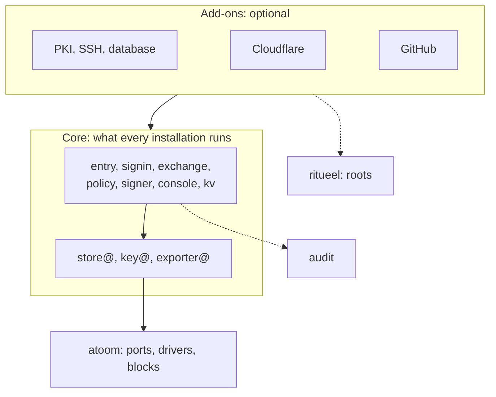

sluis is an open-source identity and access broker for people, robots and external systems. It sits between the identity providers that already know who someone is and the systems that need a credential before they let that someone in.

## Who it is for

sluis is for engineers who run the identity layer of a small organisation, a platform team or a self-hosted lab, and want it small, auditable and cheap to run. The mission is on the [home page](/).

## The layers

sluis v2 is a **core** and **add-ons** ([ADR 0044](/decisions/0044-sluis-is-a-core-and-add-ons/)).

- The **core** is what every installation runs: sign-in and tokens, the exchange of a subject's token for a resource client ([ADR 0051](/decisions/0051-exchange-targets-resource-clients-only-and-policy-decides-who-gets-what/)), grants, the hosts of atoom's blocks, KV, the console and the hardening of the issuer. It installs and runs without any add-on.
- **Add-ons** are optional, and no core actor calls one: PKI with SSH and database access first, then Cloudflare and GitHub.

The console is part of the core and is built with parity. The `ca` actor is built and stays off until the PKI add-on turns the token certificate on. The order in which the layers are built is on the [roadmap](/roadmap/).

An installation serves one boundary. Its staff and operators sign in with sluis's own passkeys; customers sign in at the group's identity provider, whose tokens the products use. sluis takes such a token only as the subject of an exchange for a resource client (an AWS role, Kubernetes, a database, SSH, a minter or KV), gives customers no sign-in session, and issues no token with a customer, an organisation or a product ([ADR 0048](/decisions/0048-product-apis-take-the-identity-providers-tokens/), [ADR 0051](/decisions/0051-exchange-targets-resource-clients-only-and-policy-decides-who-gets-what/)).

The people who work with an installation are these.

- **Operators** install it on a workstation, on three single-board computers, as AWS Lambda functions or on Kubernetes. The same actors and configuration run on each; these four are the [tested installations](/runtimes/). Boards, Lambda and Kubernetes are the **shapes** a production installation takes, and the local installation is for development ([glossary](/concepts/#shape)).
- **Platform and security engineers** write the policy that says who may get which credential, and read the audit trail that says who did.
- **Integrators** add sign-in providers, directory sources and credential minters as adapters: work actors that implement one of the ConnectRPC contracts of [Integrations](/integrations/).

## What it does

Each line says where it stands. "Built" means the code of `v2.0.0-alpha.1` runs it; "planned" names the milestone that builds it ([roadmap](/roadmap/#delivery-order)).

- It **federates sign-in** from upstream identity providers, so people use the accounts they already have. Built for a generic OpenID Connect provider.
- It **issues OIDC tokens** and **exchanges tokens** (RFC 8693): a person or a client presents a token and receives a sluis token for the system it wants to reach. Built. A robot or a CI job presenting a token from the system it runs on is planned (workload exchange: the part that KV needs with the core, the rest with parity and the GitHub add-on).
- It **mints short-lived downstream credentials**, such as cloud credentials, GitHub installation tokens and certificates. Nothing it hands out is meant to outlive the task. Planned: cloud and GitHub minters come with their add-ons, and certificates with the PKI, SSH and database add-on after parity.
- It **reconciles directory facts** from workspace directories and GitHub teams, so that policy can say "members of this team" without sluis owning the team. Planned, and not scheduled.
- It **emits a tamper-evident audit record of every flow,** refusals included, to [audit](https://github.com/truvity/audit), which keeps the log ([Audit](/concepts/audit/)). Built: the emitters and the log still run from this repository and move to audit in steps.

The part that holds a key is small and parses no internet input, and the part that decides is separate from the part that signs. Work actors hold no storage or key credential at rest; only the data and keys families do ([Families](/concepts/families/)).

## What it leaves out

- **It is not a general secrets engine.** It keeps the secrets it generates or receives as sealed or hashed data, reads the secrets an operator gives it from a secret source, and publishes a small typed set of public values. Its KV service keeps versioned static secrets for others (External Secrets reading it instead of SSM is a later option, [ADR 0049](/decisions/0049-ssm-stays-the-only-secret-store-for-now/)), but it has no transit engine, lease system or dynamic secrets. Use a secrets manager for those ([Data](/concepts/data/), [ADR 0047](/decisions/0047-kv-is-a-core-service-of-stores-that-no-tenant-owns/)).
- **It has no users of its own and holds no roots.** It writes no Kubernetes object, except a Secret that exporter@ writes when an installation chooses the direct path. Roots belong to the sister product [ritueel](https://ritueel.id). The reasons are in [what sluis is, and is not](/principles/#what-sluis-is-and-is-not).

## The family

sluis shares its design with three products, each with a repository and records of its own. A fact lives in one of them, and the others link to it.

| Product | What it owns |
|---|---|
| [sluis](https://github.com/truvity/sluis) | Identity: actors, boundaries and tenants, issuers, tokens, sign-in, clients, grants, integrations, KV and the add-ons. |
| [atoom](https://github.com/truvity/atoom) | Ports, drivers and blocks, and the tests that every driver passes. sluis's data, keys and export actors host its blocks. |
| [audit](https://github.com/truvity/audit) | The audit log: records, the usage stream, the writer, the witness, the index and the reader. |
| [session](https://github.com/truvity/session) | Browser sessions for websites behind a proxy. |

## v1 and v2

v1 is the sluis in production use today, a set of AWS Lambda functions on the `master` branch. v2 is a rewrite on `main` that shares no history with v1; its first alpha, `v2.0.0-alpha.1`, was published on 2026-11-08. v2 is delivered in this order: the core, the exchange for resource clients and the limit check, parity with v1 (the [features page](/features/) lists what that means), and the PKI, SSH and database add-on. The two lines coexist until v2 covers every required parity row and the relying parties have moved, one at a time ([ADR 0001](/decisions/0001-v1-and-v2-lines/)). The milestones and their exit tests are on the [roadmap](/roadmap/), and [Project status](/status/) shows how far each has got. The v1 documentation is at [/v1/](/v1/).

## Map of the documentation

| Section | What you find there |
|---|---|
| [Design principles](/principles/) | The yardstick the decision records follow. |
| [Concepts](/concepts/) | The model and its vocabulary: [families of actors](/concepts/families/), [data](/concepts/data/), [keys](/concepts/keys/), [boundaries](/concepts/boundaries/), [identity](/concepts/identity/) and [audit](/concepts/audit/). |
| [Integrations](/integrations/) | Every system sluis connects to, and how to set it up. |
| [Architecture](/architecture/) | The three zoom levels, the components and the deployment, and the registries behind them ([Kinds](/reference/kinds/), [Rules](/reference/rules/), [Actors](/reference/actors/)). |
| [Security](/security/threat-model/) | The threat model and break-glass recovery. |
| [Runtimes](/runtimes/) | Bare-metal, serverless and Kubernetes, and the four tested installations. |
| [Reference](/reference/) | The specifications the core is built against. |
| [Local installation](/runtimes/local/) | A step-by-step install on a single node. |
| [Distribution](/distribution/packages/) | Packages, platforms and release signing. |
| [Standards](/standards/) | The specifications sluis follows and how conformance is proved. |
| [Decisions](/decisions/), [Roadmap](/roadmap/), [Project status](/status/) | The reasoning, the order of delivery and where the work stands. |
| [Contributing](/contributing/) | How to work on sluis: the workflow, the design method, the tools and the rules for pages and records. |

A badge beside each title says whether the page describes a design not built yet, something partly built or something shipped. Plain prose is the design; a **Proposed** note names the open issue that will settle it. The rules are in [Target-state pages](/contributing/pages/).
