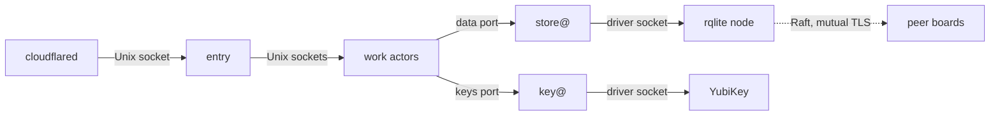

Bare-metal is the runtime where sluis owns its hosts: physical machines (single-board computers, servers), virtual machines (EC2 or any other provider) and local Docker on a workstation. Processes are long-running, the node has a persistent disk, actors and drivers talk over Unix sockets on the node, and systemd, or a container runtime for local Docker, starts everything ([what each runtime provides](/runtimes/#what-each-runtime-provides)).

The tested installations on bare-metal are [local](/runtimes/#local) and [boards](/runtimes/#boards); which drivers fit is on [Runtimes](/runtimes/#which-drivers-fit-which-runtime). The design is [0003](/decisions/0003-units-transports-and-fusion/); this page shows what it makes of a boards installation, three single-board computers with a YubiKey each. The operations of a particular set of boards are the operator's and are not here.

## What runs where

- **One systemd unit and one uid per actor and per boundary.** Each [actor](/concepts/families/) instance, `actor@boundary`, is its own OS user and its own instance of a systemd template unit. The same holds for the holders store@, key@ and exporter@ ([0003](/decisions/0003-units-transports-and-fusion/#units)).
- **Drivers are systemd units too,** started by the platform beside their owner's unit. The drivers are [atoom's](https://github.com/truvity/atoom/blob/master/docs/packages.md); sluis runs them and writes none. Nothing execs a driver, and an actor's unit may execute nothing but its own binary. Only the owner can open a driver's socket.
- **Templates and a generator.** The packages ship template units only (`sluis-<actor>@.service` and `.socket`, with `User=sluis-<actor>-%i`, `LoadCredentialEncrypted=` and `ListenStream=/run/sluis/<actor>/%i.sock`). A **systemd generator** reads the bootstrap files in `/etc/sluis/bootstrap.d/`, one for each boundary ([Where it lives](/reference/bootstrap-file/#where-it-lives)), and creates the instances and their `sysusers.d` entries, so a second [boundary](/concepts/boundaries/) on the same host is a second set of instances, not a second package. A driver unit has no `[Install]` section, because the owner's unit `Requires=` it.
- **The units are generated from the registries:** the uid, the sockets, the callers and the egress of each unit come from the actor registry, and the rules from the kind registry ([0002](/decisions/0002-families-of-actors/#registries-generate-the-enforcement)). The packages ([Packages](/distribution/packages/)) install under `/usr/libexec/sluis/`, and the boards' deploy puts the executables in the same tree, so the unit files are the packages' unit files.
- **The node agent** (`sluis-node`, planned) issues each unit a short-lived workload token and asks key@ to sign it. It holds no key credential ([0022](/decisions/0022-workload-identity-and-host-enrolment/)). Fusion of work actors is an explicit installation choice, and a holder is never fused with a work actor ([0003](/decisions/0003-units-transports-and-fusion/#fusion)).

## Sockets and the call graph

A board has no TCP listener of any actor. The call graph is declared once in the actor registry and enforced twice ([0003](/decisions/0003-units-transports-and-fusion/#the-call-graph)):

- **In logic.** The generated client exists only for the callees an actor may call, and one interceptor in every process refuses a caller that is not listed.
- **In the unit.** The callee's Unix socket is owned by the callee's uid, with a group that holds only the uids of its allowed callers (mode `0660`). Each caller's sandbox makes only its allowed sockets visible (`BindPaths=` and `InaccessiblePaths=`, with `RestrictAddressFamilies=AF_UNIX` and `PrivateNetwork=yes`). The callee reads the caller's uid with `SO_PEERCRED`.

- **`entry` listens on a Unix socket only,** at `/run/sluis/entry/<boundary>.sock`, with `PrivateNetwork=yes`, seccomp and Landlock, so it has no network at all. `cloudflared`, the edge connector, connects outbound only, forwards to that socket and holds no key. Each board runs its own, so the board opens no inbound port for sluis.
- **Every other actor and every driver listens on a Unix socket** under `/run/sluis/<actor>/`, one per boundary. key@ serves each caller on a socket of its own, in a directory only that caller can open ([0006](/decisions/0006-keys-and-sealing/#exclusive-card-access)).
- **The only inbound and inter-node port is rqlite's Raft port,** with mutual TLS, a certificate per cluster, and a firewall rule that admits it from the declared peers only ([0003](/decisions/0003-units-transports-and-fusion/#calls-between-nodes)). rqlite's client API is meant to listen on the loopback address, with store@'s driver as its only client ([0005](/decisions/0005-the-store/#engines)). Audit witnesses meet through the audit blob, not through a connection between boards.
- **Egress is denied by default** and generated from the registry: nftables per uid, and `PrivateNetwork=yes` for an actor whose registry row lists no outside host. Each unit is hardened (`ProtectSystem=strict`, an empty `CapabilityBoundingSet=`, `SystemCallFilter=@system-service`) ([0003](/decisions/0003-units-transports-and-fusion/#units)).
- **The deny tests try every pair of actors** against both layers, and check that nothing else binds a TCP address apart from rqlite's client API.

:::note[Proposed]
Mutual TLS on the Raft port, the issuer of its certificate and a firewall that fails closed are open ([#1584](https://github.com/truvity/sluis/issues/1584)); they are a gate before any real PIN or real data goes on a board ([REQ-DEPLOY-047](/requirements/deploy/#REQ-DEPLOY-047)). Today the boards run rqlite without TLS ([rqlite on the boards](#rqlite-on-the-boards)).
:::

## Deploy and prove on three boards

The boards installation is proved on an additional, external testing area of three single-board computers. Nothing about that area is part of the product or of any production installation.

The hosts and the account are never in the repository: `SLUIS_BOARDS` and the SSH settings come from the environment. The flow is a set of recipes, run as `devbox run -- just <recipe>`:

| Recipe | What it does |
|---|---|
| `build-arm64` | Cross-compiles every executable into `dist/arm64/` (Go with cgo off, Rust as static musl). The card driver, which links a C library, is built natively in an older userland ([0013](/decisions/0013-release-train-packaging-and-distribution/)). |
| `boards-prepare` | Signs the boards' config with a publisher key made for them and makes the seed: the bootstrap file that pins the key, and the credentials. The seed is never committed. |
| `boards-rqlite` | Installs the engine on a board that does not have it ([rqlite on the boards](#rqlite-on-the-boards)), before the first deploy. |
| `boards-deploy` | Copies the executables with their generated units, users and directories to every board, installs the seed under `/etc/sluis`, starts the units in order and waits for them ([the end of a deploy](#the-end-of-a-deploy)). It is idempotent; `SLUIS_BOARDS_DRY_RUN=1` stages the plan without touching a board. |
| `boards-unlock` | Gives a locked card board its PIN ([The card driver](#the-card-driver)). |
| `boards-smoke` | Runs the first signing and sealing path on each board in turn, under the uid of each actor. From the second board on it requires the first boards' `SigningRing` key and `DataKeyWrap` item, which shows the one shared store. |
| `boards-status`, `boards-avc` | Read only: the units, rqlite's readiness, the firewall and the lock state; the SELinux denials ([SELinux](#selinux-and-the-firewall)). |
| `boards-firewall` | Restricts rqlite's ports ([The rqlite firewall](#the-rqlite-firewall)). |
| `boards-recipients`, `boards-key-check` | Read each board's recipient and slot-map entry for the `KeyPlan`, and check the wrap set ([the card driver](#the-card-driver)). |
| `boards-undeploy` | Removes what `boards-deploy` added. rqlite's package and data stay unless `SLUIS_PURGE_STATE=1` asks for them to go. |

**SSH.** The scripts take extra ssh arguments from `SLUIS_BOARD_SSH_OPTIONS`. `boards-unlock`, which sends the card's PIN through the session, refuses `StrictHostKeyChecking=no`, `UserKnownHostsFile=/dev/null` and a `-t`, and forces `StrictHostKeyChecking=yes`, so nothing can make the PIN connection trust a key it has not been shown. The board's host key must therefore be known before the first unlock.

### What a board needs before the first deploy

The deploy installs no package of the card path; `boards-rqlite` is the only recipe that installs one. The scripts need `tar` and `nft` on the board and `jq` on the workstation, and the board image carries the card service. `boards-deploy` refuses a board without them before it sends anything, naming the fix ([runtime dependency matrix](/distribution/dependencies/)). Leave `nftables.service` disabled: its stock configuration begins with `flush ruleset`.

### rqlite on the boards

rqlite is not one of the units that `boards-deploy` installs. `boards-rqlite` puts it on a board from rqlite's own release packages, and `rqlited.service` is the unit the store drivers wait for.

1. **The package is pinned by sha256 in the repository** (`deploy/boards/rqlite.pins`). Upstream publishes no checksum file and no signature, so the pin is the whole trust. The digest is checked on the workstation and again on the board before the install runs as root.
2. **A drop-in sets the node, and no node can start a cluster of its own.** It runs `rqlited` with `-bootstrap-expect N` and `-join` with the Raft address of every board, the board itself included. A node with no state and no `-join` forms a cluster of one, so a board that was wiped and run through the recipe would form a second cluster beside the first: two leaders for one membership, divergent logs, lost writes. With `-bootstrap-expect` a node without state first tries to join a node that is in a cluster, so a wiped board comes back into the cluster of the others. There is no `-node-id`: the Raft address is the node id, so a board must come back at the address it had. To add a board, run the recipe with all the boards named.
3. **It starts every node, then waits** until each node is a reachable voter of a cluster with one leader and counts as many nodes as there are boards. A node that sees fewer is in a cluster of its own.

The recipe is idempotent, and a package upgrade is the same recipe.

**There is no TLS and no authentication on rqlite in this test installation.** The client and Raft ports listen on the board's address, so anyone who can reach them can read and write the store. That is acceptable for a test with the factory PIN on a network the operator controls, and not for anything else. Before any real PIN or key goes through these boards, a firewall must admit the Raft port from the other boards only and the client port from nobody else, and mutual TLS must replace it ([#1584](https://github.com/truvity/sluis/issues/1584)).

### The rqlite firewall

**Verdict.** `boards-firewall` restricts rqlite's two ports with one nftables table of its own, `inet sluis_rqlite`, generated from the list of boards. It touches no other port, table, firewalld zone or ufw rule. It adds no TLS or authentication: it narrows who can reach rqlite and does not make rqlite safe, because anyone who can use or forge an admitted address still reads and writes the store.

| Source of a packet | To the Raft port | To the client port |
|---|---|---|
| The loopback interface (the store drivers, the board's own probes) | admitted | admitted |
| Another board of the installation | admitted | dropped |
| One optional administration host the operator names | admitted | admitted |
| Anyone else, IPv4 or IPv6 | dropped | dropped |

- **A table of its own, loaded with `nft` on every supported system.** One mechanism for Ubuntu and Rocky, none of the image's state is touched, and removing it is deleting the table. firewalld, ufw and `/etc/nftables.conf` were not chosen (several mechanisms to merge with the image's state; the stock file replaces its rules), and neither was a default deny, because any port it missed would cut a board off.
- **The chain has the policy accept and these rules only:** the loopback accept, the accepts from the peers, and a rate-limited log and a counted drop of the two ports. Ssh, DNS, time and every outbound connection never meet a rule of ours. Its priority is before firewalld's and ufw's chains, and it opens nothing the image closes.
- **The file replaces the table in one transaction,** and its unit is ordered before the network and rqlite and is `PartOf=nftables.service`, because that service's stop flushes the whole ruleset.
- **A board is not cut off.** Apply arms a dead-man timer first and loads the rules second, and the file that boot loads is written only at the confirm; if ssh is lost the timer takes the rules back by itself. The confirm proves before it keeps: the board's rqlite is a ready voter with all voters reachable, each other board reaches the Raft port and times out on the client port, and ssh works. One board at a time is enforced.
- **If the rules fail to load at boot, the board fails open, loudly:** one journal line says the ports are not restricted, rqlite starts anyway, and `boards-status` fails for the board. This is the stance for the test installation ([0003](/decisions/0003-units-transports-and-fusion/#the-boot-failure-of-the-peer-only-firewall)); a firewall that fails closed is part of the gate before real PINs ([#1584](https://github.com/truvity/sluis/issues/1584)).
- **`boards-status` compares the loaded table with the kept copy** and reports `ABSENT`, `UNCONFIRMED` or `BROKEN`; `boards-firewall-check` is the read-only board check of [REQ-DEPLOY-046](/requirements/deploy/#REQ-DEPLOY-046). If a board is unreachable anyway, wait for the dead-man time, or use its serial console and run `sudo nft delete table inet sluis_rqlite`.

### Credentials are encrypted on the board

The units read their credentials with `LoadCredentialEncrypted=` (the systemd floor is 252). The deploy encrypts each credential on the board with `systemd-creds encrypt --with-key=host` into `/etc/sluis/credentials/<boundary>/<owner>/`, mode 0400, and removes the plain files of the stage. The key is the board's own host key, and a reflash makes a new one, so the deploy encrypts every credential again on every run, and a reflashed board needs nothing but the next deploy. A board below the floor, or without `systemd-creds`, is refused before any credential is written. How the `credential` driver reads the directory is [atoom's](https://github.com/truvity/atoom/blob/master/source/credential/docs/credential.md).

### The card driver

The card driver is atoom's `key/yubikeypiv` ([README](https://github.com/truvity/atoom/blob/master/key/yubikeypiv/README.md)). Its pages cover the card ([slots, PIN and touch](https://github.com/truvity/atoom/blob/master/key/yubikeypiv/docs/slots-pin-touch.md)), the card service on a board ([PC/SC and cards on boards](https://github.com/truvity/atoom/blob/master/key/yubikeypiv/docs/pcsc-and-cards-on-boards.md)), the card session after a restart ([restart and session reset](https://github.com/truvity/atoom/blob/master/key/yubikeypiv/docs/restart-and-session-reset.md)) and what it needs at run time ([runtime dependencies](https://github.com/truvity/atoom/blob/master/key/yubikeypiv/docs/runtime-dependencies.md)). A board runs it in place of the software key driver when the deploy runs with `SLUIS_BOARDS_KEY_DRIVER=yubikey-piv`. What sluis adds as the host:

- **The unit** `sluis-drv-key-yubikey-piv@.service` requires `pcscd.socket`, runs as its own uid under the hardening of every driver unit, and has a runtime directory of its own for the admin socket that takes the PIN. The unit of key@ requires the card driver in place of the software one.
- **The card service is closed to everyone else** by two locks: the socket of `pcscd` is readable by a group that only the card driver joins, and, where `pcscd` asks polkit, a rule admits root and the card driver's user and no one else ([0006](/decisions/0006-keys-and-sealing/#exclusive-card-access)).
- **The driver is bound to the board's card.** Its unit passes `--serial` from a file the deploy writes from `SLUIS_BOARD_CARD_SERIALS` (no serial is in the repository). A unit without the file does not start, and a card with another serial is not adopted.
- **The driver verifies a PIN release itself.** Its unit passes the boundary's bootstrap file, whose publisher keys it reads, and a state directory of its own.
- **The board starts locked.** The driver has no PIN until `sluis node unlock NODE` delivers it on the admin socket, as root on the board ([the command](/reference/cli/#sluis-node-unlock)). `boards-unlock` does it from the workstation for one board: the PIN comes from standard input, goes through the ssh session, and never into an argument, an environment variable or a log line. `boards-status` prints `locked` or `unlocked`, asked of the driver and not read from a journal.
- **Switching a board to the card, or back, goes one board at a time.** A new card is a new wrapping key and a new token key, and a data key is wrapped only to the keys the signed `KeyPlan` lists ([Who may receive a wrap](/decisions/0006-keys-and-sealing/#who-may-receive-a-wrap)), so a switch is a rewrap. The deploy refuses a run that switches more than one board, and marks the switched board pending until `boards-key-check` shows its key listed and the wrap set complete.
- **The first board of a new `KeyPlan` needs its PIN by hand.** A peer releases a locked board only if its own `KeyPlan` lists the board. After a re-sign with a key the old one does not list, the first board to get the new `KeyPlan` has no peer that holds it, so the deploy ends `locked`, which is expected; the next boards then unlock from it with no operator step. Prefer one board at a time when the `KeyPlan` has changed.

### SELinux and the firewall

On a board with SELinux enforcing (Rocky 10) the deploy ends its file work with `restorecon` over the paths it wrote, never forcing a label and never walking the state directories. **The sluis units run as `unconfined_service_t`:** the binaries are `bin_t`, and the policy of RHEL and Rocky starts a `bin_t` program from systemd unconfined. SELinux confines nothing of sluis; the isolation is the uids, the socket modes, the call-graph check and the systemd sandbox, as on Ubuntu, where the units run unconfined by AppArmor unless a profile names them. A policy module with a domain for each actor would be a third lock and is later work. [REQ-DEPLOY-033](/requirements/deploy/#REQ-DEPLOY-033) asks that sluis runs with no denial under each family's default policy; `boards-avc` reads the denials, and a virtual machine test (`deploy/boards/os-vm-test.sh`, run by hand today) checks labels, which the container jobs cannot see.

**The firewall is the image's.** sluis opens no port: every actor and driver listens on a Unix socket, and the inter-node ports are rqlite's, which is not sluis's unit. The one change sluis makes to the firewall is the table of `boards-firewall`. A future per-uid nftables egress table has to live beside firewalld's own table and beside `inet sluis_rqlite`, and must not be flushed by it.

## Supported operating systems

The packages and the boards run on the same three distributions ([Packages](/distribution/packages/#supported-platforms)). The systemd floor is 252, the version in Amazon Linux 2023, so the units use `LoadCredentialEncrypted=` and the deploy refuses a board below it. There are no build profiles: the packaging is the build. One cluster may mix distributions, because the package set is the same, at the price of a wider test surface.

| | Ubuntu 26.04 LTS | Rocky Linux 10.x | Amazon Linux 2023 |
|---|---|---|---|
| systemd | 259 | 257 | 252 |
| glibc | 2.43 | 2.39 | 2.34 |
| Mandatory access control | AppArmor | SELinux, enforcing | SELinux, permissive by default |
| Firewall | `ufw`, off unless the image enables it | `firewalld`, zone `public` | none by default |
| pcscd | 2.4.1, runs as the user `pcscd`, `Requires=polkit.service` | 2.2.3, runs as root | not used |
| polkit | 127 | 125 | not used |
| Card packages | `pcscd`, `libccid`, `polkitd` | `pcsc-lite`, `pcsc-lite-ccid`, `polkit` | not used |
| The boards | yes | yes | no |

The boards' kernels are far above 5.18, which VM-clone reseeding needs (`sluis doctor` warns below it). The card driver is built natively in an older userland so that it asks for no glibc symbol newer than 2.34, the glibc of Amazon Linux 2023 ([atoom's packages](https://github.com/truvity/atoom/blob/master/docs/packages.md#what-runs-where)).

CI runs the real deploy script against a systemd container of Ubuntu 26.04 and of Rocky 10, with stand-in executables: the refusal that names the card packages, the deploy of the card variant, the credentials, and the two locks of the card service against a real `pcscd`. It cannot check a card, a label, an AVC denial or the boards' kernel.

### The end of a deploy

`systemd-analyze verify` runs before anything starts and only reads the unit files, so it says nothing about a run. After the start, the deploy polls every unit for up to 60 seconds until each is `active (running)` and its restart counter has not changed for about 6 seconds. A unit that restarts, or is not active by then, is printed `unit <unit> FAILED` with the last lines of its journal, and the board's deploy fails.

The lock is asked of the card driver, not read from a journal: the deploy runs `sluis node status NODE` on the board, a read-only call on the driver's admin socket. A card board is locked after every deploy, because a restarted driver has no PIN. While it is locked key@ stays up and asks its peers for the PIN, and only an actor that signs or opens a key when it starts restarts until the PIN is given, so the units alone cannot tell a locked board from an unlocked one. A deploy ends in one of three states:

| State | Means | Exit status of the deploy script |
|---|---|---|
| `ok` | Every unit has settled, and the driver says unlocked (a board with the software key has no PIN). | 0 |
| `locked` | The driver says locked, and every unit that has not settled is waiting for it: its last error line is `unavailable: driver` or `failed_precondition: locked`. | 10; the board script prints `deployed, LOCKED` and the command that gives the PIN |
| `failed` | Everything else: a unit that has not settled and is not waiting for the lock, a card driver that is not up, or a lock state that cannot be read. `ok` is never said for a lock that nobody looked at. | 1 |

- **A unit that waits for the PIN does not die.** Every generated unit has `Restart=on-failure`, `RestartSec=2s` and `StartLimitIntervalSec=0`. The back-off grows in the program, not in the unit, because `RestartSteps=` is systemd 254's and the floor is 252: a program about to exit with a failure under systemd sleeps 2, 4, 8, 16, then 30 seconds for each further failure in a row (REQ-DEPLOY-052).
- **"Every unit is up" is a point-in-time check.** A unit that fails later is not seen by the deploy, and some units restart once or twice in the first minute after a boot while the card is locked. Read `boards-status` after the first minute and again after a night: a unit in `activating (auto-restart)`, or whose restart counter rises, is failing, whatever the deploy said. A restart-rate alert is not built.
- **The audit writer's own faults are audit's.** The state it keeps, a damaged segment, a quarantined message and the clock it trusts are in audit's [writer state](https://github.com/truvity/audit/blob/master/docs/reference/writer-state.md) and its [quarantine runbook](https://github.com/truvity/audit/blob/master/docs/runbooks/handle-quarantine.md).

## One node

A single node is one failure domain. Losing it stops sign-in until the node is rebuilt and its state restored.

- **Engine:** rqlite with one node, a cluster of one, or DynamoDB on an AWS VM. The local installation uses the same rqlite path.
- **Audit:** records go through audit's transport to its writer. On the boards the blob is the `fs` driver on the node's disk, so the sealed log is lost with the node (a reinstall, a failed eMMC) unless it was copied elsewhere, and records still in a local spool when a node dies are lost. Keep the blob store off the node if the audit trail has to outlive it, which is what the Cloudflare add-on's object storage is for.
- **Recovery** needs no cloud and no Kubernetes ([Break-glass recovery](/security/break-glass/)).

## N nodes

With three nodes the installation survives the loss of one.

- **Engine:** one rqlite cluster over the boards for the boundary. Every board holds the data and the temp data is replicated too, so any board serves any request, and each board's store@ talks to the rqlite node on its own board ([0005](/decisions/0005-the-store/#engines)). A quorum is two of three; a board that is down is replaced or repaired without losing data.
- **Peer traffic is the Raft port only.** No actor is called across nodes: a work actor asks the holders of its own node.
- **Audit:** each board keeps its own log with its own writer and log key, and the other boards are its peer witnesses through the audit blob, so one compromised board cannot extend a log alone (planned; [audit 0009](https://github.com/truvity/audit/blob/master/docs/decisions/0009-witnesses-and-verification.md)).
- **Identity:** the boundary's issuer issues workload tokens, and its key set holds one key per board card ([0022](/decisions/0022-workload-identity-and-host-enrolment/)).
- Losing two boards of three stops writes, and sign-in with them, because grants and sign-in sessions need the store. Three boards usually share a site, a network and a power feed, so this is not a multi-site design.

## A reinstalled board

A board that was reinstalled from a fresh operating system has to become a member again, with the other boards left running. What a reinstall loses:

- **The SSH host keys,** so the operator's known-hosts entry no longer matches.
- **The local rqlite data.** The other boards hold every item, but the cluster still lists the old node, so the board must come back at the same Raft address ([rqlite on the boards](#rqlite-on-the-boards)).
- **The state directories of the units:** the software key driver's keys, the marks of key@ ([below](#a-mark-that-is-ahead-of-the-store)), the unsealed audit spool and, with the `fs` blob, the board's own audit log ([One node](#one-node)).
- **The encrypted credentials,** which the next deploy encrypts again.

Everything on the YubiKey survives, because the card is a separate device: a board that keeps its card keeps its recipient and its keys. A board with a replaced card, or one that ran the software key, has a new recipient and needs the `KeyPlan` re-signed.

**Trust does not rest on the SSH host keys.** A board is trusted because its recipient (the wrapping key in slot `9d`) and its slot-map entry (the key in slot `87` with the card's attestation) are listed in the `KeyPlan` that the publisher key signed ([Who may receive a wrap](/decisions/0006-keys-and-sealing/#who-may-receive-a-wrap)). The PIN release between boards does not use SSH, so a board with no listed recipient gets no PIN from a peer and no data-key wrap, whatever its host keys say. If the old card or key may be in someone else's hands, this is a compromise, not a rebuild: revoke first ([0041](/decisions/0041-a-compromised-key-is-revoked-then-replaced/)).

## The card and its slots

A board's key mode is its YubiKey. key@ is the only process that talks to the card, with exclusive access, and every key of the board is born on it ([0006](/decisions/0006-keys-and-sealing/#keys-per-board)). The card runs firmware 5.7 or newer, the floor that fixes EUCLEAK, which atoom's card driver enforces ([0006](/decisions/0006-keys-and-sealing/#floors-in-code)).

sluis uses atoom's reference slot map, version 2, one slot per purpose and per algorithm ([the slot plan](/decisions/0006-keys-and-sealing/#the-slot-plan); [the map](https://github.com/truvity/atoom/blob/master/key/slotplan/docs/slot-plan.md)). The three slots of a board that carries sign-in:

| Slot | Purpose |
|---|---|
| `9c` | The board's X.509 intermediate, certified by ritueel's root (generated only when the PKI add-on turns the token certificate on; the core needs no slot `9c`) |
| `9a` | Token signing |
| `9d` | Key agreement (ECDH): unwraps data keys, the boundary's `grant` data key among them |

The map goes on in slots `82` to `95`: the SSH authorities, the audit log key, the release subkey, the workload issuer, the PIN release key in `87` (the one slot that needs no PIN), further keys generated only when their purpose is enabled, and six rotation spares. The generated [keys page](/reference/keys/) lists every purpose with its algorithm, its key type on AWS and its slot. Grants do not use slot `9d` directly: they are sealed under a boundary data key, so a grant costs a memory operation, not an ECDH on the card. Timings of the card are on atoom's [algorithm page](https://github.com/truvity/atoom/blob/master/key/docs/algorithms.md).

### Touch, PIN and the locked board

The rules are [0006](/decisions/0006-keys-and-sealing/#touch-and-pin); in short:

- **Cards are touch never and PIN once,** so a board signs unattended.
- **A board starts locked.** After a full power loss one person unlocks the first board, and that board then unlocks the others.
- **A peer releases the PIN through the store.** The locked key@ writes a `PinReleaseRequest` signed by the board's slot `87` key; an unlocked peer's key@ checks that the board is in the `KeyPlan`'s slot map and recipients and not revoked, and answers with a signed `PinRelease`. The PIN crosses only the Raft port, inside the store's replication, so the flow adds no listener. A boundary has one PIN.
- **A board that waits for a peer writes next to nothing.** key@ polls the two PIN kinds with a listing and never with a lookup of an id, because store@ audits every refusal and a lookup of something not written yet is one.
- **key@ never retries a wrong PIN,** because the card blocks after three attempts and then needs the PUK.

### Other key modes

- **AWS KMS** is the key mode on an AWS virtual machine ([0006](/decisions/0006-keys-and-sealing/#keys-per-boundary-on-aws)). The key policy of every key names key@'s role alone, so no other actor and no instance role reaches KMS.
- **Software key:** development only; the code refuses it in production ([0006](/decisions/0006-keys-and-sealing/#floors-in-code)).

### A mark that is ahead of the store

key@ keeps the highest `seq` it verified of the `KeyPlan` and of the `Boundary` in `keyplan.mark` and `boundary.mark` in its state directory, and refuses a lower one ([Who may receive a wrap](/decisions/0006-keys-and-sealing/#who-may-receive-a-wrap)). After a restore of the store, or a reset of the `seq`, a mark can be ahead of every document the store serves, and key@ does not start: its error names the mark file and the `seq` it holds. Two ways out:

1. **Publish a document of that kind with a higher `seq`** (`boards-prepare`, then `boards-deploy`). Rollback protection stays on.
2. **Remove that mark on purpose,** on that board only, and restart key@. It then takes the newest validly signed document the store shows, with no rollback protection for it until it verifies the next one. Do this only when you know the store serves the right document.

The card driver keeps a `keyplan.mark` of its own, because it verifies the `KeyPlan` of a PIN release itself. A `KeyPlan` below that mark does not stop the driver; it refuses the PIN release with the reason `key_plan`, and the ways out are the same.

## Board capacity

The record is [0037](/decisions/0037-capacity-is-measured-before-it-is-promised/#board-capacity); its numbers are not copied here. Measured on three boards of 2 GB with one rqlite cluster over the three, a YubiKey 5 Nano on firmware 5.8.0 in each, and 30 Go stand-ins for the units that run on a board (2026-10-31 to 2026-11-03): a typical loaded board uses 1,056 MiB of proportional memory, 53% of the board, and the worst board measured 58%. One rqlite cluster saturates at about 275 commits a second, with the leader's CPU 85% busy, against a design need of 7 to 73 estimated from the flows. A card signs about 7 times a second and opens a data key in about 143 ms, so the cards limit token signing before the store limits writes ([0012](/decisions/0012-the-language-follows-the-executable/) follows from it).

## Virtual machines (EC2)

An EC2 instance or an Auto Scaling group is a possible bare-metal installation, with the same units as on a board and the packages from the dnf repository on Amazon Linux 2023. EC2 is not a delivery target and is not tested.

## Local Docker

Docker on a workstation is the development and CI form of bare-metal, one node: the [local](/runtimes/#local) installation ([0011](/decisions/0011-runtimes-and-installations/#the-local-installation)). It runs as **Docker Compose, one container per actor and per driver**, each as its actor's uid, with Unix sockets on shared volumes under `/run/sluis/<actor>/`, so the call graph and the socket access lists are the ones the other installations enforce. Keys are **software keys** by default; a development card is opt-in, and only the key@ container reaches it. The first start, host names and TLS are on [The local installation](/runtimes/local/).

## Identity and edge

- An actor's identity on a node is its uid, read through `SO_PEERCRED` on the Unix socket. On a cloud VM, calls to AWS use the actor's own IAM role, so CloudTrail names the actor and the instance.
- `cloudflared` is the edge connector on the boards installation, as described [above](#sockets-and-the-call-graph).
- **Consumers read KV.** KV is a core service ([0047](/decisions/0047-kv-is-a-core-service-of-stores-that-no-tenant-owns/#what-kv-is)). External Secrets reads it through the Vault KV v2 subset, so the boards need no cloud for their consumers. KV is planned.
- **The console** is part of the core and planned ([0027](/decisions/0027-the-console/#built-and-planned)). `entry` will serve the console's single-page application from a directory on the node, same-origin with its API. The bundle is a separate artifact of the release ([Packages](/distribution/packages/)).

## Limits and residual risk

- The YubiKey is physical. Whoever holds the board and the card, and knows the PIN, can sign. Keep the board in a controlled place. The card's PIN policy limits the exposure of a lost board until it is replaced.
- eMMC wears under heavy writes. The spool and the data are small, and a blob store off the board keeps the audit chain. With the `fs` blob driver on the board, the audit chain is only as durable as the board's disk: a reinstall loses the log of that board.
- A root-level compromise of a node defeats host-asserted identities (uid, cgroup). On a cloud VM, KMS key policies and CloudTrail limit and record what the stolen identity can do.
- KMS is a regional service. A regional outage stops signing; there is no software fallback key, because the code refuses one in production.
- A burst beyond the signing rate of the cards queues ([Board capacity](#board-capacity)).
