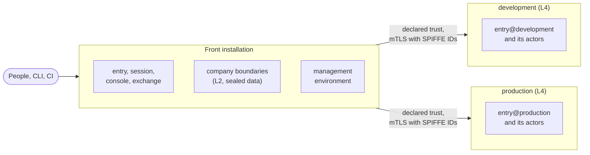

A **boundary** is the unit of isolation in sluis: what one compromised or misconfigured part cannot cross. This page says which kinds of boundary there are, how strongly each can be separated, and how several installations form one sluis for the people who use it. The record is [ADR 0009](/decisions/0009-one-installation-per-boundary/), rewritten on 2026-10-30; the issuers and tokens are [ADR 0059](/decisions/0059-each-boundary-has-its-own-issuer-and-tokens-carry-one-audience/).

## Kinds of boundary

| Kind | Owns | Holds an authority key |
|---|---|---|
| **Environment** | The machine plane: the management environment, development, staging, production. Its keys, its CA, its issuer, its state | Yes |
| **Company** | The identity plane: the directory, the upstream, the integrations, people's records, operator delegation and the audit tenant key | No |
| **Product** | A company × an environment. Created only when a company's customers sign in through sluis | Yes, its own |

A product boundary is the first candidate for promotion to a stronger level (below). None is created now.

## The isolation ladder

A boundary is placed on a **ladder**. Each level adds to the one before it.

| Level | Adds |
|---|---|
| **L0 tenant** | Separation by sluis's code only |
| **L1 keys** | Its own key-encryption key, CA, signing and grant keys |
| **L2 process** | Its own actor instances, uid or role, and state prefix |
| **L3 store** | Its own state store (an rqlite cluster, a DynamoDB table), bucket and queue |
| **L4 runtime** | Its own Kubernetes cluster, cloud account or hosts, and a separate install file joined by declared trust |

Every environment on AWS runs at least at L2. Companies run at **L2 plus sealed data**, in the front installation. The separation at each level is checked per port in three layers; see [Defence in depth](/concepts/drivers/#defence-in-depth).

An actor instance carries its boundary in its name, `<actor>@<boundary>`, in every layer: the unit, the uid, the socket, the function and role, the key alias, the state prefix and the audit record. See [Actors](/concepts/actors/#naming).

## A federation of installations

One sluis, as people see it, is a **federation**: one **front installation** and one **boundary installation for each L4 boundary**, under one operator and joined by declared trust. People get one sign-in address, one console and one identity plane.

For example, an operator with three companies (company A, B and C) and four environments runs the front and the management environment in one cloud account, and development, staging and production each at L4, with their own account or cluster, state and keys.

- **What is shared:** the front's `entry`, the console, the roots and the operator.
- **Accepted risks:** the roots, the operator who deploys, cluster administrators, a compromise of production's `ca` reaching every company in production, a bug in a shared policy definition, and data held outside sluis. They are listed with the threats each boundary answers (T-1 to T-26) on the [threat model](/security/threat-model/#accepted-risks).
- **A test installation is separate.** It serves no real user, trusts nothing, and lives outside the sluis host names.

### Across boundaries

A call from one boundary to another is **mutual TLS with SPIFFE IDs** ([Machine identity](/concepts/machine-identity/)). The target decides again with its own policy; it does not take the caller's decision on trust. A sensitive boundary verifies the **person's passkey assertion itself**, against its own challenge, so a compromised front cannot act there on a person's behalf.

### Promotion: a company leaves

The runbook exists from the first day:

1. disconnect the company's boundary;
2. export its audit tenant key, then crypto-shred it;
3. re-issue its workloads under the new CA;
4. remove its person links.

## Issuers and tokens

Each environment has its own issuer, and so does a product boundary when it exists. Companies have none.

| Issuer | Address |
|---|---|
| The group issuer, at the front | `https://sluis.example.com` |
| An environment's issuer | `https://sluis.<env>.example.com`, one origin per host |

- **Discovery and keys are static.** Each issuer publishes its discovery document and its JWKS (the current and the next key) in a bucket of its boundary, so verification survives a compute outage.
- **A boundary has no sign-in of its own.** It runs its own slim `entry@<boundary>`, and the group issuer is its upstream. Single sign-on is transparent; a passkey tap is asked for only where that boundary's policy wants fresh MFA.
- **The CLI signs in once.** `sluis login` signs in at the front, and the CLI then exchanges tokens silently at each boundary's own token endpoint. The front never sees a boundary's tokens.
- **One passkey for every issuer.** `sluis.<env>.example.com` is not under `sluis.example.com`, so the passkey's relying-party id is the registrable parent (`example.com`), and every verifier checks a strict allow-list of origins: the sluis hosts only.

### Token claims

| Claim | Rule |
|---|---|
| `iss` | The issuer URL (OIDC requires an https URL) |
| `aud` | **Exactly one registered `client_id`**, not a URL. An RFC 8707 `resource=` is mapped to a registered client and never copied into `aud`. Between actors of two boundaries, `aud` is the target's SPIFFE ID, over mutual TLS |
| `sub` | An opaque, stable **person key**, the same at every issuer. The directory account is a claim of its own, and so is `email` |
| `acr`, `amr`, `auth_time` | How and when the person signed in |
| `cnf.jkt` | The key the token is bound to |
| grants | Only that boundary's grants |
| `org` | The person's company |

Client ids are unique per issuer, readable, and the same in every environment (`kubernetes`, `argocd`, `aws-<account-alias>`). On AWS the IAM OIDC provider of each account uses a custom client id, not `sts.amazonaws.com`. A token exchange into a boundary uses that boundary's client id at the group issuer. Every relying party pins `iss` and `aud`; sluis prints reference snippets for them, and the infrastructure code applies them. Lifetimes are set per issuer.

**A copied token is useless.** Tokens are sender-constrained (DPoP or mutual TLS), and authorization codes are bound by PKCE. JWT-SVIDs come from the same issuer as people's tokens, with a SPIFFE ID as `sub`.

**Step-up is per client and per environment**, in `policy@<boundary>`: a request that needs more answers `insufficient_user_authentication` with `acr_values` ([RFC 9470](https://datatracker.ietf.org/doc/html/rfc9470)), and the boundary checks the passkey itself ([ADR 0048](/decisions/0048-passkeys-step-up-and-device-login/)).

## The reference federation

The choices below are the reference for a federation of several companies and environments. They are agreed.

| Topic | Choice |
|---|---|
| Upstreams | One upstream per directory tenant, as an integration of its own ([Actors](/concepts/actors/#naming)) |
| Subjects | A subject per directory account, plus a declared person link. Grants are not inherited across the link. An SSH certificate carries the person key |
| Keys | Keys per environment. An existing KMS root is used first; YubiKey roots join later by dual trust ([Keys](/concepts/keys/#topologies)) |
| Issuers | One per environment, as above |
| Process level | Every environment on AWS runs at L2 or above |
| State | One engine with a prefix per boundary, replaced by a store of its own at L3 and above |
| Policy | One source, compiled per environment, with a grant key per environment. **Company ceilings** are Cedar `forbid` guards |
| Audit | A log per environment. A company reads it as a tenant with its own key |
| Console | Delegation per company, plus an environment scope for machine-plane records |
| Integrations | One process per vendor tenant |
| Trust bundles | One per environment. Issuance is bound to the requester |
| SSH | An SSH CA per environment, with per-company principals in the bundle ([SSH](/integrations/ssh/)) |
| SPIFFE | A trust domain per environment: the trust domain is the boundary |
| Group applications | Hosted by the management environment |
| Product boundaries | None for now |

## Related

- [Installations](/runtimes/installations/): the four tested installations. Each is one installation of a federation.
- [Configuration](/concepts/configuration/#what-is-configured-an-installation): one install file per installation.
- [Machine identity](/concepts/machine-identity/): SPIFFE IDs, trust domains and joining.
- [Threat model](/security/threat-model/): the threats, attacker positions and controls per layer, and the [isolation requirements](/requirements/iso/) that test them.
