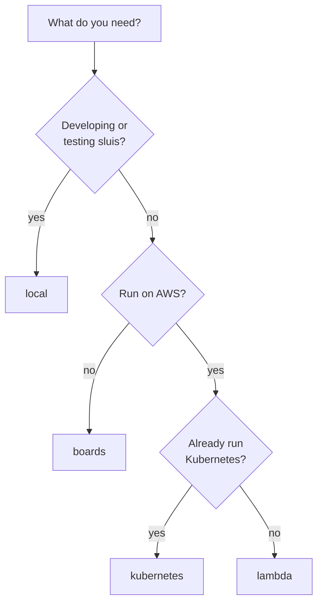
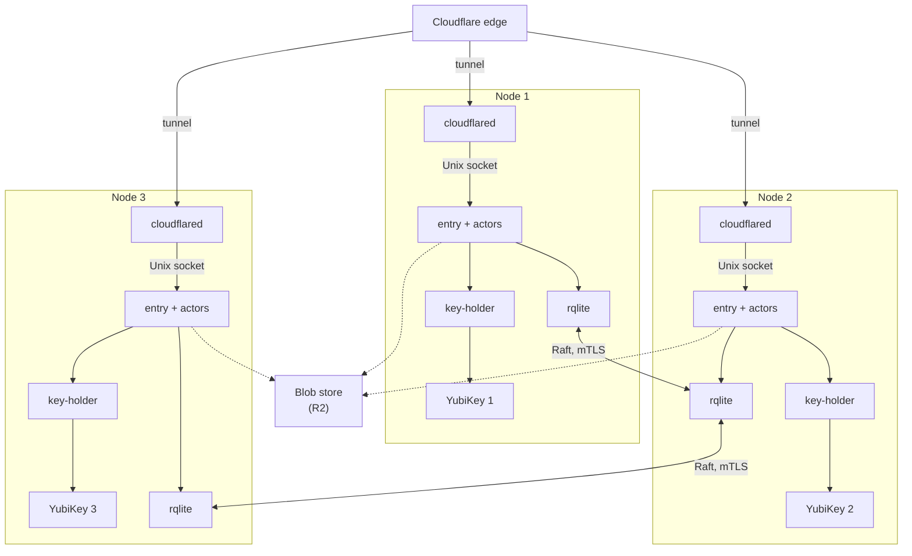

An **installation** is one concrete deployment: a [runtime](/runtimes/), a node count, the available dependencies and one [driver](/concepts/drivers/) per port. Four installations are **tested**: built, documented and kept in the test matrix ([ADR 0018](/decisions/0018-runtimes-installations-and-delivery-order/#installations)). Each one is a choice of default drivers.

| Installation | Runtime | What it is |
|---|---|---|
| [local](#local) | [bare-metal](/runtimes/bare-metal/) | Docker on a workstation, with software keys |
| [boards](#boards) | bare-metal | Three single-board computers, a YubiKey in each |
| [lambda](#lambda) | [serverless](/runtimes/serverless/) | AWS Lambda, a function per actor |
| [kubernetes](#kubernetes) | [kubernetes](/runtimes/kubernetes/) | Amazon EKS with AWS KMS, a container per actor |

An installation serves one [boundary](/concepts/boundaries/) at L4, or the front of a federation with the boundaries below L4 inside it. A test installation serves no real user, trusts nothing, and lives outside the sluis host names.

**Any other combination is a possible installation, allowed by the rules but not tested** ([Other installations](#other-installations)). "Installation" is not a configuration key: the install file is the installation, and the four tested ones ship as example install files to start from. The configuration layers are defaults, then the runtime, then the install file, then the overrides per environment, each overriding the one before ([ADR 0010](/decisions/0010-configuration-and-data-pkl-schema-origins-and-sensitivities/#pkl-and-json-schema), [Configuration](/concepts/configuration/)).

## Reference installation shapes

**Every port has more than one driver, each proven by a real installation.** sluis is one product in many shapes, and it is built against these reference shapes ([principle 10](/principles/)). A driver that no reference shape runs is not trusted to be a driver.

| Shape | Runtime and keys | Notes |
|---|---|---|
| A **workforce** installation with a few tenants | [serverless](/runtimes/serverless/), AWS KMS | Functions behind the edge, no hosts to operate |
| A **customer-identity** installation with thousands of tenants | [kubernetes](/runtimes/kubernetes/), AWS KMS | The tenants share one sealing key: each tenant's data keys are wrapped under it with the tenant in the encryption context, and no tenant has a key of its own |
| **Audit-with-quota** installations, one for each product | [kubernetes](/runtimes/kubernetes/), AWS KMS | Each holds only its own log key and uses the account's sealing key under its own alias and context |
| A **self-hosted** installation on small boards | [bare-metal](/runtimes/bare-metal/), a YubiKey in each node | No AWS account; blobs on R2 through the `s3-compatible` driver |
| **Development** | [bare-metal](/runtimes/bare-metal/), software keys | The code refuses a software key in production ([ADR 0012](/decisions/0012-cryptography-and-authority-keys/#floors-in-code)) |

The four tested installations are the named subset of these shapes. The key layout of each shape is on [Keys](/concepts/keys/).

## Ports and drivers by installation

The same actors run everywhere; the drivers behind their ports change. Where an actor runs is not chosen per installation: it is derived from the port and driver rules, which `sluis config check` enforces.

| Port | local | boards | lambda | kubernetes |
|---|---|---|---|---|
| keys | `software`; `yubikey-piv` on an opt-in development card | `yubikey-piv`, one card per node, through `key-holder` | `aws-kms` | `aws-kms` |
| state | `embedded` | `rqlite`, one cluster per (boundary, owning actor) | `dynamodb` | `dynamodb` |
| lease | local lock | `rqlite`, on the state store | `dynamodb`, on the state store | `dynamodb`, on the state store |
| blob | `fs` | `s3-compatible` on R2 | `s3-compatible` on S3 | `s3-compatible` on S3 |
| transport | `spool` or `direct` | `spool` | `sqs` | `nats-jetstream` (`sqs` possible) |
| index | `sqlite` | `rqlite` | `postgres` (`aurora` mode, through RDS Proxy) | `postgres` (`cnpg` mode) |
| witness | none | `peer`, each node witnessing the others | none | none |
| cloud | web identity through `sluis-node`, where configured | web identity; `cloudflare` for R2 credentials | the function's role | a projected ServiceAccount token per container; EKS Pod Identity for a single-actor pod |

The `direct-mtls` and `nats-jetstream` transports are supported and are the default of no installation. **The witness is optional everywhere**, and `sluis config check` warns when an installation has none ([Audit](/concepts/audit/)).

## Which drivers fit which runtime

This table is derived from what each driver requires and from [what each runtime provides](/runtimes/#what-each-runtime-provides), narrowed on Kubernetes by [ADR 0018](/decisions/0018-runtimes-installations-and-delivery-order/#kubernetes). ✓ fits, ✗ is refused, and a note is the condition.

| Port | Driver | Bare-metal, 1 node | Bare-metal, cluster | Serverless | Kubernetes |
|---|---|---|---|---|---|
| keys | `software` | not in production | not in production | ✗ | `kubernetes-dev` preset only |
| | `yubikey-piv` | ✓ | ✓ | ✗ | ✗ |
| | `aws-kms` | ✓ | ✓ | ✓ | ✓ |
| state, lease | `embedded`, local lock | ✓ | ✗ | ✗ | ✗ |
| | `rqlite` | ✓ | ✓ | ✗ | ✗ |
| | `dynamodb` | ✓ | ✓ | ✓ | ✓ |
| blob | `fs` | ✓, no lock | ✗ | ✗ | ✗ |
| | `s3-compatible` | ✓ | ✓ | ✓ | ✓ |
| transport | `direct-unix` | ✓ | ✓ | ✗ | ✗ |
| | `direct-mtls` | ✓ | ✓ | ✗, its fallback spool needs a disk | needs a per-pod volume for its fallback spool |
| | `spool` | ✓ | ✓ | ✗ | ✗ |
| | `sqs` | ✓ | ✓ | ✓ | ✓ |
| | `nats-jetstream` | ✓ | ✓ | send only; the writer runs elsewhere | ✓ |
| index | `sqlite` | ✓ | on one node | ✗ | needs a per-pod volume |
| | `rqlite` | ✓ | ✓ | ✗ | ✗ |
| | `postgres` | ✓ | ✓ | ✓, in the VPC | ✓ |
| | none (scan) | ✓ | ✓ | ✓ | ✓ |
| witness | none, `external` | ✓ | ✓ | ✓ | ✓ |
| | `peer` | ✗ | ✓ | ✗ | not independent in one cluster |
| cloud | web identity | ✓, through `sluis-node` | ✓, through `sluis-node` | the token comes from `signer` | ✓, projected token |
| | platform role | on a cloud VM | on a cloud VM | ✓ | ✓, EKS Pod Identity |
| | `cloudflare` | ✓ | ✓ | ✓ | ✓ |

A lease lives on the state store, with compare-and-set and a fencing token ([Data](/concepts/data/#leases-and-fencing-tokens)); there is no Kubernetes Lease driver.

## Choosing an installation

Anything else is a possible installation: start from the nearest tested one and change drivers within the rules.

## local

Docker Compose on one workstation, one container per actor and per driver, for development, CI and the integration tests ([ADR 0018](/decisions/0018-runtimes-installations-and-delivery-order/#the-local-installation)). It runs the release's published images, so a local run tests the images Kubernetes runs. It is not for production. Runtime: [bare-metal](/runtimes/bare-metal/#local-docker), one node. Its containers, host names, TLS and first start are on [The local installation](/runtimes/local/).

- **Keys:** `software` by default, which refuses to start in production. A **development card** is opt-in: the `key-holder` container, and only it, reaches a dedicated card through the host's smart-card service, and `key-holder` has the card to itself ([ADR 0012](/decisions/0012-cryptography-and-authority-keys/#exclusive-card-access)). A card shared with other card software such as gpg is not a mode the installation sets up.
- **Sign-in:** through the generic OpenID Connect upstream against a real identity provider: Keycloak in a container on every pull request, and nightly against two free cloud tenants: Google Cloud Identity Free and Microsoft Entra ID Free; sluis holds no accounts, even in tests. Passkeys are tested with a browser's virtual authenticator and a software authenticator library.
- **Edge:** `entry`'s container has no network. A developer or a test harness reaches its Unix socket through the forwarder, a generic reverse proxy in the Compose project that ends TLS, mounts the socket and publishes a port on the loopback address, a convenience no other installation has. The host names (`*.local.test`), the certificate chain from ritueel's test root and the first start are on [The local installation](/runtimes/local/).
- **Limits:** a software key can be read by anyone who can read its volume, so it guards development data only. One node proves behaviour, not availability, and local does not exercise the platform controls of the other installations: IAM and KMS key policies, systemd sandboxing, a replicated store, a compliance lock.

## boards

Three single-board computers (arm64, 2 GB RAM, eMMC), each with its own YubiKey, behind a Cloudflare tunnel to `sluis.example.com`. State is replicated by rqlite (Raft), and the audit pieces run on the same nodes and share driver instances. Runtime: [bare-metal](/runtimes/bare-metal/#n-nodes), three nodes. The memory and write budget of a board is in [Board capacity](/runtimes/bare-metal/#board-capacity).

- **Drivers:** `yubikey-piv` through `key-holder`; `rqlite` for state, lease and index, one cluster per (boundary, owning actor); the `spool` on each node; `s3-compatible` on R2, with credentials from the `cloudflare` cloud driver. The rqlite index is a replicated SQLite, so the reader can run on any node; its full-text search was tested on a three-node cluster on 2026-10-30, and if it fails on the boards they fall back to `sqlite` on the indexer's node.
- **Keys:** a node's keys are its own. No key is shared between nodes, so losing a node loses its keys, not the installation's. The slots are on [Keys](/concepts/keys/#the-card-slot-map).
- **Audit:** one log per node, with its own writer, spool and log key; the other two nodes are its peer witnesses, so a checkpoint carries two nodes' signatures ([Audit](/concepts/audit/)). Readers merge the logs by time. The log is on R2, so it is off site from the start. Production needs a declared retention.
- **Identity and edge:** each node runs its own `cloudflared`, which forwards to `entry`'s Unix socket. The boundary's issuer issues workload tokens, with one key per node card in its key set ([ADR 0007](/decisions/0007-workload-identity-and-host-enrolment/)). The audit pieces have a front of their own, a second `entry` with its own tunnel route on `sluis-audit.example.com` ([ADR 0015](/decisions/0015-audit-pieces-transport-search-and-front/#the-audit-front)).
- **Limits:** Raft tolerates the loss of one node of three. Physical access to a board with its card and PIN allows signing as that node; peer witnessing limits that for the audit logs but not for tokens. A Cloudflare account administrator can remove R2's lock (lock mode `removable`), so the logs get their tamper evidence from the witnesses. Every batch crosses the internet to R2, so an outage of the link or of R2 delays the logs. Mixed distributions widen what has to be tested.

## lambda

One Lambda function per actor behind API Gateway, with KMS keys, DynamoDB state, an SQS queue to the audit writer and an S3 bucket with a compliance lock. The writer runs with a reserved concurrency of 1, and correctness comes from the write-once fence on the bucket, not from the limit ([ADR 0016](/decisions/0016-the-audit-log/#the-write-once-fence)). The request path, the audit path and the limits are on [Serverless](/runtimes/serverless/). Runtime: serverless, elastic.

## kubernetes

A container per actor on Amazon EKS, installed from one chart. A key-less edge relay in the pod forwards to `entry`'s Unix socket, each integration runs in a pod of its own, and the audit side is a separate audit installation from the chart's `audit-install` preset. It is tested by a smoke test on kind with the `kubernetes-dev` preset and by integration tests on a development EKS cluster. The details are on [Kubernetes](/runtimes/kubernetes/). Runtime: kubernetes, N nodes.

## Other installations

These are possible installations: allowed by the rules, not tested.

- **One board.** The boards installation reduced to one node, with `embedded` state, `sqlite` for the index and the blob on R2. The [single-board tutorial](/tutorials/single-node-install/) walks through it.
- **EC2.** One instance or an Auto Scaling group is a bare-metal installation on virtual machines ([Bare-metal](/runtimes/bare-metal/#virtual-machines-ec2)). EC2 is not a delivery target.

For each, `sluis config check` applies the same rules as for a tested installation. What the tests do not give is evidence that the combination keeps working from release to release.
