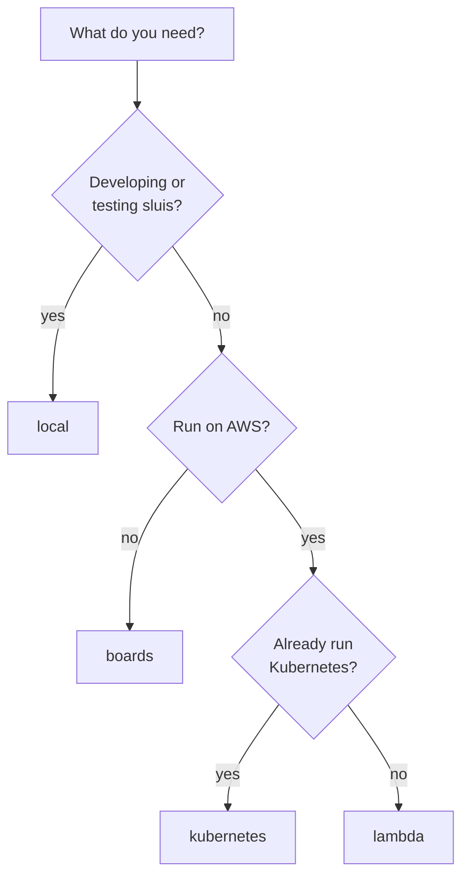
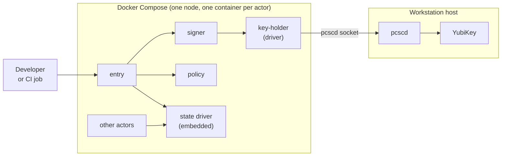
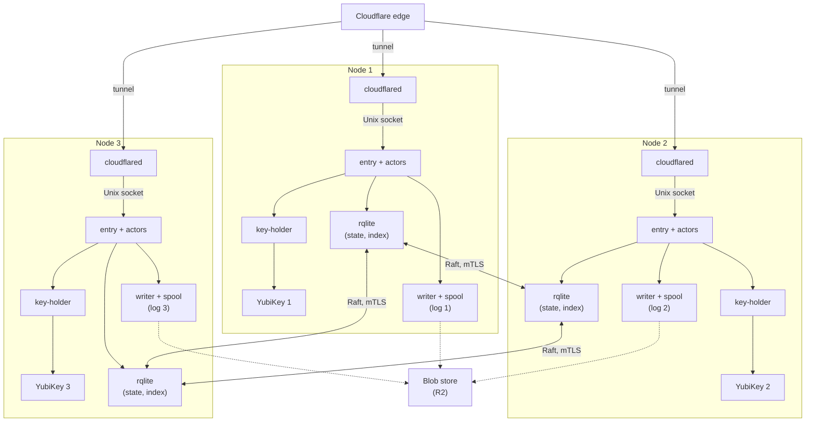
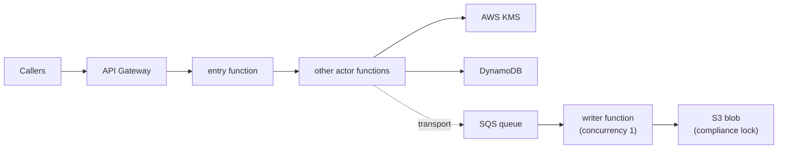

An **installation** is one concrete deployment: a [runtime](/runtimes/), a node count, the available dependencies and one [driver](/concepts/drivers/) per port. Four installations are **tested**: they are the ones the documentation, the tutorials and the test matrix name. Each one is a choice of default drivers.

| Installation | Runtime | What it is |
|---|---|---|
| [local](#local) | [bare-metal](/runtimes/bare-metal/) | Docker on a workstation, with the host's YubiKey |
| [boards](#boards) | bare-metal | Three single-board computers, a YubiKey in each |
| [lambda](#lambda) | [serverless](/runtimes/serverless/) | AWS Lambda |
| [kubernetes](#kubernetes) | [kubernetes](/runtimes/kubernetes/) | The one tested Kubernetes installation |

An installation serves one [boundary](/runtimes/boundaries/) at L4, or the front of a federation with the boundaries below L4 inside it; several installations joined by declared trust form one federation, with one sign-in address and one console. A **test installation** is always separate: it serves no real user, trusts nothing, and lives outside the sluis host names.

**Any other combination is a possible installation, allowed by the rules but not tested.** A single board, a single EC2 instance or a cluster of EC2 instances is such an installation: the rules of [Ports and drivers](/concepts/drivers/) allow it, and `sluis config check` (in the design) validates it against the requirements its drivers declare, but nobody runs it in CI. Nothing on this page forbids it. It only says what is tested.

## Delivery order

The installations are built in this order, which is agreed.

1. **local first.** The minimal drivers (embedded SQLite state, a SQLite index, a files blob, a local lock, and a spool or direct transport) and the basic functionality with its tests, until v2 can replace v1, together with the enablers of the target architecture. Keys are software keys in CI and the host's YubiKey on a workstation.
2. **Then boards, lambda and kubernetes in parallel,** each built and tested in parallel with the others.

EC2 is not a delivery target. A virtual machine is still bare-metal, so the [bare-metal](/runtimes/bare-metal/#virtual-machines-ec2) page keeps what applies to it, and an EC2 installation is a possible one.

## Defaults per installation

A driver choice that used to be a per-shape decision now reads as "this installation's default driver": the spool on bare-metal and SQS on serverless and Kubernetes ([OD-5](/open-decisions/#od-5), [OD-22](/open-decisions/#od-22)), KMS on Kubernetes ([OD-20](/open-decisions/#od-20)), and a `postgres` index that serverless may use ([OD-12](/open-decisions/#od-12), revised). Where an actor runs is not decided per installation at all: it is derived from the port and driver rules ([OD-32](/open-decisions/#od-32)).

| Installation | keys | state, lease | transport | blob | index | witness |
|---|---|---|---|---|---|---|
| local | yubikey-piv through the host's `pcscd` | embedded, local lock | spool | fs | sqlite | none |
| boards | yubikey-piv, one per node | rqlite, one cluster per owning actor | spool | s3-compatible on R2 (Garage later) | rqlite | peer |
| lambda | aws-kms | dynamodb | sqs | s3-compatible on S3 | postgres on Aurora | none |
| kubernetes | aws-kms | dynamodb | sqs | s3-compatible on S3 | postgres on cnpg | none |

The key mode follows from the installation, not from a switch: a YubiKey on local and boards, KMS on lambda and kubernetes. A software key is allowed on local for development, and the code refuses it in production. The [transport](/concepts/audit/) defaults are the ones above. The `direct` and `nats-jetstream` transport drivers are supported and are the default of no installation ([OD-34](/open-decisions/#od-34)).

:::note[Proposed]
The configuration layers are: defaults, then the runtime, then the install file, then overrides per environment (development, staging, production). Each overrides the one before. The four tested installations ship as example install files to start from; "installation" is not a configuration key. See [Configuration](/concepts/configuration/).
:::

The audit path is the one on [Audit](/concepts/audit/). Every success is audited. The emitter, a library inside each application, puts a record into the transport. The writer receives it, seals it into batches, and asks the `key-holder` to sign checkpoints; the `key-holder`'s access list lets only the writer use the log key. There is **no notary actor** ([OD-39](/open-decisions/#od-39)). The audit actors are the writer, the witness, the indexer and the reader.

**The witness is optional everywhere** ([OD-36](/open-decisions/#od-36)): `sluis config check` warns when an installation has none. With no witness, and with no notary, a compromised writer can get a rewritten checkpoint signed. A compliance lock on an s3 blob still prevents overwriting objects, but it does not prevent a split view.

## Choosing an installation

- **Learning or developing:** [local](#local). It runs in Docker with the host's YubiKey.
- **On-premises, surviving a node failure:** [boards](#boards). Three boards run rqlite and a signing key lives on each node's YubiKey.
- **AWS, no hosts to operate:** [lambda](#lambda). Each actor is a function.
- **You already run a cluster:** [kubernetes](#kubernetes) (proposed). A node pod and an audit pod hold the actors, each in a container with its own token audience.
- **Anything else** is a possible installation. Start from the nearest tested one and change drivers within the rules.

## local

Docker on one workstation, one node, no cluster. It is delivered first, and it is the one that CI uses, together with sluis v1 for GitHub OIDC to cloud permissions. It uses the **host's YubiKey** on a workstation, through the host's `pcscd` ([OD-8](/open-decisions/#od-8)), and a software key in CI. It is not for production. Runtime: [bare-metal](/runtimes/bare-metal/#local-docker).

The other actors are `ca`, `quota` and the audit actors. Each actor and driver is its own container. They reach each other over Unix sockets on a shared volume. The `key-holder` container reaches the host's `pcscd` through a mounted socket, and `pcscd` talks to the YubiKey.

- **Drivers:** the minimal set. yubikey-piv for keys on a workstation, an embedded SQLite store for state, a local lock for the lease, the spool or direct mode for transport, a local files driver for the blob, and `sqlite` for the index. A software key (EC P-384, no production secret involved) is used in CI and anywhere without hardware.
- **Host YubiKey:** the host's `pcscd` socket is mounted into the `key-holder` container. The host keeps using the YubiKey too, because `pcscd` lets several programs share the card. The pcsc-lite protocol versions of the image and the host must match. The fallback is to run the `key-holder` natively on the host, so that the containers mount only its Unix socket.
- **Verification** never trusts the index or the state, so a test can rebuild the index and still verify the chain.
- **Edge:** `entry`'s public API is a Unix socket on a shared volume, and `entry`'s container has no network, as on every bare-metal installation. See [Listeners](/architecture/listeners/).

:::note[Proposed]
How a developer or a test harness reaches `entry`'s socket is not yet decided (ADR 0055). One candidate is an edge-connector container (`cloudflared` with a `unix:` origin on the socket, as on boards). Another is a development proxy that publishes a port to the workstation; a published port is a development convenience that no other installation has.
:::

- **Limits:** a software key is extractable by anyone who can read the container's filesystem, so use it for development data only. With the host's YubiKey, any process that can open the `key-holder` socket can ask for a signature, subject to the `key-holder` ACL. One node has one failure domain: local proves behaviour, not availability. It does not exercise the platform controls of the other installations (IAM and KMS key policies, systemd sandboxing, Cilium policy).

## boards

Three single-board computers (arm64, 2 GB RAM, eMMC), each with its own YubiKey, behind a Cloudflare tunnel to `sluis.example.com`. It is built in parallel with lambda and kubernetes, after local. State is replicated by rqlite (Raft), and the audit pieces run on the same nodes, so they share driver instances ([OD-37](/open-decisions/#od-37)). The nodes may mix Ubuntu and Rocky Linux, because the package set is the same on both. Runtime: [bare-metal](/runtimes/bare-metal/#n-nodes), three nodes.

- **Drivers:** yubikey-piv with one YubiKey per node, through `key-holder`, and the slot plan on [bare-metal](/runtimes/bare-metal/#keys); rqlite for state and lease, one cluster per (boundary, owning actor); the spool for transport on each node; the `s3-compatible` blob driver on **R2**, with credentials from the `cloudflare` cloud driver; and the index on rqlite ([ADR 0022](/decisions/0022-search-is-an-index-fed-from-the-log-and-the-index-is-one-driver-with-provisioning-modes/)). Garage, a blob store on the boards themselves, is a later backend: its spike ([issue #982](https://github.com/truvity/sluis/issues/982), 2026-10-31) found no conditional writes and no prefix-scoped keys, both open upstream ([ADR 0058](/decisions/0058-boundaries-are-enforced-in-three-layers-per-port-and-every-state-value-is-encrypted/)). The rqlite index is a replicated SQLite, so the reader can run on any node. Its full-text search (FTS5) was tested on a three-node cluster on 2026-10-30; the board spike (S5, 2026-10-31) measured rqlite on native arm64 and eMMC, but not the full-text index itself, and if that fails on the boards they fall back to `sqlite` on the indexer's node.
- **Memory and writes:** measured on one board on 2026-10-31 (spike S5, [ADR 0060](/decisions/0060-the-language-follows-the-executable/)). A tier-0 board with 10 rqlite clusters, 30 actors, two entries, the card path, `cloudflared` and the services that share the board needs about 985 MiB with Go actors or about 680 MiB with Rust actors, of 1978 MiB usable and under a ceiling of 1380 MiB (a quarter of the RAM for page cache, and 100 MiB for slab and bursts). About a third of the Go figure is estimated, not measured: OpenBao, `cloudflared` with a live tunnel, a status page, alerting and DNS. rqlite costs about 9 MiB per cluster. Writes are limited by the CPU, not the eMMC, at about 400 commits/s per board, summed over its clusters. The board's temperature is open: it reached 83 °C under load.
- **Keys:** a node's key is its own. No key is shared between nodes, so losing a board loses one key, not the install's. Sealing uses ECDH plus HKDF with the node's `9d` key.
- **Audit:** the pieces run on the same nodes and share driver instances. **There is one log per node** ([the agreed rule](/concepts/audit/): exactly one writer per log, not one per installation). Each node has its own writer, spool and log key, and the other two nodes are its peer witnesses, the agreed 2-of-3 co-signing. Readers merge the logs by time. A writer asks its node's `key-holder` to sign checkpoints, and there is no notary. Batches are created with `If-None-Match: *`, so with one log per node no writer lease is needed. The log is on R2, so it is off site from the start; the hourly off-site copy of [ADR 0021](/decisions/0021-the-audit-log-is-sealed-batches-in-a-blob-with-a-lock-mode/) comes with Garage, later. (inferred) Production needs a declared retention, and the peer witnesses satisfy the lock-mode rule.
- **Identity and edge:** each node runs its own `cloudflared`, which forwards to `entry`'s Unix socket, and the boundary's issuer is the issuer for workload tokens, with one key per node's YubiKey in its key set ([ADR 0012](/decisions/0012-machine-identity-follows-spiffe-proofs-are-exchanged-for-short-lived-credentials/)). The public hostname is `sluis.example.com`. The audit pieces have a front of their own, a second `entry` with its own tunnel route on `sluis-audit.example.com` ([ADR 0062](/decisions/0062-audit-front-is-a-slim-entry-the-reader-as-its-api-and-a-console-of-its-own/)).
- **Limits and residual risk:** Raft tolerates the loss of one node of three. A node's YubiKey and PIN guard its key; physical access to a board with its key and PIN allows signing as that node, which peer witnessing limits for the audit logs but not for tokens; with one issuer per boundary such a token can name any actor of the boundary. R2's lock can be removed by a Cloudflare account administrator (lock mode `removable`), so the logs get their tamper evidence from the witnesses, not from the bucket. Every batch is written to R2 over the internet, so an outage of the link or of R2 delays the logs. (inferred) Mixed distributions widen what has to be tested.

## lambda

One Lambda function per actor, with KMS keys and DynamoDB state. It is built in parallel with boards and kubernetes, after local. The details, the request path and the audit path are on [Serverless](/runtimes/serverless/). Runtime: [serverless](/runtimes/serverless/), elastic nodes.

- **Drivers:** aws-kms for keys, DynamoDB for state and lease, an SQS queue for transport (a function's disk does not outlive its sandbox), the `s3-compatible` blob driver on S3. The default index is `postgres` on Aurora, reached through RDS Proxy with IAM authentication ([ADR 0022](/decisions/0022-search-is-an-index-fed-from-the-log-and-the-index-is-one-driver-with-provisioning-modes/)), so the indexer and the reader run in the VPC.
- **Writer:** the audit writer runs with a reserved concurrency of 1 on a standard SQS queue. Correctness comes from the blob fence: every batch is created only if absent, so a second instance cannot fork the log. The throttling this causes is measured at the Lambda step ([ADR 0029](/decisions/0029-one-repository-one-version-one-release-train-and-packaging-follows-the-runtime/)). It signs checkpoints with the log key in KMS, under a key policy that names only its role; there is no `key-holder` and no notary.
- **Witness:** none by default. `sluis config check` warns about it ([OD-36](/open-decisions/#od-36)); an `external` witness is the way to add one.
- **Transport:** the direct mode needs a disk for its fallback spool ([OD-35](/open-decisions/#od-35)), so it is not available on serverless.
- **Identity and edge:** the function's IAM role is its identity. API Gateway sits in front of `entry`, through the Lambda Web Adapter to `entry`'s loopback port.
- **Limits:** five layers and 250 MB unzipped bound a function; cold starts; egress is not name-restricted.

## kubernetes

A node pod and an audit pod, a container per actor, on Amazon EKS with AWS KMS. It is built in parallel with boards and lambda, after local. It is in design and test scope now ([OD-7](/open-decisions/#od-7)), and its design is proposed. The details and the open points are on [Kubernetes](/runtimes/kubernetes/). Runtime: [kubernetes](/runtimes/kubernetes/), N nodes.

- **Drivers:** aws-kms for keys ([OD-20](/open-decisions/#od-20)), DynamoDB for state ([OD-21](/open-decisions/#od-21)) and for the lease (a Kubernetes Lease driver is in the backlog), SQS for transport for now ([OD-22](/open-decisions/#od-22)), the `s3-compatible` blob driver on S3, and `postgres` on `cnpg` for the index ([ADR 0022](/decisions/0022-search-is-an-index-fed-from-the-log-and-the-index-is-one-driver-with-provisioning-modes/); the `external` mode takes a connection string only).
- **Witness:** none by default. A peer witness in the same cluster is not independent, so an `external` witness is the useful one.
- **Identity:** projected ServiceAccount tokens, one audience per actor ([OD-19](/open-decisions/#od-19)).
- **Edge:** a key-less edge relay in the pod that forwards to `entry`'s Unix socket, or a `cloudflared` sidecar ([OD-24](/open-decisions/#od-24), decided).
- **Integrations:** a pod per integration, with its own egress NetworkPolicy ([OD-29](/open-decisions/#od-29), decided).
- **Tests:** a kind smoke test on every pull request, and a real EKS cluster nightly (proposed).

## Other installations

These are possible installations: allowed by the rules, not tested. They are listed because earlier versions of the design named them.

- **One board.** The boards installation reduced to one node, with the embedded state, `sqlite` for the index and the blob on R2, as on the boards. The [single-board tutorial](/tutorials/single-node-install/) walks through it.
- **One EC2 instance** with KMS keys, DynamoDB state, the spool and S3.
- **Three EC2 instances** in an Auto Scaling group, with KMS keys (a key per node for the log), rqlite state, the spool and S3 ([#886](https://github.com/truvity/sluis/issues/886)).

For each, `sluis config check` applies the same rules as for a tested installation. What the tests do not give is evidence that the combination keeps working from release to release.
