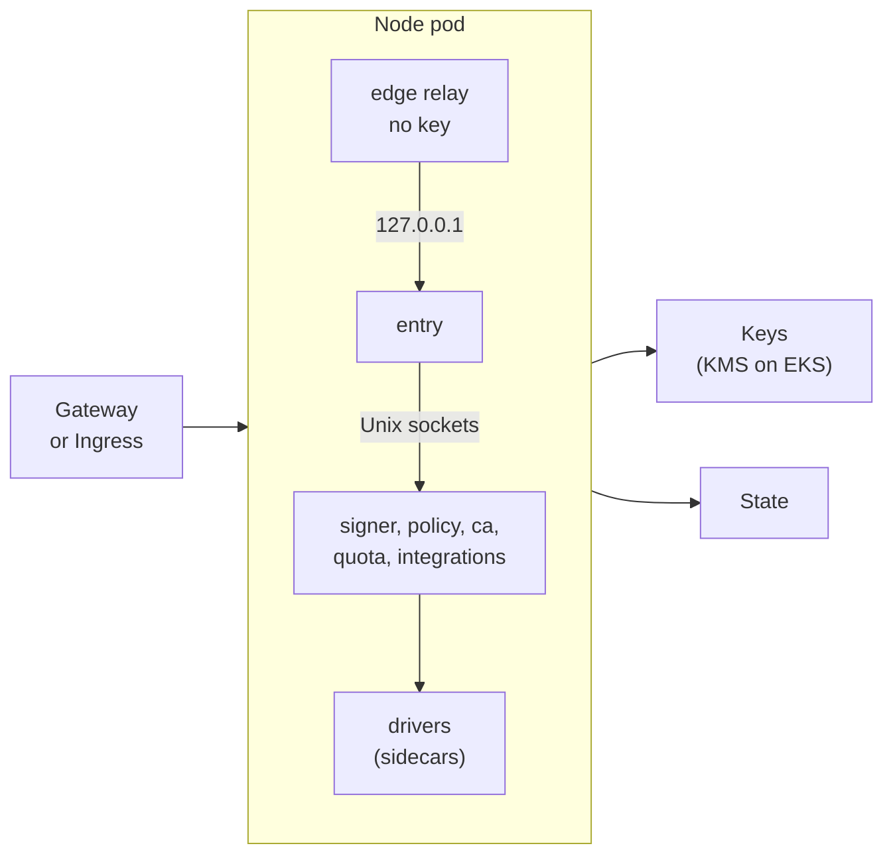
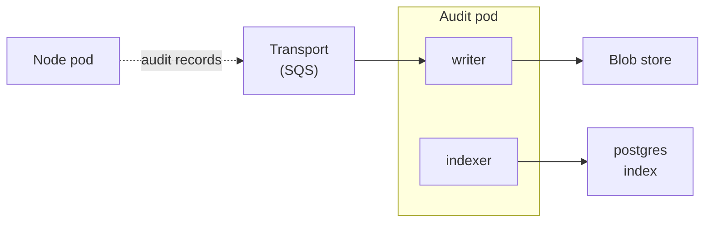

The kubernetes runtime, the [kubernetes](/runtimes/installations/#kubernetes) installation, is in design and test scope now (see [OD-7](/open-decisions/#od-7)), and it is built after local, in parallel with boards and lambda. Everything on this page is the design as proposed, except the points that [agreed decisions](/open-decisions/) already fix: sluis writes no Kubernetes objects, a driver talks to its actor over a Unix socket, and the audit path is the one in [Audit](/concepts/audit/). The pod layout ([OD-17](/open-decisions/#od-17)), AWS KMS only ([OD-20](/open-decisions/#od-20)), DynamoDB only ([OD-21](/open-decisions/#od-21)) and the SQS transport ([OD-22](/open-decisions/#od-22)) are decided.

On Kubernetes an actor is a container with its own user id and its own cloud identity. The containers of one node form a pod, and the audit path forms a second pod, cut at the audit transport ([OD-17](/open-decisions/#od-17)). The first release supports Amazon EKS with AWS KMS ([OD-20](/open-decisions/#od-20)), and a cluster with no key mode that the floor allows refuses to start. The audit side is being redesigned as a separate audit installation; see [OD-31](/open-decisions/#od-31).

:::note[Proposed]
The chart renders everything from the permission manifest, and sluis itself calls no Kubernetes API. The maintainer has not yet agreed the rest of the proposals on this page. Other clusters are specified where a decision is open.
:::

## Topology

### The node pod

The gateway reaches the edge relay. The drivers reach the keys and the state.

The node pod runs two or three replicas. A request enters through the edge relay and never leaves the pod: the actors and their drivers call each other over Unix sockets.

### The audit pod

The audit pod runs two replicas, and one of them writes. The transport is the only link between the two pods. The reader, in the node pod, reads the same index.

:::caution[Open decision OD-31: Audit as a separate installation]
The audit side is being redesigned as its own installation, connected to sluis over the network. The actors of the audit installation are decided: the writer, the witness, the indexer and the reader, with no notary. Open: how an emitter authenticates, and a co-located profile for a small install. The lean is that audit is its own installation, and sluis emits over TCP or a queue through the transport port.

The points [OD-32](/open-decisions/#od-32) to [OD-39](/open-decisions/#od-39) refine this one, and all of them are decided. Placement is derived from the port and driver rules (OD-32). Quota meters by default and enforces per policy rule (OD-33). Audit is four pieces that share driver instances when combined (OD-37 and OD-38). The installation defaults for the transport stay, with direct and NATS JetStream supported but not a default (OD-34); direct mode falls back to a local spool when the writer is down (OD-35); a witness is optional (OD-36); and there is no notary actor (OD-39).
:::

## What runs where

- **Sockets stay Unix sockets.** Actors and drivers talk over Unix sockets in shared volumes, and the callee reads the caller's user id with `SO_PEERCRED` and checks the call graph, default deny.
- The packaging for kubernetes is an OCI image and a Helm chart. Helm charts are OCI artifacts with images pinned by digest. They are built from the release output; see [Packages](/distribution/packages/). One release means one set of images, so the actors inside a pod can never be at different versions.
- sluis does not write Kubernetes objects. It exports, and clusters pull. cert-manager and trust-manager stay as clients of sluis. The chart renders no Role, RoleBinding, ClusterRole or ClusterRoleBinding, because sluis needs no access to the Kubernetes API.

- **Two pod kinds, cut along the audit transport** ([OD-17](/open-decisions/#od-17)).
  - The **node pod** holds every actor on the synchronous call graph: `entry`, `signer`, `policy`, `ca`, `quota`, the reader and the integrations, with their drivers and the edge container. It runs as a Deployment of two or three replicas spread over zones. Replicas exist for availability, not throughput.
  - The **audit pod** holds the writer and the indexer. One replica writes at a time, chosen by a lease with a fencing token. The only link between the two pods is the audit transport, so no call crosses a pod boundary.
  - One pod per node with every actor a container is the layout inside each pod. One pod per actor with mutual TLS between pods was rejected: it gives every actor a TCP listener and needs a certificate for every pod from `ca`.
  - The audit side is being redesigned as a separate audit installation, connected to sluis over the network; see [OD-31](/open-decisions/#od-31).

:::note[Proposed]
- **An actor is a container.** Each actor and each driver runs as its own container with a unique user id, a read-only root file system, no capabilities, no privilege escalation and the runtime default seccomp profile. Drivers are native sidecars, so the platform starts them before the actors that call them.
- **The mount is the first lock.** Each callee has its own volume for its socket directory, and that volume is mounted read-only only into the containers that the call graph allows. On Kubernetes this replaces the socket group of the hosts, because a container cannot have its own supplementary groups. The callee still checks the peer's user id.
- **A driver is never a pod of its own,** because a socket cannot cross a pod boundary.
:::

:::caution[Open decision OD-18: What a unit is in the fusion rule on Kubernetes]
The [fusion rule](/architecture/processes/) says no unit holds a key next to an unauthenticated listener. Options: the pod, or the container as the unit of credentials. The proposal is the container, with a generated check that no container that can use a key also has a listener.
:::

:::caution[Open decision OD-29: Placement of integrations on Kubernetes]
Options: integrations as containers of the node pod; each as a pod of its own, called over HTTPS; a per-integration switch in the manifest. The proposal is containers now, and a switch for an integration that needs its own egress rules or its own lifecycle.
:::

## Keys

- A software key is refused in production.
- A cluster with no key mode that the floor allows does not start. `sluis config check` and the process both refuse.

For now the kubernetes runtime supports AWS KMS only, on EKS ([OD-20](/open-decisions/#od-20)). A cluster outside AWS is not supported until a second key mode is wanted.

:::note[Proposed]
On AWS (EKS) the keys are AWS KMS keys with the same layout as on the other AWS installations: one symmetric key with encryption contexts for sealing, and one `ECC_NIST_P384` key per authority purpose. Each key policy names one actor.

When a second mode is wanted, PKCS#11 through `key-holder` comes first, then cloud KMS drivers. A remote `key-holder` on a machine with a hardware key is not proposed, because it puts a key beside a network listener.
:::

## Identity

The identity of an actor is the token mounted into its container.

:::note[Proposed]
The pod defines one projected ServiceAccount token volume for each actor, with an audience for that actor, and mounts it only into the actor's container and its driver. The actor's cloud driver exchanges the token with the cloud: `AssumeRoleWithWebIdentity` on AWS, Workload Identity Federation on Google Cloud, a federated credential on Azure. It is the same driver code path as on EC2 installations. Only the source of the token differs: the kubelet and the API server issue it, and not `sluis-node`.

The pod's default ServiceAccount token is not mounted. The cloud role of each sluis actor trusts the cluster's issuer, the audience of that actor, and the namespace and ServiceAccount of the install. Nothing in the cluster is created for this: the infrastructure code that the manifest generates registers the issuer and the actors.

The workload tokens are the cluster's, signed by the cluster's key. They are not sluis keys, so the P-384 rule of [Keys](/concepts/keys/) does not cover them.

EKS Pod Identity is used for a pod that holds a single actor, because its credentials belong to the pod and not to a container. The node agent `sluis-node` is not used on Kubernetes.
:::

:::caution[Open decision OD-19: Cloud identity for pods]
Options: EKS Pod Identity per pod; projected tokens per container with an audience per actor; per-actor tokens signed by `sluis-node` in the pod; a mix. Pod Identity alone cannot separate the actors of a pod, because every container of the pod can use the pod's credentials. The proposal is projected tokens per container as the default.
:::

On a cluster outside AWS the cluster's issuer must be reachable by the cloud, or its public keys must be published as static documents, as in [Identity](/concepts/identity/). Setting the API server's issuer is an operator step on the cluster.

Pods also must not reach the node's instance metadata service. Every key policy denies the node's role.

## State

- The chart refuses more than one replica on any state store that is not shared.
- For now the kubernetes runtime supports DynamoDB only for state ([OD-21](/open-decisions/#od-21)).
- **State port:** DynamoDB on EKS, with conditional writes, transactions for the atomic batch, and IAM conditions that allow exactly one writer actor for each record kind.

:::note[Proposed]
A Postgres state driver, for example on CNPG, with a database role for each sluis actor, is the portable follow-up. rqlite on Kubernetes is not proposed, because it would add a second replication layer and a shared driver inside a cluster that already offers replicated databases.
:::

## Audit

- **Index:** `postgres`, in the `cnpg` mode (proposed): a CloudNativePG (CNPG) cluster in the same Kubernetes cluster. The `external` mode takes a connection string only, for a database someone else runs, such as a CNPG cluster in another Kubernetes cluster behind a load balancer. Exposing CNPG through a load balancer is not a driver of its own; from sluis's side it is `external`. See [The postgres index driver](/concepts/drivers/#the-postgres-index-driver).
- The sealed batches go to the blob store, and the writer asks the `key-holder` to sign checkpoints into the hash chain, as on every runtime. The `key-holder`'s access list lets only the writer use the log key; there is no notary actor ([OD-39](/open-decisions/#od-39)).
- A separate audit installation, which holds the indexer, the reader and the index for an installation that has no index of its own, such as [serverless](/runtimes/serverless/), runs from the same chart with a different values profile.
- **Transport:** SQS is the audit transport on Kubernetes ([OD-22](/open-decisions/#od-22), [OD-34](/open-decisions/#od-34)), as on Lambda. `direct` and NATS JetStream are supported but are not the default; in `direct` mode, a writer that is down means the emitter falls back to a local spool ([OD-35](/open-decisions/#od-35)), which needs a volume. Producers may only send, and the writer receives. Blocking on the archive is not used, because a request must never wait for the writer, the archive or the index.

:::note[Proposed]
A volume spool, with a writer in every replica, is proposed for clusters outside AWS.

**Witness:** optional ([OD-36](/open-decisions/#od-36)). A peer witness inside the same cluster is not independent, so an `external` witness is the useful one; `sluis config check` warns when there is none.
:::

:::caution[Open decision OD-26: Reaching a separate audit install]
A console reaches the reader over a Unix socket in its own install. For an audit install in another place, options: the audit install runs its own `entry` in front of the reader; or the console calls it as a remote plugin over HTTPS with a token. The proposal is the first.
:::

## Edge

The console's single-page application runs in a static container behind the same ingress as `entry`, so the page and the console API share one origin.

`entry` listens on `127.0.0.1` on every runtime. A gateway cannot route to a loopback address in another pod, and the kubelet's HTTP and TCP probes connect to the pod address, so they cannot reach it either.

:::note[Proposed]
`entry` keeps its loopback listener. A container in the same pod bridges it, in one of two modes:

- **Edge relay (the default).** A small container that holds no key listens on the pod address and forwards to `entry` on `127.0.0.1`. A Service targets its port, so any Gateway API implementation or Ingress controller can route to it. The relay serves a health endpoint for the gateway, passes the client address in `X-Forwarded-For`, and removes that header from requests unless they come from a configured trusted proxy. A certificate can be configured when the hop from the gateway must be encrypted.
- **`cloudflared`.** A sidecar that connects out to the edge and to `entry`'s loopback port, as on the boards installation. The pod accepts no inbound connection at all.

The kubelet probes `entry` with an `exec` probe, which runs inside the container's network namespace and reaches the loopback port. `entry` is not bound to the pod address.
:::

:::caution[Open decision OD-24: Edge on Kubernetes]
Options: a `cloudflared` sidecar; a key-less edge relay on the pod address; `entry` bound to the pod address. The relay is a second TCP listener, so the rule in [Listeners](/architecture/listeners/) that only `entry`'s API listens on TCP would gain the relay as an exception. The proposal is the relay as the default and `cloudflared` as a supported mode. Binding the pod address in `entry` is not proposed.
:::

## Packaging

- The packaging is an OCI image and the Helm chart `oci://ghcr.io/truvity/charts/sluis`, built from the release output by `ocictl helmctl`, with every image pinned by digest. Whether one chart covers the audit install too is open (OD-30).
- The values schema is generated from the Pkl configuration schema, so the chart, `sluis config check` and the runtime validate against one source. The install document is passed whole. The chart fails at render time only on what spans the document and the deployment values, for example more than one replica on a state store that is not shared, or a key driver the floor refuses.

:::note[Proposed]
The permission manifest generates:

- one ServiceAccount for each pod kind, with the automatic token mount off;
- for each container, a unique `runAsUser`, `runAsNonRoot`, a read-only root file system, dropped capabilities, `allowPrivilegeEscalation: false` and the runtime default seccomp profile;
- for each pod, `shareProcessNamespace: false`;
- the socket volumes and the token volumes described above, each mounted only where the call graph allows;
- a NetworkPolicy for each pod kind that allows the gateway to reach the edge port and nothing else inbound, and egress to DNS and the allowed cloud endpoints;
- optionally a CiliumNetworkPolicy, because a plain NetworkPolicy cannot match host names, and Cilium can express egress by FQDN with default deny;
- a PodDisruptionBudget, zone spread and a rolling update that never takes a replica away before its replacement is ready;
- the infrastructure code for the cloud side: the issuer registration, the roles, the key policies, the tables and the queue.

The namespace carries the Pod Security label `restricted`. The render is tested against it.
:::

:::caution[Open decision OD-30: One chart or two]
Options: one chart with an install profile and an audit-install profile; a chart for the install and another for the audit install. The proposal is one chart, so that one install can never run a writer and a reader from different releases.
:::

:::caution[Open decision OD-28: Kubernetes baseline]
Which Kubernetes version and features the chart requires: native sidecars, the `restricted` Pod Security level, projected tokens, and a CNI that enforces NetworkPolicy. Whether OpenShift, which assigns user ids by namespace range, and sandboxed runtimes are supported. The proposal is native sidecars and `restricted` required, Cilium optional, and OpenShift and sandboxed runtimes outside the first release.
:::

## Testing

:::note[Proposed]
The runtime is tested in three parts.

- **Smoke test on kind, on every pull request.** The chart installs under the `restricted` level. A first test confirms that `SO_PEERCRED` identifies the peer by user id across the containers of one pod. The rest checks the socket reachability matrix, the NetworkPolicy deny matrix, the edge, the probes, a rolling upgrade, and that the render contains no RBAC objects. It runs without cloud credentials, with a development values profile.
- **A real EKS cluster in the development account,** as a job of the integration-test workflow that runs on the private runner, nightly and on release candidates, never on a pull request. It covers what kind cannot: the cluster's issuer into the cloud, key policies per actor, IAM conditions on the state, and the queue.
- **A cluster outside AWS** joins the matrix when a key mode for it exists.
:::

:::caution[Open decision OD-25: Development profile for the Kubernetes smoke test]
A smoke test on kind has no KMS, and the floor refuses a software key in production. Options: a `kubernetes-dev` values profile that allows a software key, on the terms of the [local](/runtimes/installations/#local) installation; an emulated KMS; no signer in the smoke test. The proposal is the profile.
:::

:::caution[Open decision OD-27: Reaching a development EKS cluster from the integration job]
Options: a public API endpoint limited to the private runner's address; an ephemeral runner inside the development network against a private endpoint. The proposal is the first, if the runner's address is stable.
:::

## Limits and residual risk

- Identity is as strong as the cluster. A cluster administrator, a compromised node or a permissive admission policy can mint a token for any audience of a ServiceAccount, or open a shell in a container. A cluster is one trust domain.
- A network policy and the cloud's view of the pod are per pod. All containers of a pod share its egress allow-list, so the allow-list is the union of what every container needs. An integration with a long list of hosts is the candidate for its own pod (OD-29).
- Separation between containers depends on unique user ids, on no container being able to change its user id, and on `shareProcessNamespace` being false. The generator and the tests enforce all three, and `SO_PEERCRED` behaviour has to be confirmed on every container runtime that is claimed.
- A pod has many containers, one for each actor and each driver. Memory and start-up time are measured, not assumed.
- Do not run the install that signs in to a cluster on that same cluster without the [recovery](/concepts/audit/) path, which needs no Kubernetes.
- A `postgres` index adds a stateful dependency.
