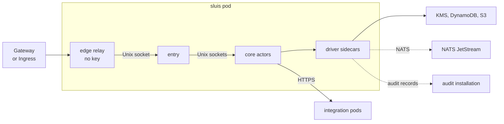

On the kubernetes runtime the kubelet supervises sluis, and each actor is a container with its own user id and its own cloud identity. The tested installation is [kubernetes](/runtimes/installations/#kubernetes): Amazon EKS with AWS KMS keys, DynamoDB state and leases, the NATS JetStream audit transport and S3 blobs, installed from one Helm chart. It is the customer-identity installation, and the reference installation of the `nats-jetstream` driver. The design is [ADR 0018](/decisions/0018-runtimes-installations-and-delivery-order/#kubernetes); which drivers fit Kubernetes is on [Installations](/runtimes/installations/#which-drivers-fit-which-runtime).

**sluis never writes Kubernetes objects.** Cluster tools such as cert-manager, trust-manager and External Secrets stay its clients and pull what sluis serves and exports.

## Topology

The edge relay is the only container with a port on the pod address. It forwards to `entry`'s Unix socket, and `entry` calls the core actors (`session`, `console`, `exchange`, `signer`, `policy`, `ca`, `ssh-ca`, `quota`) over their sockets. A call to an integration leaves for that integration's own pod; audit records leave through the transport for a separate audit installation.

## What runs where

- **An actor is a container,** and so is each driver, with a unique user id pinned to the same value as in the local installation's Compose file, because the peer-uid check relies on it. The namespace runs at the `restricted` Pod Security level: non-root, no capabilities, no privilege escalation, the runtime default seccomp profile.
- **Drivers are native sidecars,** started by the platform before the actors that call them ([ADR 0004](/decisions/0004-drivers-listeners-and-boundary-enforcement/#drivers-are-platform-started-services)). A driver is never a pod of its own, because its socket cannot leave the pod.
- **The mount is the first lock.** Each callee's socket directory is its own volume, mounted only into the containers the call graph allows; this takes the place of a host's socket groups. The callee still reads the caller's uid with `SO_PEERCRED` and checks the call graph, default deny. `shareProcessNamespace` is off.
- **The fusion unit is the container** ([ADR 0003](/decisions/0003-core-actors-with-one-responsibility-each/#the-fusion-rule)). A generated check fails the build when a container that holds a key credential exposes a listener.
- **A pod per integration,** with its own egress NetworkPolicy listing only its vendor's hosts, and its own lifecycle. The sluis pod calls it over HTTPS.
- **No RBAC.** The chart renders no Role, RoleBinding, ClusterRole or ClusterRoleBinding: sluis needs no access to the Kubernetes API, not even for leases.

## Keys

- **AWS KMS only,** with the layout of every AWS installation ([Keys](/concepts/keys/#aws-kms-layout)). Each key policy names one actor role and denies the node's role. No card and no `key-holder` run on Kubernetes: the key policy is the access list.
- **No software key in production.** Only the `kubernetes-dev` preset allows the `software` driver, on the terms of the local installation, for the smoke test on kind. A cluster with no key mode that the floor allows refuses to start ([ADR 0012](/decisions/0012-cryptography-and-authority-keys/#floors-in-code)).
- A cluster outside AWS is not supported in the first cut, because it would need a second key mode.

## Identity

- **One projected ServiceAccount token per container,** with one audience per role, mounted only into the actor's container and its driver ([ADR 0007](/decisions/0007-workload-identity-and-host-enrolment/#proofs-and-the-exchange)). The cloud driver exchanges it with `AssumeRoleWithWebIdentity`, the same code path as on a virtual machine; only the issuer of the token differs.
- **The pod's default ServiceAccount token is not mounted.** Each actor's cloud role trusts the cluster's issuer, that actor's audience, and the installation's namespace and ServiceAccount. The infrastructure code generated from the manifest registers the issuer and the roles.
- **EKS Pod Identity is used for single-actor pods,** such as an integration pod, because its credentials belong to the pod and every container of a pod could use them. Per-actor tokens signed by `sluis-node` in the pod are only a fallback.
- The workload tokens are signed by the cluster's key, not a sluis key, so the P-384 rule does not cover them. Pods must not reach the node's instance metadata service.

## State and leases

- **DynamoDB only,** for state and leases ([ADR 0011](/decisions/0011-state-is-one-port-with-compare-and-set/#drivers)): conditional writes, transactions for the atomic batch, and IAM `dynamodb:LeadingKeys` conditions that allow one writer actor per record kind. Each boundary has its own table.
- **A lease is a record on the state store** with a fencing token ([Data](/concepts/data/#leases-and-fencing-tokens)). There is no Kubernetes Lease driver, and no Postgres or rqlite state driver on Kubernetes.
- The chart refuses more than one replica on a state store that is not shared.

## Audit

- **The audit side is a separate audit installation** from the same chart's `audit-install` preset: the writer, the indexer, the reader and an optional witness, behind its own front ([ADR 0015](/decisions/0015-audit-pieces-transport-search-and-front/#the-audit-front)), a slim `entry` on its own host with its own edge relay or `cloudflared` and its own gateway route.
- **Transport:** NATS JetStream. NATS accounts and permission templates on scoped signing keys let each producer only publish its own records ([ADR 0004](/decisions/0004-drivers-listeners-and-boundary-enforcement/#nats-jetstream)); the NATS credentials use the Ed25519 named exception ([ADR 0012](/decisions/0012-cryptography-and-authority-keys/#named-exceptions)). SQS and `direct-mtls` are supported but not the default; `direct-mtls` falls back to a local spool when the writer is down, which needs a per-pod volume. A request never waits for the writer or the index.
- **One writer at a time,** by a lease with a fencing token, and every batch is created with `If-None-Match: *`, so a second writer cannot fork the log ([ADR 0016](/decisions/0016-the-audit-log/#the-write-once-fence)). The writer signs checkpoints with the log key in KMS.
- **Index:** `postgres` in the `cnpg` mode, a CloudNativePG cluster in the same Kubernetes cluster; a database someone else runs is the `external` mode, a connection string only ([The postgres index driver](/concepts/drivers/#the-postgres-index-driver)). The reader can run in any pod that reaches the database.
- **Witness:** a peer witness in the same cluster is not independent, so an `external` witness is the useful one. `sluis config check` warns when there is none.

## Edge

A gateway cannot route to a Unix socket in another pod, and the kubelet's HTTP and TCP probes connect to the pod address, so a container in the pod bridges to `entry`, in one of two modes:

- **Edge relay, the default.** A key-less container listens on the pod address and forwards to `entry`'s Unix socket in a shared volume. A Service targets its port, so any Gateway API implementation or Ingress controller can route to it. It is written in Rust, like `entry` ([ADR 0014](/decisions/0014-the-language-follows-the-executable/)).
- **`cloudflared`, supported.** A sidecar connects out to the Cloudflare edge and forwards to `entry`'s socket, and the pod accepts no inbound connection at all.

The relay is the one exception on Kubernetes to the rule that only `entry`'s API listens on TCP ([ADR 0004](/decisions/0004-drivers-listeners-and-boundary-enforcement/#listeners)), and it holds no key. `entry` stays socket-only and is probed with an `exec` probe.

:::note[Proposed]
The relay serves a health endpoint for the gateway, passes the client address in `X-Forwarded-For` and strips that header unless the request comes from a configured trusted proxy, and can terminate TLS when the hop from the gateway must be encrypted. The record of the edge, pod identity and the fusion unit is planned: [#1019](https://github.com/truvity/sluis/issues/1019).
:::

The console's single-page application runs as its own Deployment and image, behind the same gateway route as `entry`, so the page and the console API share one origin.

## Packaging and the baseline

- **One OCI image per process and one Helm chart,** `oci://ghcr.io/truvity/sluis/charts/sluis`, with every image pinned by digest and the chart's version equal to the release version ([ADR 0019](/decisions/0019-release-train-packaging-and-distribution/#packaging-per-runtime)). The same images run the [local](/runtimes/installations/#local) installation.
- **One chart with presets** `install`, `audit-install`, `quota-install` and `kubernetes-dev`, and no subcharts, so a writer and a reader always come from one release. The cert-manager issuer has a chart of its own.
- **The values schema is generated from the configuration schema,** so the chart, `sluis config check` and the process validate against one source. The chart fails at render time only on what spans the install document and the deployment values, such as more than one replica on a state store that is not shared.
- **The baseline:** native sidecars, the `restricted` Pod Security level, projected ServiceAccount tokens and a CNI that enforces NetworkPolicy. Cilium is optional, for egress by host name. OpenShift and sandboxed runtimes such as gVisor and Kata are not in the first cut. A cluster must meet the baseline before the chart installs.

:::note[Proposed]
From the permission manifest the chart renders one ServiceAccount per pod kind with the automatic token mount off; a NetworkPolicy per pod kind that admits only the gateway to the edge port and allows egress to DNS and the allowed AWS endpoints, and per integration pod one that admits only the sluis pod; optionally a CiliumNetworkPolicy; and a PodDisruptionBudget, zone spread over two or three replicas, and rolling updates that never remove a replica before its replacement is ready. The record of the baseline and the chart layout is planned: [#1020](https://github.com/truvity/sluis/issues/1020).
:::

## Testing

- **A smoke test on kind** installs the chart with the `kubernetes-dev` preset under the `restricted` level, with no cloud credentials. It confirms that `SO_PEERCRED` identifies the peer across the containers of one pod, then checks the socket reachability and NetworkPolicy deny matrices, the edge, the probes, a rolling upgrade, and that the render holds no RBAC objects.
- **Integration tests on a development EKS cluster** cover the cluster's issuer at AWS, the key policies, the IAM conditions on the state and the queue. They run on a short-lived runner inside the VPC against the cluster's private API endpoint; the cluster has no public endpoint ([#891](https://github.com/truvity/sluis/issues/891)).

## Limits and residual risk

- **Identity is as strong as the cluster.** A cluster administrator, a compromised node or a permissive admission policy can mint a token for any audience of a ServiceAccount, or open a shell in a container ([accepted risks](/security/threat-model/#accepted-risks)).
- All containers of a pod share its egress allow-list, which is why each integration has a pod of its own.
- Separation between containers depends on unique uids, on no container changing its uid, and on `shareProcessNamespace` being off; `SO_PEERCRED` behaviour is confirmed on every container runtime that is claimed.
- A pod has a container for each actor and driver; memory and start-up time are measured, not assumed.
- Do not run the installation that signs people in to a cluster on that same cluster without [break-glass recovery](/security/break-glass/), which needs no Kubernetes.
