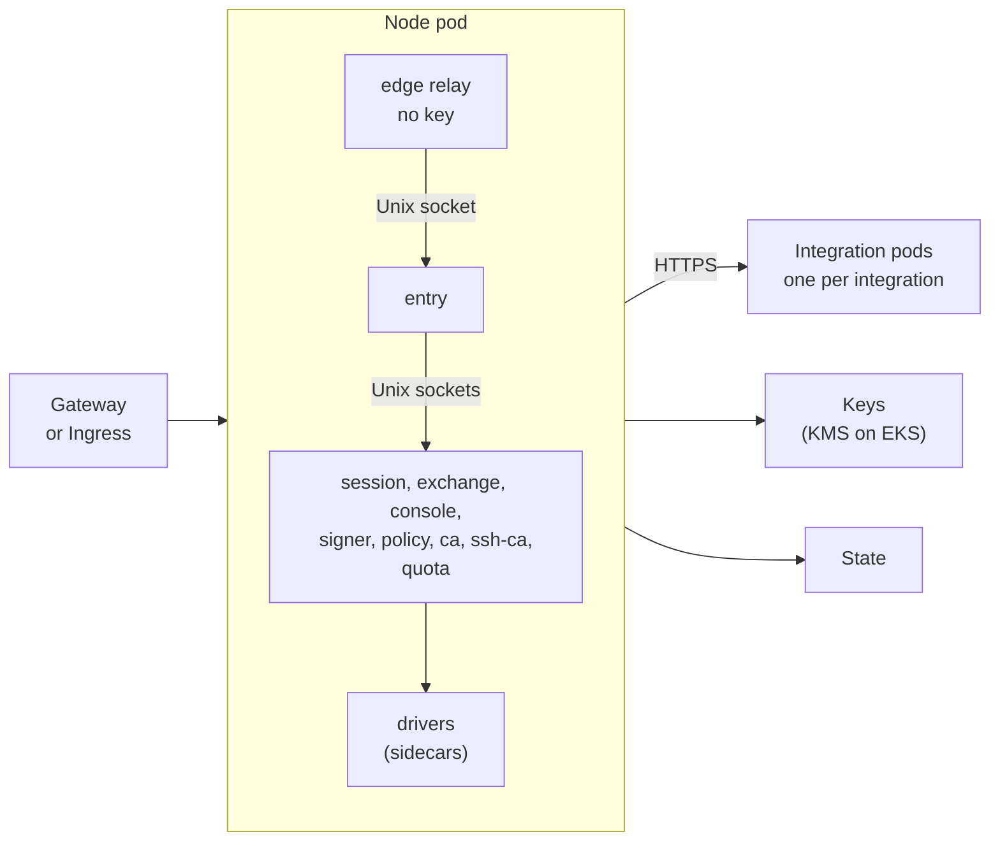
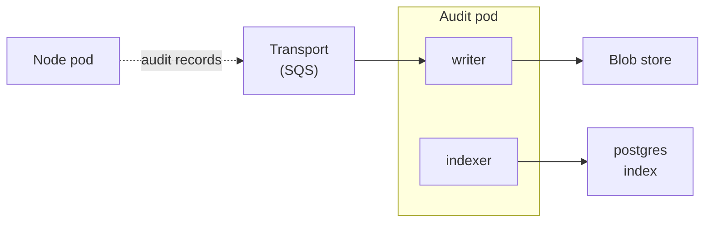

The kubernetes runtime, the [kubernetes](/runtimes/installations/#kubernetes) installation, is in design and test scope now (see [OD-7](/open-decisions/#od-7)), and it is built after local, in parallel with boards and lambda. Everything on this page is the design as proposed, except the points that [agreed decisions](/open-decisions/) already fix: sluis writes no Kubernetes objects, a driver talks to its actor over a Unix socket, and the audit path is the one in [Audit](/concepts/audit/). The pod layout ([OD-17](/open-decisions/#od-17)), AWS KMS only ([OD-20](/open-decisions/#od-20)), DynamoDB only ([OD-21](/open-decisions/#od-21)) and the SQS transport ([OD-22](/open-decisions/#od-22)) are decided. So are, since 2026-10-30, the edge relay ([OD-24](/open-decisions/#od-24)), the audit installation's own `entry` ([OD-26](/open-decisions/#od-26)), the runner for the EKS tests ([OD-27](/open-decisions/#od-27)), the baseline ([OD-28](/open-decisions/#od-28)), a pod per integration ([OD-29](/open-decisions/#od-29)) and the co-located audit profile ([OD-31](/open-decisions/#od-31)).

On Kubernetes an actor is a container with its own user id and its own cloud identity. The containers of one node form a pod, and the audit path forms a second pod, cut at the audit transport ([OD-17](/open-decisions/#od-17)). The first release supports Amazon EKS with AWS KMS ([OD-20](/open-decisions/#od-20)), and a cluster with no key mode that the floor allows refuses to start. Audit is a separate audit installation ([OD-31](/open-decisions/#od-31), decided).

:::note[Proposed]
The chart renders everything from the permission manifest, and sluis itself calls no Kubernetes API. The Kubernetes decisions of 2026-10-30 are recorded in [ADR 0018](/decisions/0018-runtimes-installations-and-delivery-order/#kubernetes); the details on this page that it does not name are design, not decisions. Other clusters are specified where a decision is open.
:::

## Topology

### The node pod

The gateway reaches the edge relay. The drivers reach the keys and the state. Each integration runs in a pod of its own.

The node pod runs two or three replicas. A request enters through the edge relay, and the actors and their drivers call each other over Unix sockets inside the pod. A call to an integration leaves the pod for that integration's pod ([OD-29](/open-decisions/#od-29)).

### The audit pod

The audit pod runs two replicas, and one of them writes. The transport is the only link between the two pods. Where the reader runs is derived, not fixed ([Audit](#audit) below).

**Audit is its own installation** ([OD-31](/open-decisions/#od-31), decided 2026-10-30), connected to sluis over the network, and sluis emits over TCP or a queue through the transport port. The actors of the audit installation are the writer, the witness, the indexer and the reader, with no notary. An emitter is authenticated by the transport driver's own layer: a queue policy per sender role on SQS, the client certificate's SPIFFE ID on `direct-mtls`, NATS accounts on NATS JetStream ([Audit](/concepts/audit/#the-transport)). A **co-located profile** for a small install shares the installation's driver instances, and the defence-in-depth layers stay per actor, unchanged.

The points [OD-32](/open-decisions/#od-32) to [OD-39](/open-decisions/#od-39) refine this one, and all of them are decided. Placement is derived from the port and driver rules (OD-32). Quota meters by default and enforces per policy rule (OD-33). Audit is four pieces that share driver instances when combined (OD-37 and OD-38). The installation defaults for the transport stay, with direct and NATS JetStream supported but not a default (OD-34); direct mode falls back to a local spool when the writer is down (OD-35); a witness is optional (OD-36); and there is no notary actor (OD-39).

## What runs where

- **Sockets stay Unix sockets.** Actors and drivers talk over Unix sockets in shared volumes, and the callee reads the caller's user id with `SO_PEERCRED` and checks the call graph, default deny.
- The packaging for kubernetes is an OCI image and a Helm chart. Helm charts are OCI artifacts with images pinned by digest. They are built from the release output; see [Packages](/distribution/packages/). One release means one set of images, so the actors inside a pod can never be at different versions.
- sluis does not write Kubernetes objects. It exports, and clusters pull. cert-manager and trust-manager stay as clients of sluis. The chart renders no Role, RoleBinding, ClusterRole or ClusterRoleBinding, because sluis needs no access to the Kubernetes API.

- **Two pod kinds, cut along the audit transport** ([OD-17](/open-decisions/#od-17)).
  - The **node pod** holds the core actors on the synchronous call graph: `entry`, `session`, `console`, `exchange`, `signer`, `policy`, `ca`, `ssh-ca` and `quota`, with their drivers and the edge relay.
  - **Each integration is a pod of its own** ([OD-29](/open-decisions/#od-29), decided), with its own egress NetworkPolicy, so the node pod's allow-list does not carry every integration's hosts. The node pod calls it over HTTPS. Each container is named for its actor instance, such as `ca-prod`, with a ServiceAccount of the same name. It runs as a Deployment of two or three replicas spread over zones. Replicas exist for availability, not throughput.
  - The **audit pod** holds the writer and the indexer. One replica writes at a time, chosen by a lease on the state store with a fencing token, and every batch is created with `If-None-Match: *`, so a second writer cannot fork the log. The only link between the two pods is the audit transport, so no call crosses a pod boundary.
  - One pod per node with every actor a container is the layout inside each pod. One pod per actor with mutual TLS between pods was rejected: it gives every actor a TCP listener and needs a certificate for every pod from `ca`.
  - Audit is a separate audit installation, connected to sluis over the network ([OD-31](/open-decisions/#od-31), decided).

:::note[Proposed]
- **An actor is a container.** Each actor and each driver runs as its own container with a unique user id, a read-only root file system, no capabilities, no privilege escalation and the runtime default seccomp profile. Drivers are native sidecars, so the platform starts them before the actors that call them.
- **The mount is the first lock.** Each callee has its own volume for its socket directory, and that volume is mounted read-only only into the containers that the call graph allows. On Kubernetes this replaces the socket group of the hosts, because a container cannot have its own supplementary groups. The callee still checks the peer's user id.
- **A driver is never a pod of its own,** because a socket cannot cross a pod boundary. An integration is an actor, not a driver, so it can be (above).
:::

**The unit of the fusion rule is the container** ([OD-18](/open-decisions/#od-18), decided 2026-10-30). The [fusion rule](/architecture/processes/) says no unit holds a key next to an unauthenticated listener; on Kubernetes the unit is the container, the scope of its credentials, and a generated check fails the build if any container that can use a key also has a listener.

**Integrations run in a pod each** ([OD-29](/open-decisions/#od-29), decided 2026-10-30). Each integration's pod has its own egress NetworkPolicy, listing only the hosts that integration needs, and its own lifecycle. The node pod calls it over HTTPS. The other options were containers of the node pod, with one shared egress list, and a per-integration switch in the manifest.

## Keys

- A software key is refused in production.
- A cluster with no key mode that the floor allows does not start. `sluis config check` and the process both refuse.

For now the kubernetes runtime supports AWS KMS only, on EKS ([OD-20](/open-decisions/#od-20)). A cluster outside AWS is not supported until a second key mode is wanted.

:::note[Proposed]
On AWS (EKS) the keys are AWS KMS keys with the same layout as on the other AWS installations: one symmetric key with encryption contexts for sealing (grants included), and one `ECC_NIST_P384` key per enabled authority purpose. Each key policy names one actor.

When a second mode is wanted, PKCS#11 through `key-holder` comes first, then cloud KMS drivers. A remote `key-holder` on a machine with a hardware key is not proposed, because it puts a key beside a network listener.
:::

## Identity

The identity of an actor is the token mounted into its container.

:::note[Proposed]
The pod defines one projected ServiceAccount token volume for each actor, with an audience for that actor, and mounts it only into the actor's container and its driver. The actor's cloud driver exchanges the token with the cloud: `AssumeRoleWithWebIdentity` on AWS, Workload Identity Federation on Google Cloud, a federated credential on Azure. It is the same driver code path as on EC2 installations. Only the source of the token differs: the kubelet and the API server issue it, and not `sluis-node`.

The pod's default ServiceAccount token is not mounted. The cloud role of each sluis actor trusts the cluster's issuer, the audience of that actor, and the namespace and ServiceAccount of the install. Nothing in the cluster is created for this: the infrastructure code that the manifest generates registers the issuer and the actors.

The workload tokens are the cluster's, signed by the cluster's key. They are not sluis keys, so the P-384 rule of [Keys](/concepts/keys/) does not cover them.

EKS Pod Identity is used for a pod that holds a single actor, because its credentials belong to the pod and not to a container. The node agent `sluis-node` is not used on Kubernetes.
:::

**Cloud identity for pods** ([OD-19](/open-decisions/#od-19), decided 2026-10-30): projected ServiceAccount tokens per container, one audience per actor, are the default. EKS Pod Identity is used only for a pod that holds a single actor, because every container of a pod can use the pod's credentials. Per-actor tokens signed by `sluis-node` in the pod are only a fallback.

On a cluster outside AWS the cluster's issuer must be reachable by the cloud, or its public keys must be published as static documents, as in [Identity](/concepts/identity/). Setting the API server's issuer is an operator step on the cluster.

Pods also must not reach the node's instance metadata service. Every key policy denies the node's role.

## State

- The chart refuses more than one replica on any state store that is not shared.
- For now the kubernetes runtime supports DynamoDB only for state ([OD-21](/open-decisions/#od-21)).
- **State port:** DynamoDB on EKS, with conditional writes, transactions for the atomic batch, and IAM `dynamodb:LeadingKeys` conditions that allow exactly one writer actor for each record kind. Each boundary has its own table.
- **Lease port:** on the state store, DynamoDB, with a fencing token, like every lease ([Data](/concepts/data/#leases-and-fencing-tokens)). A Kubernetes Lease driver is in the backlog, so the chart still needs no Role for leases.

:::note[Proposed]
There is no Postgres state driver in 2.0: state on Kubernetes is DynamoDB only ([ADR 0018](/decisions/0018-runtimes-installations-and-delivery-order/#kubernetes)). rqlite on Kubernetes is not proposed, because it would add a second replication layer inside a cluster that already offers replicated databases.
:::

## Audit

- **Reader:** where the reader runs is derived from the port and driver rules ([OD-32](/open-decisions/#od-32)). With a `postgres` index it can run in any pod that reaches the database, so this page does not fix it to one pod.
- **Index:** `postgres`, in the `cnpg` mode ([ADR 0015](/decisions/0015-audit-pieces-transport-search-and-front/)): a CloudNativePG (CNPG) cluster in the same Kubernetes cluster. The `external` mode takes a connection string only, for a database someone else runs, such as a CNPG cluster in another Kubernetes cluster behind a load balancer. Exposing CNPG through a load balancer is not a driver of its own; from sluis's side it is `external`. See [The postgres index driver](/concepts/drivers/#the-postgres-index-driver).
- The sealed batches go to the blob store, and the writer asks the `key-holder` to sign checkpoints into the hash chain, as on every runtime. The `key-holder`'s access list lets only the writer use the log key; there is no notary actor ([OD-39](/open-decisions/#od-39)).
- A separate audit installation, which holds the indexer, the reader and the index for an installation that chose no index of its own, runs from the same chart with the `audit-install` preset.
- **Transport:** SQS is the audit transport on Kubernetes ([OD-22](/open-decisions/#od-22), [OD-34](/open-decisions/#od-34)), as on Lambda. `direct` and NATS JetStream are supported but are not the default; in `direct` mode, a writer that is down means the emitter falls back to a local spool ([OD-35](/open-decisions/#od-35)), which needs a volume. Producers may only send, and the writer receives. Blocking on the archive is not used, because a request must never wait for the writer, the archive or the index.

:::note[Proposed]
A volume spool, with a writer in every replica, is proposed for clusters outside AWS.

**Witness:** optional ([OD-36](/open-decisions/#od-36)). A peer witness inside the same cluster is not independent, so an `external` witness is the useful one; `sluis config check` warns when there is none.
:::

**Every audit installation has its own front** ([OD-26](/open-decisions/#od-26), [ADR 0015](/decisions/0015-audit-pieces-transport-search-and-front/)): a slim router `entry` on its own host, `sluis-audit.<env>.example.com`, the API, which is the `reader`, its own `session` and `console`, and a console bundle of its own. On Kubernetes the audit `entry` gets its own edge relay or `cloudflared` sidecar and its own route at the gateway (inferred from the edge rules below). A console of another installation calls the audit `entry` with an exchanged token whose `aud` is the audit client id, valid for at most 5 minutes and bound to the console's X.509-SVID by mutual TLS.

## Edge

The console's single-page application runs as **its own Deployment and image**, behind the same gateway as `entry` by path, so the page and the console API share one origin. It is a key-less listener that serves static files only ([Listeners](/architecture/listeners/#the-consoles-static-host)).

On bare-metal `entry` listens on a Unix socket, and on serverless on `127.0.0.1` inside the sandbox. A gateway cannot route to a socket or a loopback address in another pod, and the kubelet's HTTP and TCP probes connect to the pod address, so a container in the same pod bridges it ([OD-24](/open-decisions/#od-24), decided 2026-10-30), in one of two modes:

- **Edge relay (the default).** A key-less container in the pod listens on the pod address and forwards to `entry`'s Unix socket in a shared volume. A Service targets its port, so any Gateway API implementation or Ingress controller can route to it. The relay serves a health endpoint for the gateway, passes the client address in `X-Forwarded-For`, and removes that header from requests unless they come from a configured trusted proxy. A certificate can be configured when the hop from the gateway must be encrypted. The relay is written in Rust, like `entry` ([ADR 0014](/decisions/0014-the-language-follows-the-executable/)).
- **`cloudflared` (supported).** A sidecar that connects out to the edge and forwards to `entry`'s Unix socket, as `cloudflared` does on the boards installation. The pod accepts no inbound connection at all.

The relay is a second TCP listener, so the rule in [Listeners](/architecture/listeners/) that only `entry`'s API listens on TCP has the relay as its one exception on Kubernetes. The relay holds no key. `entry` is not bound to the pod address, and the kubelet probes it with an `exec` probe, which runs inside its container. (that `entry` listens on a socket in a shared volume on Kubernetes follows from the decision that the relay forwards to its Unix socket)

## Packaging

- The packaging is **one OCI image per process** and **one Helm chart**, `oci://ghcr.io/truvity/sluis/charts/sluis`, built from the release output by `ocictl helmctl`, with every image pinned by digest. The chart's version is the release version.
- **One chart with presets** ([OD-30](/open-decisions/#od-30), decided; [ADR 0019](/decisions/0019-release-train-packaging-and-distribution/)). A piece selector and the presets `install`, `audit-install`, `quota-install` and `kubernetes-dev` choose what is rendered; there are no subcharts, so one install can never run a writer and a reader from different releases.
- **Adapters are separate.** The cert-manager issuer has a chart of its own, with its CRDs and RBAC. The certificate sidecar is an image plus a snippet to add to a pod ([PostgreSQL](/integrations/postgresql/)).
- **Images** are `ghcr.io/truvity/sluis/<kind>/<name>`, multi-arch, on distroless `static`, or distroless with glibc and a pinned `pcsc-lite` where an executable needs cgo. The same images run the [local](/runtimes/installations/#local) installation, and they carry the packages' binaries, byte for byte, which a hash test checks ([ADR 0018](/decisions/0018-runtimes-installations-and-delivery-order/)).
- The values schema is generated from the Pkl configuration schema, so the chart, `sluis config check` and the runtime validate against one source. The install document is passed whole. The chart fails at render time only on what spans the document and the deployment values, for example more than one replica on a state store that is not shared, or a key driver the floor refuses.

:::note[Proposed]
The permission manifest generates:

- one ServiceAccount for each pod kind, with the automatic token mount off;
- for each container, a unique `runAsUser`, `runAsNonRoot`, a read-only root file system, dropped capabilities, `allowPrivilegeEscalation: false` and the runtime default seccomp profile;
- for each pod, `shareProcessNamespace: false`;
- the socket volumes and the token volumes described above, each mounted only where the call graph allows;
- a NetworkPolicy for each pod kind that allows the gateway to reach the edge port and nothing else inbound, and egress to DNS and the allowed cloud endpoints; for each integration pod, a NetworkPolicy that admits only the node pod and allows egress to that integration's hosts only;
- optionally a CiliumNetworkPolicy, because a plain NetworkPolicy cannot match host names, and Cilium can express egress by FQDN with default deny;
- a PodDisruptionBudget, zone spread and a rolling update that never takes a replica away before its replacement is ready;
- the infrastructure code for the cloud side: the issuer registration, the roles, the key policies, the tables and the queue.

The namespace carries the Pod Security label `restricted`. The render is tested against it.
:::

**The Kubernetes baseline** ([OD-28](/open-decisions/#od-28), decided 2026-10-30). The chart requires native sidecars, the `restricted` Pod Security level, projected ServiceAccount tokens and a CNI that enforces NetworkPolicy. Cilium is optional, for egress by FQDN. OpenShift, which assigns user ids by namespace range, and sandboxed runtimes such as gVisor and Kata are not in the first cut.

## Testing

:::note[Proposed]
The runtime is tested in three parts.

- **Smoke test on kind, on every pull request.** The chart installs under the `restricted` level. A first test confirms that `SO_PEERCRED` identifies the peer by user id across the containers of one pod. The rest checks the socket reachability matrix, the NetworkPolicy deny matrix, the edge, the probes, a rolling upgrade, and that the render contains no RBAC objects. It runs without cloud credentials, with the chart's `kubernetes-dev` preset.
- **A real EKS cluster in the development account,** as a job of the integration-test workflow, nightly and on release candidates, never on a pull request. The job runs on a short-lived runner inside the development VPC, against the cluster's private API endpoint ([OD-27](/open-decisions/#od-27)). It covers what kind cannot: the cluster's issuer into the cloud, key policies per actor, IAM conditions on the state, and the queue.
- **A cluster outside AWS** joins the matrix when a key mode for it exists.
:::

**The development profile for the smoke test** ([OD-25](/open-decisions/#od-25), decided) is the chart's `kubernetes-dev` preset. A smoke test on kind has no KMS, and the floor refuses a software key in production, so the preset allows a software key on the terms of the [local](/runtimes/installations/#local) installation.

**The EKS test job runs inside the VPC** ([OD-27](/open-decisions/#od-27), decided 2026-10-30): a short-lived runner in the development VPC reaches a private API endpoint, so the cluster's API is not public. The other option was a public endpoint limited to the runner's address.

## Limits and residual risk

- Identity is as strong as the cluster. A cluster administrator, a compromised node or a permissive admission policy can mint a token for any audience of a ServiceAccount, or open a shell in a container. A cluster is one trust domain.
- A network policy and the cloud's view of the pod are per pod. All containers of a pod share its egress allow-list, so the allow-list is the union of what every container needs. That is why each integration has a pod of its own, with its own list ([OD-29](/open-decisions/#od-29)).
- Separation between containers depends on unique user ids, on no container being able to change its user id, and on `shareProcessNamespace` being false. The generator and the tests enforce all three, and `SO_PEERCRED` behaviour has to be confirmed on every container runtime that is claimed.
- A pod has many containers, one for each actor and each driver. Memory and start-up time are measured, not assumed.
- Do not run the install that signs in to a cluster on that same cluster without the [recovery](/concepts/audit/) path, which needs no Kubernetes.
- A `postgres` index adds a stateful dependency.
