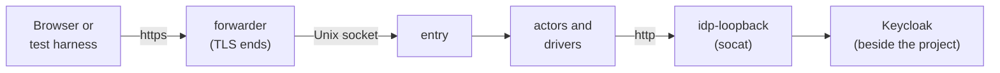

The [local installation](/runtimes/#local) is the core of sluis on one workstation: Docker Compose, one container per actor and per driver, an rqlite engine of one node, and software keys. It is for development, continuous integration and the integration tests. It proves behaviour, not availability, and it serves no real user ([ADR 0011](/decisions/0011-runtimes-and-installations/#the-local-installation)). The drivers are [atoom's](https://github.com/truvity/atoom/blob/master/README.md): sluis consumes them and decides which ones this installation runs.

It is built. The smokes of this page run in CI on every pull request, so a step that stops working fails the build. The core leaves the token certificate off, so the key set carries no `x5c` chain; [The first start](#the-first-start) says what `local-up` still does today.

:::caution
The steps follow the recipes of a checkout of `truvity/sluis`. A step that names a recipe runs today; a step that says "planned" does not exist yet and links its issue. Outputs are examples, not captured logs.
:::

## Start here

You finish with a running installation, a sign-in through a real identity provider (Keycloak, run beside it), a token you verified yourself and the audit records of your sign-in.

### Prerequisites

- A Linux workstation with Docker, devbox and `git`. Every command runs as `devbox run -- just <recipe>` from the root of the checkout. The first run installs the toolchain and builds every executable and image, which takes a while.
- A checkout of `truvity/sluis` on `main`, the v2 line (a fresh clone starts on `master`, which is v1). The installation's files are `tests/installations/local/` (the bootstrap file, the config documents, the policy and the identity provider's realm) and `deploy/local/` (the Compose project, generated from the registries, and its scripts).
- A free `/24` subnet for the project's network, and the address of the identity provider that this subnet reaches. `local-up` picks a free `/24` of `10.99.0.0/16` from the project name when `SLUIS_LOCAL_SUBNET` is not set. A host firewall may drop the subnet Docker picks on the way to the identity provider, so set `SLUIS_LOCAL_SUBNET` where only some subnets are let through. The steps below set one.
- No hosts file, browser or certificate import is needed for the recipes. They are needed only to sign in with your own browser and CLI ([Trust the harness CA](#trust-the-harness-ca)).

### Read the bootstrap file

store@ reads one local file at start, the [bootstrap file](/reference/bootstrap-file/): the boundary, a driver socket for each of its four ports, and the public keys of the publishers that sign config. Everything else is a signed config document ([Signed config](/reference/signed-config/)). The local file, abridged:

```yaml
# Abridged from tests/installations/local/bootstrap.yaml
boundary: dev
start_timeout: 30s

config_source: { driver: file, socket: /run/sluis/store/dev/config-source.sock }
secret_source: { driver: credential, socket: /run/sluis/store/dev/secret-source.sock }
durable: { driver: rqlite, socket: /run/sluis/store/dev/durable.sock }
temp: { driver: rqlite, socket: /run/sluis/store/dev/temp.sock }

publishers:
  - kid: publisher-1
    public_key: "-----BEGIN PUBLIC KEY-----…"
    spki_sha384: "d4c36e17…afcbb4"
```

- **One rqlite node serves both engine ports,** the engine of the boards with a cluster of one ([0005](/decisions/0005-the-store/#engines)).
- **The publisher pin is the trust anchor of config.** store@ verifies every config document against a pinned key before it parses it, and refuses any other. The committed file carries a test key that guards nothing; `local-up` makes a publisher key for the run, writes its pin into the copy the run uses and signs the documents with it ([0005](/decisions/0005-the-store/#configuration-loading)).
- **A duration carries a unit** in every config document: one whole number and `s`, `m`, `h` or `d` ([0004](/decisions/0004-the-data-model/#schemas-are-protobuf)).

### Start the identity provider and the project

Sign-in goes through an upstream identity provider, never through accounts in sluis. `local-idp` starts a Keycloak container with the reviewed realm of the tests (the user `alice`, with a password and a one-time password) and writes a file of random secrets for the run. `local-up` then builds the executables and the images, makes the state of the run below `.cache/local` and starts the project. It returns when every service that has a health check is healthy.

```sh
# Example: the subnet and its first address are yours to choose
export SLUIS_LOCAL_SUBNET=10.99.8.0/24
export SLUIS_UPSTREAM_TARGET=10.99.8.1:8180
export SLUIS_KEYCLOAK_SECRETS="$PWD/.cache/idp.env"

devbox run -- just local-idp .cache/idp.env
devbox run -- just local-up
devbox run -- just local-status
```

- **`SLUIS_UPSTREAM_TARGET`** is the `host:port` of the identity provider as the project's network reaches it: the first address of the subnet (the network's gateway) and port 8180, where `local-idp` publishes Keycloak. The repository names no real value.
- **`SLUIS_KEYCLOAK_SECRETS`** names the file `local-idp` writes. Its values are random and never printed.
- **`local-status`** lists each service with its user id, state and health. `local-logs store key` shows the logs of the services named.

The keys are software keys. key@'s `software` driver refuses to start in a production boundary and warns in a staging one, so these keys guard development data only ([0006](/decisions/0006-keys-and-sealing/#floors-in-code)). To run the images of a release instead of building them, see [Images](#images).

### Check the configuration

`sluis config check` validates the bootstrap file and the config documents the way store@ does at start: schema, every signature against the pinned publisher keys, the sequence, and the whole set against the registries ([the command](/reference/cli/)). The smoke of the command-line tool runs it, with `doctor`, `key status` and the other commands of the first version, against the running installation:

```sh
devbox run -- just local-cli-smoke
```

Its `config check` step prints lines like these:

```text
# Example output
ok    bootstrap file: schema v1, publisher-1 matches its pin
ok    config documents: every signature verifies against a pinned publisher key
ok    snapshot: the set validates against the kind registry
ok    drivers fit the runtime (bare-metal, 1 node)
warn  audit: no witness; with no witness a compromised writer can get a rewritten checkpoint signed
```

The warning is expected: the local installation has no witness. A `fail` line exits 3.

### Trust the harness CA

`local-up` made a certificate authority for the run, the harness CA, and a leaf for the forwarder that ends TLS. The CA's certificate is `.cache/local/ca/ca.pem`. The recipes trust it through `SSL_CERT_FILE`, so they need nothing from you. Never import it into the system trust store; `local-down` deletes it. To reach the installation by hand, give `curl` the CA and a name mapping, with the project on its default port 8443:

```sh
# Example
curl --cacert .cache/local/ca/ca.pem --resolve sluis.dev.local.test:8443:127.0.0.1 \
  https://sluis.dev.local.test:8443/.well-known/openid-configuration
```

To sign in with your own browser and CLI, set `SLUIS_LOCAL_PORT=443` before `local-up`, add two lines to the hosts file and import `ca.pem` into a browser profile made for this project ([Host names](#host-names), [TLS](#tls)):

```text
127.0.0.1 sluis.dev.local.test
127.0.0.1 sluis-audit.dev.local.test
```

### Sign in as alice

The realm sends `amr` with `mfa` after the one-time password, so the local policy's multi-factor rule passes ([Sign-in](#sign-in)). The local policy binds `alice` to the grant name `dev:example-app:user` ([a worked example](/reference/policy/#a-worked-example)).

```sh
devbox run -- just local-login-headless
```

The recipe runs the real `sluis login --issuer https://sluis.dev.local.test`. A harness fills in Keycloak's form and computes the one-time code from the user's secret, where a browser and an authenticator would. The CLI reaches the forwarder through a CONNECT proxy of the test process, so no hosts file is needed.

```text
# Example output
signed in to https://sluis.dev.local.test
subject  pm4x7q2wz5c3nbr6dy7vjk5tha
```

The subject is an opaque random id of 26 base32 characters that sluis assigned at the first sign-in, the same for every client and never an e-mail address ([0017](/decisions/0017-identity-and-sign-in/#subjects)). With your own browser and CLI you run `SSL_CERT_FILE=.cache/local/ca/ca.pem sluis login --issuer https://sluis.dev.local.test` yourself; `sluis` is the binary that `local-up` built at `dist/local/bin/cli/sluis`.

### Get a token and verify it

```sh
devbox run -- just local-person-smoke
```

The recipe signs `alice` in, runs `sluis token --audience example-app`, which has `exchange` do the token exchange of RFC 8693, prints the claims of the ID token and of the exchanged token, and checks both against `/jwks`. `example-app` asks for multi-factor authentication no older than 900 seconds, so a later run asks for a new sign-in.

A sluis token is a standard JWS. Any JOSE library verifies it against the key set of the boundary's issuer, which exporter@ publishes as a static document; sluis needs no client library. Save the key set that the discovery document points to, then verify a token you made with `sluis token`:

```python
# Example
import jwt  # pip install "pyjwt[crypto]"

issuer = "https://sluis.dev.local.test"
keys = jwt.PyJWKSet.from_json(open("jwks.json").read())  # saved from the jwks_uri of the discovery document

token = open("token.jwt").read().strip()
kid = jwt.get_unverified_header(token)["kid"]
key = next(k for k in keys.keys if k.key_id == kid)
claims = jwt.decode(token, key.key, algorithms=["ES384"], issuer=issuer, audience="example-app")
print(claims["sub"], claims["groups"])
```

ES384 is the default; an audience whose client names `signing_alg: RS256` gets RS256 ID tokens from a separate key ([0006](/decisions/0006-keys-and-sealing/#named-exceptions)). The issuer is the `dev` boundary's own: a relying party that pins another boundary's issuer refuses this token ([0017](/decisions/0017-identity-and-sign-in/#issuers)).

### Find the audit record

Your sign-in and the token are audit records of the `dev` boundary, written by audit's writer to its `fs` blob and indexed for search. Each names you by a keyed pseudonym, not by subject or e-mail. They appear a few seconds after the event: the writer seals every 5 seconds and the indexer follows.

```sh
devbox run -- just local-audit-search 'action:signer.sign since:2m'
```

A word like `key:value` is a filter (`action`, `status`, `actor`, `trace`, `record`, `project`, `tenant`, `since`) and any other word is free text. The log, its reader and `audit verify` are [audit's](https://github.com/truvity/audit/blob/master/docs/reference/audit-verify.md); this page only runs them. What is built today: `sluis audit verify`, in sluis's CLI, checks a log in a local directory with one log key, offline, and both person and spine smokes run it. A search command is planned in audit; until it exists, search is the harness recipe above, which calls audit's [reader API](https://github.com/truvity/audit/blob/master/docs/reference/reader-api.md).

### Stop, or start again

```sh
devbox run -- just local-down      # removes the containers, the volumes and the state of the run
docker rm -f sluis-idp             # removes the identity provider that local-idp started
```

`local-down` deletes the harness CA, the publisher key, the credentials, the signed config and the data. The next `local-up` is a first start with a new CA, and a browser profile that trusted the old one trusts nothing that exists any more.

Where to go next: the other installations, [boards](/runtimes/#boards) on [bare-metal](/runtimes/bare-metal/), [lambda](/runtimes/#lambda) on [serverless](/runtimes/serverless/) and [kubernetes](/runtimes/#kubernetes), all part of the core and being built; and [Break-glass recovery](/security/break-glass/) when sign-in fails.

## Topology



| Service | Image | What it is |
|---|---|---|
| `init` | A pinned Alpine | A one-shot service. It makes the volumes (owner, group and mode of every socket directory) and puts in them the signed config, the bootstrap file, the credentials and the forwarder's certificate from the seed that `local-up` prepared. Every other service waits for it |
| The actors and drivers | The release's images | One container per actor and per driver, generated from the registries: store@, key@ (with the `software` driver) and exporter@ (with the directory driver); the work actors `entry` (one instance for the boundary, one for audit's front), `signin`, `exchange`, `policy`, `signer`, `ca` and `adapter-upstream-oidc`; and audit's `writer`, `indexer` and `reader` with their drivers, whose code still sits in sluis. The container of `signin` is still named `session`, as its executable. A driver runs beside its holder, and only the holder mounts its socket volume |
| `rqlite` | The pinned rqlite release | The engine, one node. Its client API is on the loopback address, and the driver's container shares rqlite's network namespace (`network_mode: service:rqlite`), so the driver is its only client ([0005](/decisions/0005-the-store/#engines)) |
| `forwarder` | Caddy, pinned by digest | Ends TLS for the two hosts and forwards by `Host` to the socket of the `entry` that serves them. The only service that publishes a port, on the loopback address |
| `idp-loopback` | `socat`, pinned by digest | The adapter's only way out. It shares the adapter's network and forwards `127.0.0.1:8180` to `SLUIS_UPSTREAM_TARGET`, because the test upstream's issuer is a loopback address, which the plain-http floor accepts in a `development` boundary ([0011](/decisions/0011-runtimes-and-installations/#the-local-installation)) |
| Keycloak | Keycloak 26.8, from a reviewed realm-import file | The upstream identity provider, a test fixture of the repository, not part of the Compose project: `local-idp` starts it as the container `sluis-idp` on port 8180. Users and groups are created per test through its admin API |

- **Identities and network.** Every container runs as the `uid:uid` of its registry entry, so the peer-credential checks work as on a host. Socket directories are volumes mounted read-write into the owner and read-only into a caller; key@ has one volume per caller, and a caller mounts its own alone. No container has a network except the forwarder and the adapter's sidecar. `entry` has no `check` command, so its health is the forwarder's probe of the discovery document through it.
- **The forwarder serves the key set that exporter@ publishes.** The directory driver writes `jwks` to a volume the forwarder mounts read-only. For `/jwks` the forwarder answers from that file with `Cache-Control: public, max-age=300` and `Access-Control-Allow-Origin: *` <!-- terms-allow: origin (the CORS header name) -->; before exporter@ has written it, the request goes on to `entry`, whose live key set is the fallback ([0009](/decisions/0009-export/#publishing-public-material)). exporter@ reads its destinations from `tests/installations/local/exporter/destinations.json` until store@ serves that kind.
- **The forwarder is a generic reverse proxy and no code of the product:** TLS in, HTTP over a Unix socket out, routed by `Host`, the local counterpart of the edge in front of the other installations ([Deployment](/architecture/deployment/#listeners)). Nothing depends on it being Caddy. The images' dependencies are in one matrix, [Runtime dependencies](/distribution/dependencies/).
- **The Compose file is generated from the registries,** like the systemd units, with the uids pinned (`just compose-gen`); a test fails while the committed file differs from what the registries make ([0011](/decisions/0011-runtimes-and-installations/#consequences)).
- **The files of `deploy/local/`:** `compose.yaml` and `init.sh` (generated), `compose.release.yaml`, `Dockerfile` (one image for every executable), `Dockerfile.rqlite`, `Caddyfile`, `build.sh` and `local.sh` (what the recipes call).
- **A second project on one machine** sets `COMPOSE_PROJECT_NAME`, `SLUIS_LOCAL_PORT` and `SLUIS_LOCAL_TAG`; the first is left alone, and `local-smoke` follows the same three variables.

## Recipes

Run each as `devbox run -- just <recipe>`. The project needs Docker, and `SLUIS_UPSTREAM_TARGET` and `SLUIS_KEYCLOAK_SECRETS` in the environment.

| Recipe | What it does |
|---|---|
| `local-idp` | Starts the test Keycloak with the realm of `tests/installations/local/idp/realm.json` and writes the secrets file |
| `local-up` | Builds the executables and images (or, with `SLUIS_LOCAL_IMAGES=release`, pulls those of a release), makes the state of the run and starts the project; returns when every service with a health check is healthy ([The first start](#the-first-start)) |
| `local-status`, `local-logs` | Each service with its uid, state and health; the logs of the services named |
| `local-down` | Stops the project and deletes its volumes and the state of the run |
| `local-smoke` | The proof of the spine: a client under the uid of `exchange` asks `policy` for a `token.exchange` decision and `signer` for a token; the token is checked against `/jwks` through the forwarder, trusting only the harness CA; the records are found in the audit log and `sluis audit verify` checks it |
| `local-person-smoke` | The proof of the person: `sluis login` signs a person in through the forwarder, `entry`, `signin`, the upstream adapter and Keycloak, and `sluis token` exchanges the token for an audience, also as the confidential client `example-app` (after a wrong secret is refused with `invalid_client`). It checks that the ID token and the exchanged token have one `sub`, asks Keycloak for `prompt=none`, `max_age` and `prompt=login`, finds the audit record of every step and runs `sluis audit verify` |
| `local-login-headless` | The sign-in of `sluis login` for one user, headless ([Start here](#sign-in-as-alice)) |
| `local-passkey-smoke` | The browser proof of adding a passkey ([Sign-in](#sign-in)): a headless Chromium, a virtual authenticator and the run's CA in an NSS database of its own (`tests/e2e/passkey/rig.mjs`). About 4 minutes; needs Chrome or Chromium and `certutil` (`libnss3-tools`) |
| `local-cli-smoke` | The commands of the first version of the CLI against the running installation ([Check the configuration](#check-the-configuration)) |
| `local-audit-search`, `local-idle-check` | Search audit's log through its front; the idle check ([Idle](#idle)) |
| `local-smoke-tamper` | store@ refuses to start with one signed document changed |
| `local-handoff`, `local-handoff-check`, `local-keyset-check` | The hand-off of the boundary's intermediate and its checks ([The first start](#the-hand-off-of-the-intermediate)): the second run makes, issues and installs nothing anew; every key of `/jwks` carries an `x5c` chain to the root |
| `local-conformance` | The OpenID Foundation conformance suite ([Conformance](/standards/conformance/#what-runs-today)): the suite in containers pinned by digest, two public clients of the installation, each module judged against `tests/conformance/expected.yaml`. It needs `local-idp` and `local-up`, and runs the core as a public client, which is not the certification profile |
| `local-deny` | The deny matrix ([0002](/decisions/0002-families-of-actors/)): for every caller and socket, a probe as the caller's uid checks the call graph at the socket and at the guard. It starts a Compose project of its own and leaves a `local-up` project alone; `SLUIS_DENY_SUBNET` sets its subnet |

The `smokes` job of CI runs the smokes, the passkey smoke, the hand-off check, the idle check and the CLI smoke on every pull request; the `deny` job runs the matrix.

## Images

`local-up` builds every executable and image from the checkout by default, which is what a change to the code is judged by. It also runs the published images of a release and then builds nothing ([0013](/decisions/0013-release-train-packaging-and-distribution/#packaging-per-runtime)):

```sh
# Example
SLUIS_LOCAL_IMAGES=release SLUIS_LOCAL_VERSION=2.0.0-alpha.1 devbox run -- just local-up
```

- **The same services.** `compose.release.yaml` goes after `compose.yaml`, gives each service the release image that holds its executable (`ghcr.io/truvity/sluis/actor-store`, `driver-store-rqlite`, `vendor-rqlite` for the engine) and runs it at its install path, `/usr/libexec/sluis/actors/<name>` or `/usr/libexec/sluis/drivers/<owner>/<name>`. Uids, groups, mounts and commands are those of `compose.yaml`.
- **By tag or by digest.** `SLUIS_LOCAL_VERSION` is the tag without the `v`. `SLUIS_RELEASE_IMAGES` names the `release-images.txt` of the release (a file or an `https` URL) and pins every image by digest, which reproduces a release exactly. `SLUIS_IMAGE_PREFIX` moves the namespace, for a registry mirror.
- **The catalogue.** `SLUIS_RELEASE_CATALOGUE` names the `audit-catalogue.yaml` of the release (a file or an `https` URL). The harness signs it in place of the checkout's catalogue, which names release `0.0.0`, because audit's writer refuses the records of a release newer than its catalogue ([Releasing](/distribution/packages/#the-audit-catalogue-of-a-release)).
- **The CLI.** Unpack `sluis` from the release archive before `local-up` and point `SLUIS_LOCAL_CLI` at it; the hand-off runs it.
- **Proved when a change can affect the release.** The `release` job of CI builds the release as a tag would, starts this installation from its images by digest with nothing built, and runs both smokes ([Releasing](/distribution/packages/#releasing)).

## Host names

| Host | Serves |
|---|---|
| `sluis.dev.local.test` | The `dev` boundary's issuer and API |
| `sluis-audit.dev.local.test` | Audit's front for the `dev` boundary, a sibling host with its own `entry` instance |
| `app.local.test` | Only the redirect address of the example client `example-app`; nothing listens there |

The forwarder serves the first two, and Keycloak is reached on the loopback address (see [Topology](#topology)). The passkey relying-party ID is `local.test`, the registrable parent of every host, as in production ([ADR 0017](/decisions/0017-identity-and-sign-in/#passkeys)). Planned, not built: a group issuer host (`sluis.local.test`), Keycloak inside the project behind the forwarder (`idp.local.test`), and the forwarder as a network alias of each host, so that a container sees the names a browser does.

- **Why `.test`.** RFC 6761 reserves it for testing, so nobody can register a name under it and the installation never collides with a real one. Resolvers answer it with an immediate negative ([RFC 6761, section 6.2](https://datatracker.ietf.org/doc/html/rfc6761#section-6.2)), so the harness maps the names, and the mapping is the one place that says "this is a test" ([ADR 0017](/decisions/0017-identity-and-sign-in/#issuers)).
- **A test harness** points its browser at the published port with a name mapping, for Chromium `--host-resolver-rules="MAP *.local.test 127.0.0.1:<port>"`, so the URLs carry no port and the issuer stays `https://sluis.dev.local.test`. A developer's own browser uses the hosts-file lines above and the project on port 443.

### The dev domain for the nightly runs

Planned; the code does not read it yet ([ADR 0011](/decisions/0011-runtimes-and-installations/#the-local-installation)). The nightly and pre-release runs sign in through the vendors' free test tenants, which accept a redirect host only under a public suffix ([Google](https://developers.google.com/identity/protocols/oauth2/web-server)) or `https` ([Microsoft Entra](https://learn.microsoft.com/en-us/entra/identity-platform/reply-url)); `test` is no public suffix. Those runs use the same hosts under a configurable dev domain:

- **`SLUIS_DEV_DOMAIN`** is read by the runs against a vendor's tenant only; pull-request runs and a developer's local run keep the `.test` names. There is no Keycloak host: the vendor's tenant is the identity provider.
- **The public default is `127.0.0.1.nip.io`,** so anyone can register the redirect address at their own tenant and reproduce the run. The project's own CI sets the variable to a domain it controls, which is never written in this repository.
- **nip.io is a third-party DNS service with no stated guarantee,** and a resolver with DNS-rebinding protection can refuse a name that answers a loopback address. Then map the names in the test browser (`--host-resolver-rules`), use the hosts file, allow the domain at the resolver, or set `SLUIS_DEV_DOMAIN` to a domain you control.

### A virtual authenticator accepts `local.test`

WebAuthn lets a page claim an RP ID that is a registrable domain suffix of its host ([Web Authentication Level 3](https://www.w3.org/TR/webauthn-3/)). Chromium decides "registrable" with its list of registries and counts an unknown top-level domain as one, so `test` is a registry and `local.test` is registrable. Measured with Chrome 156, headless, with the DevTools virtual authenticator (CTAP2, internal, resident keys, user verification on), one registration and one assertion per row:

| Page | RP ID | Result |
|---|---|---|
| `sluis.local.test` | `local.test` | works |
| `sluis.dev.local.test` | `local.test` | works: one credential for both hosts |
| `sluis.dev.local.test` | `sluis.local.test` | refused: not a suffix of the page's host |
| `sluis.local.test` | `test`, `other.test`, `dev.local.test` | refused |
| any, CA not trusted | | not a secure context: the certificate error stops the API first |

A browser that does not trust the chain cannot test a passkey at all, and `--ignore-certificate-errors` is no substitute: a real chain tests the real path, including the name constraints.

## TLS

The chain a browser sees today is the **harness CA** (`sluis TEST ONLY harness CA`, made by `tools/harness/ca`) and a leaf for the two hosts.

1. **The CA** has critical name constraints: DNS names under `local.test` and nothing else, so a leaf for any other name does not verify. It lasts 30 days and its key is a file below `.cache/local/ca`, with no passphrase.
2. **The leaf** is for `serverAuth`, valid seven days, made again at the next `up` when less than a day is left or when the CA is new. The forwarder serves it.
3. **Trust is per run.** The CA's certificate goes to the recipes (`SSL_CERT_FILE`), to the test harness's browser in a throwaway profile (Chromium on Linux reads an NSS database in `$HOME/.pki/nssdb`, so the harness gives the browser a home of its own with the CA imported and deletes it with the run) and to a developer's own browser in a separate profile made for the project. The machine's system trust store is not touched.
4. **`local-down` deletes the CA's key,** and the next `up` makes a new CA. A browser profile that trusted the old one trusts nothing that exists any more.

Open: a test root made by ritueel would replace the harness CA, so that the local run exercises the chain the other installations use. ritueel has no software-root mode yet; its [hand-off contract](https://ritueel.id/reference/hand-off-contract/) is the specification.

### Roads not taken

- **mkcert** installs a root into the system, Firefox and Java trust stores and keeps its key beside it. A CA trusted for one run, by a profile that is thrown away, does what it does with none of that reach, and with a name constraint.
- **A certificate from sluis's `ca` for the forwarder.** Public TLS ends at the edge, and the certificate there is never the internal CA's ([0023](/decisions/0023-certificate-authorities/#leaf-profiles)). The forwarder is the edge.
- **Certificate errors switched off, plain HTTP on `localhost`, a tunnel to a public name.** The first switches off the secure context the passkey tests need, an issuer must be an `https` URL, and a tunnel leaves the test names.
- **`*.localhost`, `*.internal`, `*.example`, a real domain.** A name with no registrable parent cannot share a passkey (`https://sluis.localhost` cannot claim the RP ID `localhost`, measured as above); `.internal` is used for the private zones of real environments ([0023](/decisions/0023-certificate-authorities/#the-intermediates-name-constraints)); `.example` is for documentation; a real name breaks "a test installation lives outside the sluis host names".

## The first start

`local-up` prepares the state, then starts the project in two steps, because the software wrapping key does not exist before the first start. A step is skipped when its output already exists, so a second `local-up` changes nothing.

1. **Prepare the state** below `.cache/local` (nothing of it is in the repository, and `local-down` deletes it): the harness CA and leaf ([TLS](#tls)); the `sub` of each test user, read from Keycloak's admin API as the realm's bootstrap administrator, because the policy binds a person by `sub` and never by user name ([REQ-SUBJ-044](/requirements/subj/#REQ-SUBJ-044)); the publisher key, the signed config documents and the bootstrap file that pins the key (`tools/harness/sign-config`); and the credentials (the upstream's client secret from the secrets file, and a random secret for each client of the installation).
2. **First start of key@.** The `KeyPlan` lists the wrapping keys that may receive a wrap of a data key, each by its RFC 7638 thumbprint, and key@ wraps to those and to no one else ([0006](/decisions/0006-keys-and-sealing/#who-may-receive-a-wrap)). The software key is made at the first start, so its thumbprint cannot be in the committed source, where `recipients: []`. `local-up` signs the config with the empty list and starts key@ with what it needs. key@ makes its wrapping key and no data key, so no actor can start yet.
3. **List its key, start the rest.** `local-up` runs key@'s `check`, which prints `wrapping key id: <thumbprint>`, keeps the id in `.cache/local/recipients`, signs the config again with it, puts the documents in the config volume and waits until `check` prints `wrapping key listed: true`. Then it starts everything else and waits until every service with a health check is healthy.
4. **Publish the log's verifier key.** audit's indexer verifies every checkpoint with the public key of the writer's log key, which the writer logs at start; `local-up` hands it to the indexer's volume.
5. **The hand-off,** today by default (below).

**What persists.** The volumes hold the key files, the signed config, the software keys and the rqlite data. `docker compose down` keeps them, and the next `up` starts with the same issuers and keys. `local-down` removes the volumes and the state together; if the volumes are made again while the state is kept, `up` says so and stops, because the hand-off's answer would be refused as `key-mismatch`.

### The hand-off of the intermediate

The core leaves the token certificate off and needs no intermediate and no test certifier ([0044](/decisions/0044-sluis-is-a-core-and-add-ons/), [0006](/decisions/0006-keys-and-sealing/#the-token-certificate)). Turning it on belongs to the PKI add-on, and in the local installation to an opt-in `certificate` preset: it adds the intermediate to the `KeyPlan` (the source does not list `x509-intermediate`; `local.sh` adds slot `9c` to the copy it signs), signs `token_certificate: true` and ends with the hand-off below. Each key of `/jwks` then carries an `x5c` chain to the run's root.

:::note[Proposed]
The preset is not built. Until it is ([#1895](https://github.com/truvity/sluis/issues/1895)), `local-up` always runs the hand-off and signs `token_certificate: true`, so a run today shows the `x509-intermediate` row in `sluis key status` and an `x5c` chain in the key set. Treat both as the preset's output, not as something the core needs.
:::

The hand-off follows ritueel's [hand-off contract](https://ritueel.id/reference/hand-off-contract/) with a stand-in, because ritueel has no software-root mode yet ([0024](/decisions/0024-root-custody-and-the-signing-api/#the-hand-off)). It runs the `sluis` CLI from `dist/local/bin/cli/sluis` or the file `SLUIS_LOCAL_CLI` names, and every step is kept, so a second run changes nothing:

1. `tools/harness/certifier init` makes a throwaway software root in `.cache/local/root`, with the CA bundle, the signed root list and the root's pin. Its key is a file with mode 0600 that no container mounts. The root says `TEST ONLY` in its subject, and its name constraints are critical: DNS names, URI hosts and mail addresses under `local.test`, no IP address. A chain from it verifies for no other name.
2. The real `sluis key request --boundary dev --trust-domain dev.local.test --dns-zone dev.local.test` runs against the real key@, as root, in a one-shot container with no network.
3. `tools/harness/certifier certify` answers it: a strict DER reader, the contract's checks with the kit's own code (`kits/go/handoff`) and its reason codes in its order, the software store only, and a certificate valid for 13 months. It is not ritueel: it has no ceremony.
4. The real `sluis key install` checks the answer against the CA bundle, the root list and the root's pin and installs it through key@. `ca` then makes the token certificate, `signer` puts its chain in the key set and exporter@ publishes it.

## A board's intermediate

The boards take the same hand-off with a card, from the same test certifier with a throwaway root of its own. It is opt-in (`SLUIS_BOARDS_X509_INTERMEDIATE=1`) and belongs to the PKI add-on, since the core needs no intermediate. Nothing here has been run on a board.

- **What the certifier checks for a card,** in the contract's order. A PIV card is accepted only when the run pins the maker's attestation root and bundle, and then it takes cards only; a KMS key is refused. The evidence (`CheckPIVEvidence` in `kits/go/handoff`): the certificates lead to the pinned root, the token's certificate is a CA with path length 0 issued by a PIV attestation intermediate, the slot certificate names a slot the contract names, and the firmware, serial and policy extensions are present. The attested key is the request's. The policy: firmware 5.7.0 or newer, PIN once or always, the slot of the purpose (`9c`), a serial from `SLUIS_BOARD_CARD_SERIALS`, the one shape of request key@ signs, and names inside the root's zones.
- **Names.** A root permits the zones it was made for and nothing else, no IP address. A zone is a name under the reserved top-level domain `test`: the local root has `local.test`, the boards' root `boards.test`, and a board's request names `dev.boards.test`.
- **The key plan.** The shared source does not list `x509-intermediate`, because key@ makes a key for every purpose its plan lists, which on a card board is a key in slot `9c` at the next start. `SLUIS_BOARDS_X509_INTERMEDIATE=1 just boards-prepare` adds it to the boards' plan, then `just boards-deploy` and the unlock, as for any plan change.
- **Where the root lives.** On the admin host only, in `$SLUIS_BOARDS_STATE/handoff/root/private` (mode 0600), which only the certifier reads. `deploy/boards/handoff.sh` trusts the repository's maker root under the driver's pin and nothing else, and refuses to run on a host that has `/etc/sluis`, `/usr/libexec/sluis` or `/opt/sluis`. What goes to a board is public. A new root makes every earlier answer useless.
- **The steps.** `just boards-handoff-root` once on the admin host; `just boards-handoff-plan <board>` prints the commands for the board: `sluis key request` as root there, the request and proof to the admin host, `just boards-handoff-certify <board>`, the answer and the public trust files back, and `sluis key install` with `--ca-bundle`, `--root-list` and `--root-pin`.
- **Not proven.** Everything on a card. No real attestation has been run through the check. The rule that the token's certificate is a CA with path length 0 comes from ritueel's measurement and no document of the maker confirms it, so the first board run may refuse a good card at `evidence.attestation[1].basic constraints`. The slot map changes when a purpose is added. `key request` as root on a board with SELinux enforcing is on the board run list.

## Sign-in

Tests sign in through the upstream identity provider, never through accounts in sluis ([0011](/decisions/0011-runtimes-and-installations/#the-local-installation)).

- **Every pull request: Keycloak,** from the reviewed realm `tests/installations/local/idp/realm.json`, imported by `local-idp` with secrets made for the run. The realm has the user `alice`, with a password and a one-time password. A test creates its users and groups through the admin API, and the harness drives the sign-in over HTTP with a client that follows redirects, with no browser. The client for sluis must not add `session_state` to the authorization response (`entry`'s callback takes the closed list of RFC 6749 and RFC 9207 only). Every ID token carries `amr`, so the local multi-factor rule (`context.amr.contains("mfa")`) passes ([REQ-TEST-010](/requirements/test/#REQ-TEST-010)):
  - **The mapper.** The client has the "Authentication Method Reference (AMR)" protocol mapper, available since Keycloak 24. Without it Keycloak sends no `amr`.
  - **The values.** The password execution has the reference value `pwd`, the one-time-password execution `otp`, and the step after it adds `mfa`. The harness computes each user's code ([RFC 6238](https://www.rfc-editor.org/rfc/rfc6238)).
  - **Users are bound by `sub`,** the user's id in the realm, which Keycloak makes at import. The policy source names a user as `{{sub:alice}}`, and `local-up` fills in each id before it signs the `Policy` document; an unfilled placeholder is not signed. The deny matrix, with an empty realm, gives each user a random UUID that no account has.
  - **`default.reference.maxAge` is set on each execution.** Its default, 0, makes Keycloak add `amr` only when the token is minted in the same second as the authentication, so the test would fail at random. The realm sets a value that outlasts a run.
- **Passkeys: a browser** (`local-passkey-smoke`), with the RP ID `local.test`. It signs alice in, adds a device-bound and a synced passkey, and shows what the browser did: the page's script runs under its Content-Security-Policy, which holds the script's hash (a wrong hash stops it), and the cookie `__Host-sluis_ceremony` (`SameSite=Strict`) set after the cross-site redirect into `/callback` is sent on the page's post but not on a navigation from another site. It also shows the refusals (an authentication that is not from the request, an origin that is not in the list, a held person) and checks the audit log for the reason of each. It deletes every passkey of the test tenant at the start and the end. What measuring it taught:
  - **The CA goes into the NSS database, or the page is not a secure context.** Without `certutil` the rig falls back to `--ignore-certificate-errors-spki-list` and says so; that does not test the chain.
  - **A navigation started by the protocol has no initiator, so it is not cross-site;** the page must start it (`location.href = …`). Chrome counts the scheme in a site, so `http://127.0.0.1` and `https://sluis.dev.local.test` are two sites. `test` is not on the public suffix list, so `app.local.test` and `sluis.dev.local.test` are one site.
- **Planned: Dex,** as an upstream that sends no `acr`, `amr` or `auth_time`, to prove that a missing value is treated as unknown ([Policy](/reference/policy/#context)).
- **Nightly and before a release:** two free cloud tenants on the private runner group ([#891](https://github.com/truvity/sluis/issues/891)), for the vendors' own `amr` values. Entra adds `amr` to the ID token only when the app registration lists it as an optional claim, so the nightly one does. Google adds `amr` and `auth_time` only when the request carries a `claims` parameter, which the generic upstream cannot send yet ([#1154](https://github.com/truvity/sluis/issues/1154)). The redirect addresses are on [the dev domain](#the-dev-domain-for-the-nightly-runs).

## Idle

An installation with no traffic writes at most 60 audit records an hour (audit's idle bound, REQ-AUDIT-180 in [audit's requirements](https://github.com/truvity/audit/blob/master/docs/requirements/README.md)). Every service has a health check that runs every 5 seconds, 720 runs an hour, and store@ and key@ audit every refusal ([0005](/decisions/0005-the-store/)), so a check whose call is refused fills the log on its own. So:

- **A health check asks for nothing that is absent and nothing its callee would refuse.** It lists a kind (an empty page is no refusal) in place of reading an item that may not exist. `exchange`'s check lists `SessionChain` by an index on a value no chain has; before, it read a chain that does not exist and asked key@ to open an envelope that cannot open. Measured on an idle project (2026-11-07): 709 `store.refused`, 154 `key.refuse` and 142 `policy.decide` records an hour before the change, none in 16 minutes after it. key@'s limiter does not keep an idle installation under the bound by itself, since it folds a caller's refusals into 10 facts a minute and a summary; only the absence of the refusal does.
- **`local-idle-check` measures the whole project, and a window alone cannot.** It waits 90 seconds, reads the audit log once, and fails on more than 3 records in the next 180 seconds (60 an hour, scaled); on a summary record with a `suppressed` number anywhere in the run, the trace of a flood that key@ stops reporting about 5.5 minutes after it began; and on a run that lacks the records the caller expects (`key.start`, and after the smokes `signer.sign` and `key.certificate.install`), the control that a 0 does not mean the front saw nothing. The boards have no periodic check.
- **The check cannot prove that key@ is reachable.** The one call `exchange` may make at key@ without an envelope or a grant is `PublicKey` for the purpose `enrolment`, which this installation's `KeyPlan` does not list, so key@ would refuse it and audit the refusal. A rule added only for a probe would widen `exchange`'s reach. `TestExchangeHasNoKeyCallThatARefusalFreeCheckCouldMake` fails when the registry gives `exchange` a `PublicKey` purpose that the installation plans. Until then, key@ being down shows at the first exchange, which fails closed (`unavailable`), and in key@'s own health check.
- **A start reads three things that are not there yet,** once each: `signer` reads the `SigningRing` before it makes the first key, and key@ reads the `DataKeyWrap` of the two data keys it makes first. Each is one `store.refused` per start, and the idle check, which starts 90 seconds later, does not count them.

## Limits

The limits of the installation are on [Runtimes](/runtimes/#local): a software key can be read by anyone who can read its volume, one node proves behaviour and not availability, and the platform controls of the other installations are not exercised. The CA is the extra limit of this page: its key is a file with no passphrase, so the trust a browser gives it lasts as long as the run and no longer.
