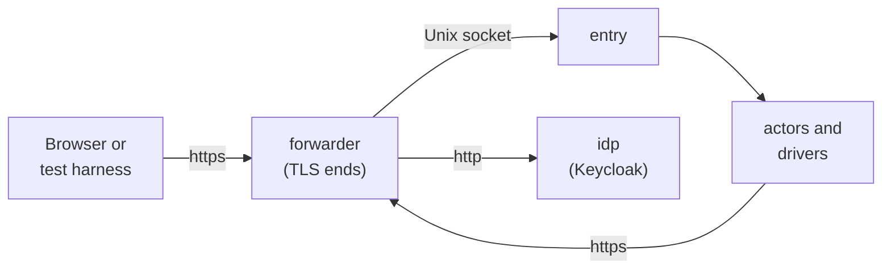

The [local installation](/runtimes/installations/#local) is Docker Compose on one workstation, with software keys, for development, continuous integration and the integration tests ([ADR 0018](/decisions/0018-runtimes-installations-and-delivery-order/#the-local-installation)). This page fixes what the Compose project holds, the host names it uses, how a browser comes to trust it, and what happens at the first start. Its install file is the [example file](/reference/install-file/#the-example-file-for-local). Everything outside sluis's own containers, the forwarder, the identity provider and the setup, belongs to the **harness**: files that ship beside the install file, and no code of the product (a development installation differs by configuration only, [Principles](/principles/#what-sluis-is-and-is-not)).

## Topology

| Service | Image | What it is |
|---|---|---|
| The actors and drivers | The release's images | One container per actor and per driver, generated from the permission manifest: the core actors, the audit actors `writer`, `indexer` and `reader`, the `oidc` upstream, and the drivers the install file names. `entry`'s container has no network |
| `forwarder` | Caddy, pinned by digest (v2.11.7, released 2026-10-03) | Ends TLS for every host of the project and forwards by `Host`: the sluis hosts to the socket of the `entry` that serves them, `idp.local.test` to `idp`, `app.local.test` to the harness's relying party. The only service that publishes a port, on the loopback address. Containers reach it by the host names too, as network aliases |
| `idp` | Keycloak 26.8.1 (released 2026-10-13), from a reviewed realm-import file | The upstream identity provider, on plain HTTP behind the forwarder. Users and groups are created per test through its admin API. Dex v2.46.1 (2026-10-21) can run in its place, for an upstream that sends no `acr`, `amr` or `auth_time` |
| `setup` | The harness image, with the `ritueel` release and `sluis` | A one-shot service that does the [first start](#the-first-start) and exits. Every service that needs the keys or the trust files waits for it to complete |

- **The forwarder is a generic reverse proxy, not a sluis component.** It is the local counterpart of Cloudflare's edge, of `cloudflared` and of the Gateway in front of the edge relay: public TLS ends at the edge, and the edge relay and `entry` stay key-less ([Deployment](/architecture/deployment/#where-entrys-listener-is-per-runtime)). Nothing depends on it being Caddy: it is TLS in, HTTP over a Unix socket out, routed by `Host`. Caddy was picked for its short configuration; nginx would do the same.
- **The forwarder's certificate is not sluis's.** In production the edge holds a certificate that sluis did not issue. Locally it holds one from the harness's `edge` intermediate, certified by the same ritueel root as sluis's own intermediates ([TLS](#tls)).
- **The Compose file is generated from the permission manifest,** like the systemd units, with the uids pinned ([ADR 0018](/decisions/0018-runtimes-installations-and-delivery-order/#consequences)). The harness services are written by hand beside it.

## Host names

| Host | Serves | Resolved to |
|---|---|---|
| `sluis.local.test` | The group issuer, the console and the front's API | `forwarder` |
| `sluis.dev.local.test` | The `dev` boundary's issuer | `forwarder` |
| `idp.local.test` | The upstream identity provider | `forwarder` |
| `app.local.test` | The example relying party the tests drive | `forwarder` |

The passkey relying-party ID is `local.test`, the registrable parent of every host, as in production ([ADR 0006](/decisions/0006-identity-issuers-audiences-and-sign-in/#passkeys)).

- **Why `.test`.** RFC 6761 reserves `.test` for testing: nobody can register a name under it, so the installation can never collide with a real one, and it lives outside the sluis host names as a test installation must ([ADR 0006](/decisions/0006-identity-issuers-audiences-and-sign-in/#issuers)). The RFC tells software not to treat `.test` as special and tells caching resolvers to answer it with an immediate negative ([RFC 6761, section 6.2](https://datatracker.ietf.org/doc/html/rfc6761#section-6.2), February 2013), so a name has to be mapped by the harness. That is a feature here: the mapping is the one place that says "this is a test".
- **Inside the project,** Compose gives `forwarder` the four names as network aliases, so the actors, Keycloak and the harness's clients reach each host by its name and cross the same TLS as a browser.
- **A test harness** points its browser at the published port with a name mapping, for Chromium `--host-resolver-rules="MAP *.local.test 127.0.0.1:<port>"`, so the URLs carry no port and the issuer stays `https://sluis.local.test`. A developer's own browser uses four lines of the hosts file for `127.0.0.1` and the project published on port 443.

### A virtual authenticator accepts `local.test`

The WebAuthn specification lets a page claim an RP ID that is "a registrable domain suffix of or is equal to the caller's origin's effective domain" ([Web Authentication Level 3](https://www.w3.org/TR/webauthn-3/), W3C Recommendation of 25 August 2026, read 2026-11-01). Chromium decides "registrable" with its list of registries and counts an unknown top-level domain as one: `OriginIsAllowedToClaimRelyingPartyId` calls `HostHasRegistryControlledDomain` with `INCLUDE_UNKNOWN_REGISTRIES`, and refuses a claimed ID no longer than the caller's registry ([`webauthn_security_utils.cc`](https://github.com/chromium/chromium/blob/main/components/webauthn/core/browser/webauthn_security_utils.cc), last changed 2026-10-12, read 2026-11-01). So `test` is a registry and `local.test` is registrable.

That was measured, not only read, on 2026-11-01: Chrome 156.0.8078.79, headless, with the virtual authenticator of the [DevTools protocol](https://chromedevtools.github.io/devtools-protocol/tot/WebAuthn/) (CTAP2, internal, resident keys, user verification on), against a TLS server whose chain ends in a root that was trusted in a throwaway profile. Each row is one registration followed by one assertion.

| Origin | RP ID | Result |
|---|---|---|
| `https://sluis.local.test` | `local.test` | works |
| `https://sluis.dev.local.test` | `local.test` | works: the credential is the same for both hosts |
| `https://sluis.local.test` | `sluis.local.test` | works |
| `https://sluis.dev.local.test` | `sluis.local.test` | refused: not a registrable suffix of the origin |
| `https://sluis.local.test` | `test` | refused: the registry itself |
| `https://sluis.local.test` | `other.test` | refused |
| `https://sluis.local.test` | `dev.local.test` | refused: not a suffix of the origin's host |
| any of the above, root not trusted | | not a secure context: the certificate error stops the API before the RP ID is looked at |

The last row is why TLS matters here: WebAuthn is exposed only in secure contexts, "established without errors" (the same specification), so a browser that does not trust the chain cannot test a passkey at all. `--ignore-certificate-errors` is not a substitute; a real chain tests the real path, including the intermediate's name constraints.

## TLS

The chain a browser sees is `root` (ritueel's software test root), `edge` (an intermediate, name-constrained to `local.test` once ritueel checks DNS names; see the note before the limits) and a leaf for the four hosts.

1. **The root** is the software root that `ritueel init --test-root` makes in the setup. It is marked `TEST ONLY` in its name and in every product, and ritueel refuses to mix it with a real root ([Commands](https://ritueel.id/reference/cli/#the-first-versions-commands)). Its key is a file in a volume of the project, with no passphrase.
2. **`edge`** is the harness's own intermediate. The setup makes a P-384 key, a request and a proof for the hand-off with `openssl`, and ritueel certifies it as the entry `edge` of its `ritueel.yaml`, the way it certifies `sluis-dev`, the intermediate of `sluis key request`. A software key is accepted by the hand-off contract when the policy says it is the development setting ([the contract](https://ritueel.id/reference/hand-off-contract/#software)).
3. **The leaf** is made by the setup with the `edge` key: `serverAuth`, DNS names for the four hosts, valid for seven days, made again at the next `up` when less than a day is left. The forwarder serves the leaf and `edge`.
4. **Trust is per run.** The root's certificate, from `ritueel bundle build`, goes to:
   - the project's containers, as the system bundle of their images, read-only;
   - the test harness's browser, in a throwaway profile. Chromium on Linux reads an NSS database in `$HOME/.pki/nssdb`, so the harness gives the browser a home of its own with the root imported (the measurement above did this) and deletes it with the run;
   - a developer's own browser, in a separate profile made for the project. The system trust store of the machine is not touched.
5. **`down -v` deletes the root's key,** and the next `up` makes a new root. A browser profile that trusted the old one trusts nothing that exists any more.

### Roads not taken for TLS

- **mkcert.** It installs a root into the system, Firefox and Java trust stores of the developer's machine and keeps its key beside it; its own README says that file "gives complete power to intercept secure requests from your machine" ([mkcert](https://github.com/FiloSottile/mkcert), last release v1.4.4 of 2022-04-26). It would also be a second root beside ritueel's, so the local run would not test the chain that the other installations use (sluis makes no root, [ADR 0013](/decisions/0013-the-hand-off-to-root-custody-and-the-signing-api/#sluis-holds-no-root)), and its certificates carry no name constraint. A test root that is trusted for a run, by a profile that is thrown away, does what mkcert does with none of that reach.
- **A certificate from sluis's `ca` for the forwarder.** Public TLS ends at the edge, and the certificate there is never the internal CA's in production; `ca`'s name constraints and leaf profiles are for the actors and hosts of the boundary ([ADR 0021](/decisions/0021-leaf-certificate-profiles-lifetimes-and-revocation/#leaf-profiles)). The forwarder is the edge.
- **Certificate errors switched off in the browser.** They would also switch off the secure context the passkey tests need to be honest about, and the name constraints.
- **Plain HTTP on `localhost`.** A browser treats `localhost` as a secure context, but an issuer must be an `https` URL and the relying-party ID would be `localhost` ([below](#roads-not-taken-for-names)).
- **A tunnel to a public name.** It needs an account and a network, and it would put the installation on a name that is not a test name.

### Roads not taken for names

- **`*.localhost`.** Browsers resolve it to the loopback address with no mapping, which is attractive. Measured on 2026-11-01 as above: `https://sluis.localhost` cannot claim the RP ID `localhost`, because a name with no registrable parent cannot be shared, so the two hosts of ADR 0006 would need two RP IDs, two passkeys and a different design from production. Only `https://sluis.dev.localhost` with RP ID `dev.localhost` worked, and then the front host could not share it.
- **`*.internal`.** ICANN reserved it for private use in 2024, and [ADR 0021](/decisions/0021-leaf-certificate-profiles-lifetimes-and-revocation/#the-intermediates-name-constraints) uses it for the private zones of real environments. A test installation must not look like one, and a developer's network may serve a real `.internal` zone.
- **`*.example` or a subdomain of a name sluis owns.** `.example` is reserved for documentation and `example.com` is not ours to resolve; a name under a real domain breaks "a test installation lives outside the sluis host names".

## The first start

`docker compose up` starts the project. The `setup` service runs these steps in order, and each step is skipped when its output already exists, so a second `up` changes nothing:

1. **Make the root.** `ritueel init --store software --roots 1 --test-root --key-dir /ritueel/keys`, with the `ritueel.yaml` of the example directory, which declares two intermediates: `sluis-dev` and `edge`. This writes the root, the first trust products (`root-list.json` and `root-list.jws`, `ca-bundle.pem`) and the key file.
2. **Publish the trust files.** The root list and the bundle are copied to the volume that the install file's `trust.root_list` and `trust.ca_bundle` name, and the bundle is also the trust bundle the containers read.
3. **Ask for sluis's keys.** `sluis key request --out /requests` makes the keys of the install file that do not exist, in the `software` store, and writes `dev-x509-intermediate.csr.pem` and its proof ([Commands](/reference/cli/#the-key-commands)).
4. **Have the intermediate certified.** `ritueel intermediate add sluis-dev --request dev-x509-intermediate --key-dir /ritueel/keys`, in the two runs of a script's ceremony: `--plan-only`, then the plan with `--confirm` and its digest ([ritueel commands](https://ritueel.id/reference/cli/#a-scripts-ceremony)). A test root asks no passphrase.
5. **Install the answer.** `sluis key install /ritueel/dir/answers` checks the certificate against the root list and installs it. The token certificate is then issued on the node by the new intermediate, and `signer` writes the discovery document and the key set as blobs under `/var/lib/sluis/blob/signer@dev/issuer/` ([Storage](/reference/storage/#fs)).
6. **Make the edge.** The `edge` key, request and proof, certified in the same two runs, and then the leaf for the four hosts. The forwarder starts when `leaf.pem` exists.
7. **Check.** `sluis doctor` and `sluis key status` run and must exit 0, and the setup fetches `https://sluis.dev.local.test/.well-known/openid-configuration` and the key set through the forwarder, which proves the chain, the names and the static documents at once. It then exits 0.

The services that need the keys start when `setup` completes (`service_completed_successfully`). A failure of any step stops the project at that step with the command's own exit code and message; nothing starts on a half-made root.

**What persists.** The volumes hold the ritueel directory, the key file, the trust files, the software keys and the state of the drivers. `docker compose down` keeps them, and the next `up` starts with the same issuers and keys. `down -v` removes them all, and the next `up` is a first start with a new root.

## Sign-in

Tests sign in through the upstream identity provider, never through accounts in sluis ([ADR 0018](/decisions/0018-runtimes-installations-and-delivery-order/#the-local-installation)).

- **Every pull request: Keycloak,** in the project, from the reviewed realm-import file. A test creates its users and groups through the admin API, and the harness drives the sign-in over HTTP with a client that follows the redirects, with no browser. Keycloak sends no `amr`, so `amr` is checked by the nightly run only.
- **Passkeys: a browser.** The test that registers and uses a passkey runs in a Chromium that has a virtual authenticator and the root trusted as above, for the front host and a boundary host, with the RP ID `local.test`. A software authenticator library drives the same ceremony without a browser ([ADR 0006](/decisions/0006-identity-issuers-audiences-and-sign-in/#passkeys)).
- **Optionally: Dex,** as an upstream that sends no `acr`, `amr` or `auth_time`, to prove that a missing value is treated as unknown ([Policy](/reference/policy/#context)).
- **Nightly and before a release:** the two free cloud tenants, outside this project, on the private runner group ([#891](https://github.com/truvity/sluis/issues/891)).

:::caution[Waiting on ritueel]
**DNS names in ritueel's policy.** ritueel's `ritueel.yaml` limits the name constraints of an X.509 intermediate request to `permitted_uri_hosts`, URI hosts. The `edge` intermediate is constrained to a DNS subtree, `local.test`, and so is the DNS part of the constraints of `sluis-dev` ([ADR 0021](/decisions/0021-leaf-certificate-profiles-lifetimes-and-revocation/#the-intermediates-name-constraints)). Until ritueel's policy lists DNS subtrees and checks them, the constraint of the `edge` entry waits: ritueel cannot check it, so nothing it certifies for `edge` is constrained by its policy, and the constraint described on this page takes effect when ritueel has the change. The wait is on a change in ritueel, tracked in [truvity/ritueel#70](https://github.com/truvity/ritueel/issues/70).
:::

## Limits

The limits of the installation are on [Installations](/runtimes/installations/#local): a software key can be read by anyone who can read its volume, one node proves behaviour and not availability, and the platform controls of the other installations are not exercised. The test root is the extra limit of this page: its key is a file with no passphrase, so the trust a browser gives it lasts as long as the run and no longer.
