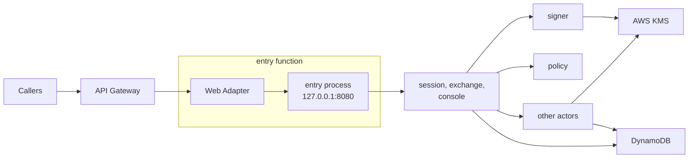
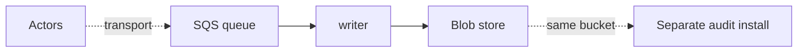

Serverless is the runtime where the platform runs a function per event: no long-running process, no persistent local disk, and no inbound connection between processes except a trigger or a gateway. Same-host Unix sockets work within one function, through extensions. The nodes are elastic and have no identity. Serverless always comes with a provider, so the provider is part of the runtime: AWS Lambda today. The tested installation is [lambda](/runtimes/installations/#lambda), the third to be delivered after local and boards. To keep the words apart, Lambda's own term is always written "Lambda runtime" on this page; "runtime" alone means serverless, bare-metal or kubernetes.

sluis runs as one Lambda function per [actor](/concepts/actors/). v1 already runs as many Lambda functions, and the serverless runtime keeps that lineage while moving to the v2 actor split.

## Topology

The runtime is drawn in two steps: the request path, then the audit path.

### Step 1: the request path

The callers are browsers, CLIs and relying parties. The web adapter is the Lambda Web Adapter; it connects to the `entry` process on `127.0.0.1:8080` inside the sandbox. Each arrow from `entry` to an actor is a Lambda invoke. In the picture, `entry` routes to `session`, `exchange` and `console`, which call `signer`, `policy`, `ca`, `ssh-ca` and `quota` in turn. The audit writer is not invoked: records reach it through the queue (step 2).

### Step 2: the audit path

The other actors put their audit records into the queue, the SQS transport driver. The separate audit installation, when this installation has no index of its own, runs the indexer and the reader with their index, and reads the same bucket.

## What runs where

- **One function per actor, one zip per executable** (agreed, PKG-1). Each actor instance, `<actor>@<boundary>`, is its own Lambda function and IAM role, `sluis-<actor>-<boundary>`. Only `entry` takes requests from outside; every other function is invoke-only, and its resource policy names the caller's alias.
- **Zip only.** The packaging for serverless is a zip per executable. A function is a zip archive, so layers and extensions combine. A container image is not used on Lambda. The handler is the same binary as in the `.deb`, renamed `bootstrap`; only `entry` uses the Lambda Web Adapter. Zips are built for `arm64`, the default, and `x86_64`, and are named `sluis-<kind>-<name>_<version>_<arch>.zip`; they are published into the installation's own account, and there are no public layer ARNs. See [Packages](/distribution/packages/#lambda-zips). There are no build profiles, and `dev` is not a build.
- **Drivers are one Lambda extension.** A driver is a platform-started service that speaks ConnectRPC over a Unix socket. On Lambda the platform that starts it is the extension mechanism, and the actor calls it over the socket inside the sandbox. **One Rust `aws` executable** implements every AWS port for the function, as one extension (PKG-2).
- **Lambda Web Adapter.** `entry` speaks HTTP, so the Lambda Web Adapter, pinned at v1.1.0, translates Lambda events into HTTP requests. The adapter is vendored into sluis's own layer, so the function does not reference the public AWS layer.
- **Limits.** A function has at most five layers and 250 MB unzipped, counting the function code, layers and extensions together. sluis uses **at most three layers of its own** (edge, drivers, configuration), so two are left to the operator; there is no OpenTelemetry layer.
- **Configuration.** Declared configuration arrives in a Lambda layer or through the AWS AppConfig API (not the AppConfig agent layer), as whole versioned snapshots. A function may live-reload a new snapshot: it is validated, swapped atomically and audited, and a snapshot that fails validation leaves the version in force ([ADR 0016](/decisions/0016-data-has-an-origin-and-a-sensitivity/)).
- **Single instance.** An actor that declares exactly one instance (the audit writer) is fenced by create-if-absent on the blob, so a second instance cannot fork the log.

The writer runs with a **reserved concurrency of 1 on a standard SQS queue** (decided 2026-10-30). An event source mapping starts at a concurrency of 2, so the limit throttles it and messages return to the queue. Correctness comes from the create-if-absent fence, not from the limit, and the throttling is measured at the Lambda step ([ADR 0029](/decisions/0029-one-repository-one-version-one-release-train-and-packaging-follows-the-runtime/)).

## Keys

- **KMS:** one symmetric key with encryption contexts for sealing, and one `ECC_NIST_P384` signing key per authority purpose. Each key policy names the one function role allowed to use it.
- A function's execution role is its identity to KMS. Only the `signer` function can use the token-signing key, only `ca` the X.509 CA key, only `ssh-ca` the SSH CA keys, and only the writer the log key. There is **no `key-holder` on serverless**: the key policy is the access list.
- Tokens are signed directly with the non-extractable key. There is no software key on Lambda.

## State and audit

- **State:** DynamoDB, with conditional writes and one writer per record kind, enforced by an IAM `dynamodb:LeadingKeys` condition per actor role. Each boundary has its own table; at L4 it is in the boundary's own account. Every value is encrypted in the port library before it reaches the table ([Data](/concepts/data/#every-value-is-encrypted)).
- **Audit transport:** an SQS queue, because a function's local disk does not outlive its sandbox. The writer consumes the queue, seals batches and writes them to the blob store (S3, create-if-absent), and signs checkpoints with the log key in KMS. The key policy lets only the writer's role use that key; there is no notary actor ([OD-39](/open-decisions/#od-39)). The queue policy names each sender role, and each boundary has its own queue. SQS is the default on serverless, and the other transports are supported without being a default ([OD-34](/open-decisions/#od-34)). The `direct` mode falls back to a local spool when the writer is down ([OD-35](/open-decisions/#od-35)), so it needs a disk and is not available on serverless.
- **Witness:** optional ([OD-36](/open-decisions/#od-36)), none by default on serverless. `sluis config check` warns when there is none. With no witness and no notary, a compromised writer can get a rewritten checkpoint signed. A compliance lock on the S3 bucket still prevents overwriting objects, but not a split view.
- **Index:** serverless may run the indexer and the reader with a `postgres` index ([OD-12](/open-decisions/#od-12), revised). On AWS the provisioning mode is `rds` or `aurora`, and the functions reach the database through RDS Proxy (proposed), so that short-lived functions do not exhaust its connections. The `external` mode takes a connection string only. The lambda installation's default index stays `none` (proposed); with no index, the reader and its index run in a separate audit installation on another runtime that reads the same bucket: Kubernetes with Postgres (`cnpg`, or `external` with a connection string), or a server with `sqlite`. A small install can run `sluis audit search` from the CLI, which builds a local `sqlite` index from the chain. The index is a rebuildable cache; the chain in the bucket is the record. Where Search runs is derived from the port and driver rules ([OD-32](/open-decisions/#od-32)). See [The postgres index driver](/concepts/drivers/#the-postgres-index-driver).

## Identity and edge

- The function's IAM role is its identity. The platform injects the credentials only into that function's sandbox. A function calls another by `lambda:Invoke`, and the callee reads the invoked alias, which tells it the caller class, and a verified token, which tells it the caller actor.
- **Listener.** `entry`'s public API listens on TCP, bound to `127.0.0.1` inside the sandbox (`8080` in the example), and the Lambda Web Adapter connects to it. The sandbox holds only sluis's own processes, and the port is never reachable from outside it. The other functions have no TCP listener; their drivers use Unix sockets. See [Listeners](/architecture/listeners/).
- **Edge.** API Gateway sits in front of the `entry` function.
- **The console.** The console's single-page application is served from the bucket behind the same API gateway, so the browser sees one origin for the page and the console API in `entry`.
- There is no node agent: the JWT for a cloud federation has to come from the `signer`.
- **Response streaming.** API Gateway REST APIs can stream Lambda responses since 2025-11-19, which changes the earlier premise that every call on Lambda is unary. It is to be tested again; the public API stays Connect only for now.

## Limits and residual risk

- Five layers and 250 MB unzipped bound what a function can carry. Rust or large SDKs push against it; link only the SDK packages an actor uses.
- Lambda has cold starts. The adapter and extensions add start-up work, and a larger zip starts slower.
- Outside a VPC, egress is unrestricted. In a VPC, egress rules work by IP, not by name, so a per-function allow-list by host name needs a proxy or firewall.
- Per-function granularity needs one zip and one IAM role per actor. It raises the number of artifacts and resources to keep in step; the generator derives them all from the manifest.
- The vendored adapter is part of the supply chain. It is pinned to a version, rebuilt into sluis's layer, and signed with the rest of the release.
- Search over the audit trail needs a `postgres` index, a separate audit install, or `sluis audit search` from the CLI. The lambda installation has no index of its own by default (proposed).
