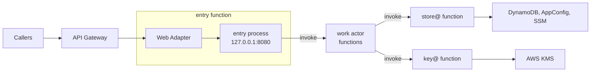

Serverless is the runtime where the platform runs a function per event: no long-running process, no persistent local disk, and no inbound connection between processes except a trigger or a gateway. The nodes are elastic and have no identity. Serverless always comes with a provider, so the provider is part of the runtime: AWS Lambda today. The tested installation is [lambda](/runtimes/#lambda). Lambda's own term is written "Lambda runtime" on this page; "runtime" alone means serverless, bare-metal or kubernetes.

**None of this is built.** There is no Lambda deploy code, no vendored adapter and no zip. In atoom the `dynamodb` and `aws-kms` drivers exist as libraries; `appconfig`, `ssm`, `s3`, `sqs` and the extension zips are planned ([0011](/decisions/0011-runtimes-and-installations/#the-lambda-shape)). The lambda installation is part of the core and runs with test clients only ([The core is done when](/roadmap/#the-core-is-done-when)).

## The shape

**Every function runs behind the Lambda Web Adapter,** vendored and pinned in sluis's build ([0011](/decisions/0011-runtimes-and-installations/#the-lambda-shape), [0003](/decisions/0003-units-transports-and-fusion/#units)). No function has a native handler: a function runs the same HTTP application as on a host or in a container, and the adapter turns the Lambda event into an HTTP request to it.

**A function is an app zip plus a config layer, plus one merged drivers layer only where a driver's language differs from the function's.**

| Part | What it holds |
|---|---|
| App zip | The package's executable, renamed `bootstrap`, one zip per executable, named `sluis-<kind>-<name>_<version>_<arch>.zip`. Built for `arm64` (the default) and `x86_64`. A container image is not used on Lambda, because layers do not apply to images. |
| Config layer | The bootstrap file and the signed config documents the function needs ([bootstrap file](/reference/bootstrap-file/), [signed config](/reference/signed-config/)). |
| Drivers layer, where needed | atoom's Lambda extension zips for the drivers whose language is not the function's, merged into one layer by the install tooling, so a function stays within Lambda's limit of five layers. |

A driver in the function's own language is linked in process and needs no layer. [0012](/decisions/0012-the-language-follows-the-executable/#the-rules) writes the AWS-backed drivers in Go, so the split is:

| Function | Language | Driver | How it is carried |
|---|---|---|---|
| key@ | Go | `aws-kms` | Linked into the function |
| store@ | Rust | `dynamodb`, and the planned `appconfig` and `ssm` | An extension in the drivers layer |
| store@ | Rust | `file` (config from the layer) | Linked into the function |

The drivers, the layers and the extension zips are [atoom's](https://github.com/truvity/atoom/blob/master/docs/decisions/0010-distribution-per-driver-and-lambda.md); the Lambda column of its [driver table](https://github.com/truvity/atoom/blob/master/docs/packages.md) says which driver has a Lambda form. sluis publishes no public layer ARNs: an installation verifies the zips and publishes the layers into its own account. What each layer carries is in [Runtime dependencies](/distribution/dependencies/). Packaging is [0013](/decisions/0013-release-train-packaging-and-distribution/#packaging-per-runtime).

Open: whether the adapter sits in its own layer or inside the app zip. [0003](/decisions/0003-units-transports-and-fusion/#listeners) says "layer", [0011](/decisions/0011-runtimes-and-installations/#the-lambda-shape) lists no adapter layer. The answer changes the layer budget by one.

## Topology

Each arrow after the gateway is a Lambda invoke: `entry` routes to the work actor that owns the step, and every work actor invokes store@ for its data and key@ for its keys. The adapter in each function hands the invoke to the function's application as an HTTP request. The audit pieces (writer, indexer, reader) are [audit's](https://github.com/truvity/audit/blob/master/docs/decisions/0016-distribution-and-the-lambda-shape.md): sluis's functions only send records to the audit transport.

## What runs where

- **One function per actor and per holder, one zip per executable.** Each instance, `actor@boundary`, is its own Lambda function and IAM role, `sluis-<actor>-<boundary>`. Only `entry` takes requests from outside; every other function is invoke-only.
- **A work function carries no driver and holds no credential.** Its role lets it invoke other functions and send to the audit transport, and nothing else. Only the holders' roles reach storage, keys and export destinations ([0002](/decisions/0002-families-of-actors/#credential-holders)).
- **Every function's process listens on `127.0.0.1` inside its sandbox,** and the adapter is the only client of that port. A driver extension uses a Unix socket. Nothing else is reachable from outside the sandbox ([0003](/decisions/0003-units-transports-and-fusion/#listeners)).
- **Configuration.** store@ loads signed config documents from the config layer (`file`) or through the AWS AppConfig API, verifies each signature before it parses the document, and swaps the snapshot atomically ([0005](/decisions/0005-the-store/#configuration-loading)). A layer never changes under a running function, so a config that must change without a deploy comes from AppConfig; the bootstrap file in the layer holds the only settings that need a restart, and a new layer is a new function version.
- **A job that must run once takes a lease,** a temp kind of atoom's `state` ([0005](/decisions/0005-the-store/)). A reserved concurrency of 1 is an optimisation, not the guarantee ([0003](/decisions/0003-units-transports-and-fusion/#units)).

## The call graph

The call graph of the actor registry is enforced in each function's code and again by Lambda ([0003](/decisions/0003-units-transports-and-fusion/#the-call-graph)):

- **An invoke resource policy per callee.** A function's resource policy grants `lambda:InvokeFunction` only to the roles of its allowed callers, so a function that is not on the graph cannot call it at all. The callee reads the caller's role and alias and applies the call graph, default deny.
- **Roles, functions, schedules and the invoke grants are generated from the registries** ([0002](/decisions/0002-families-of-actors/#registries-generate-the-enforcement)), so they cannot drift from the call graph.

**No function links store@ or its drivers into a work actor's process.** That would fuse a holder with a work actor and give the work actor's role a storage credential ([0003](/decisions/0003-units-transports-and-fusion/#fusion)). A read or write is an invoke of store@'s function. The Lambda latency spike measured the invokes and the opens of sign-in session cookies at key@ and found them fast enough, so no exception is needed ([#1179](https://github.com/truvity/sluis/issues/1179); the figures of the warm sign-in and the memory of the functions on its path are in [0037](/decisions/0037-capacity-is-measured-before-it-is-promised/#the-warm-sign-in-on-lambda)).

## Keys

- **AWS KMS only,** with the layout in [0006](/decisions/0006-keys-and-sealing/#keys-per-boundary-on-aws). The key policy of every KMS key names the role of the key@ function alone. Every other actor reaches a key through key@, whose rules say who may ask for which purpose.
- **key@ caches opened data keys in memory,** and on Lambda the cache's time to live is also the longest time a deleted tenant's data can still be opened ([0006](/decisions/0006-keys-and-sealing/#the-cache)).
- **There is no card and no software key on Lambda:** the key policy and the invoke policy are the access list.

## Data and audit

- **Engine:** DynamoDB, behind store@. Only store@'s role reaches the table; a work actor never does. Each engine has its own table. An engine serves a boundary at L3 or above, and a boundary below L3 is served under its address prefix by its parent's engine ([0005](/decisions/0005-the-store/#engines)); at L4 the table is in the boundary's own account. Every sealed value is ciphertext before it reaches the table, because store@ never seals or opens.
- **Audit:** the blob, the transport and the index of this installation are audit's drivers, chosen by [audit's distribution record](https://github.com/truvity/audit/blob/master/docs/decisions/0016-distribution-and-the-lambda-shape.md): S3, an SQS queue and a PostgreSQL index on Aurora Serverless v2. The `direct` transport needs a local disk for its spool, so it is not available on Lambda. The sluis side is the role of each function, which may send to the queue and nothing more. The writer, its fence, the witness and the index are audit's.
- **Exporter:** DynamoDB Streams on the store's table wake exporter@ when an exportable item changes, and a daily scheduled run rebuilds the documents and removes what is gone ([0009](/decisions/0009-export/#on-lambda)).

## Identity and edge

- **The function's IAM role is its identity.** The platform injects the credentials only into that function's sandbox. A function calls another by `lambda:InvokeFunction`. There is no node agent: the token for a cloud federation comes from the `signer`.
- **Edge.** API Gateway sits in front of the `entry` function, and the installation sits behind the Cloudflare edge ([0011](/decisions/0011-runtimes-and-installations/#the-cloudflare-edge)):
  - Cloudflare proxies to an API Gateway custom domain with mutual TLS, and Cloudflare's authenticated-pull CA is the truststore. The API's default `execute-api` endpoint is disabled, so the custom domain is the only way in.
  - The key set and the discovery document are cacheable, with a cache time below the key pre-publish time; `/token` and the recovery paths are rate limited. The edge is the first line: `entry` also bounds `/token`, `/authorize` and the recovery paths with its own limiter ([0036](/decisions/0036-volumetric-abuse/#inside-sluis)).
  - sluis's deploy code sets the default endpoint off, the truststore and the cache headers. The Cloudflare records, rules and rate limits are documented, and the installation's own infrastructure code applies them. sluis holds no Cloudflare credential in the core.
- **The console.** Its single-page application is served from the bucket behind the same API gateway, so the page and the console API in `entry` are same-origin ([0027](/decisions/0027-the-console/#the-browser)).
- **Response streaming.** API Gateway REST APIs can stream Lambda responses since 2025-11-19. The public API stays unary Connect on Lambda until streaming is tested.

## Limits and residual risk

- Five layers and 250 MB unzipped, code, layers and extensions together, bound what a function can carry; link only the SDK packages an actor uses.
- Lambda has cold starts, and a request that crosses several functions chains them. The adapter and the extensions add start-up work, and a larger zip starts slower. Provisioned concurrency on `entry`, `signer` and the holders is the lever ([0013](/decisions/0013-release-train-packaging-and-distribution/#consequences)).
- Outside a VPC, egress is unrestricted. In a VPC, egress rules work by IP, not by name, so a per-function allow-list by host name needs a proxy or a firewall.
- One zip and one IAM role per actor and per holder raise the number of artifacts and resources to keep in step; the generator derives them all from the registries.
- The vendored adapter is part of the supply chain. It is pinned to a version and built into the release.
- Open: the adapter's pass-through of an invoke between two functions and of an SQS event is to be tested on real Lambda ([0011](/decisions/0011-runtimes-and-installations/#follow-ups)).
