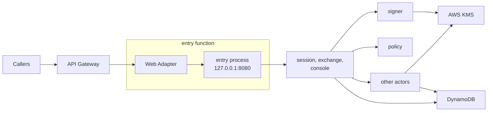
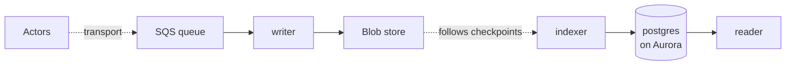

Serverless is the runtime where the platform runs a function per event: no long-running process, no persistent local disk, and no inbound connection between processes except a trigger or a gateway. Same-host Unix sockets work within one function, through extensions. The nodes are elastic and have no identity. Serverless always comes with a provider, so the provider is part of the runtime: AWS Lambda today. The tested installation is [lambda](/runtimes/installations/#lambda), and which drivers fit serverless is on [Installations](/runtimes/installations/#which-drivers-fit-which-runtime). Lambda's own term is written "Lambda runtime" on this page; "runtime" alone means serverless, bare-metal or kubernetes.

sluis runs as one Lambda function per [actor](/concepts/actors/).

## Topology

### Step 1: the request path

The Lambda Web Adapter connects to the `entry` process on `127.0.0.1:8080` inside the sandbox. Each arrow from `entry` to an actor is a Lambda invoke: `entry` routes to `session`, `exchange` and `console`, which call `signer`, `policy`, `ca`, `ssh-ca` and `quota`. The audit writer is never invoked; records reach it through the queue.

### Step 2: the audit path

The indexer follows the log's checkpoints in the bucket and writes the `postgres` index on Aurora, and the reader serves queries from it behind the audit front's own `entry` ([ADR 0015](/decisions/0015-audit-pieces-transport-search-and-front/)).

## What runs where

- **One function per actor, one zip per executable** ([ADR 0019](/decisions/0019-release-train-packaging-and-distribution/#packaging-per-runtime)). Each actor instance, `<actor>@<boundary>`, is its own Lambda function and IAM role, `sluis-<actor>-<boundary>`. Only `entry` takes requests from outside; every other function is invoke-only, and its resource policy names the caller's alias.
- **Zip only.** A function is a zip archive, so layers and extensions combine; a container image is not used on Lambda. The handler is the same binary as in the `.deb`, renamed `bootstrap`; only `entry` uses the Lambda Web Adapter. Zips are built for `arm64`, the default, and `x86_64`, and are named `sluis-<kind>-<name>_<version>_<arch>.zip`; they are published into the installation's own account, and there are no public layer ARNs. See [Packages](/distribution/packages/).
- **Drivers are one Lambda extension.** A driver is a platform-started service on a Unix socket; on Lambda the extension mechanism starts it, inside the sandbox. **One Rust `aws` executable** implements every AWS port the function needs.
- **Lambda Web Adapter.** `entry` speaks HTTP, so the Lambda Web Adapter, pinned at v1.1.0 and vendored into sluis's own layer, translates Lambda events into HTTP requests.
- **At most three sluis layers** (edge, drivers, configuration), so two of Lambda's five are left to the operator; there is no OpenTelemetry layer.
- **Configuration.** Declared configuration arrives in a Lambda layer or through the AWS AppConfig API (not the AppConfig agent layer), as whole versioned snapshots. A function may live-reload a new snapshot: it is validated, swapped atomically and audited, and a snapshot that fails validation leaves the version in force ([ADR 0010](/decisions/0010-configuration-and-data-pkl-schema-origins-and-sensitivities/)).
- **Single instance.** An actor that declares exactly one instance, such as the audit writer, is fenced by create-if-absent on the blob, so a second instance cannot fork the log.

The writer runs with a **reserved concurrency of 1 on a standard SQS queue**. An event source mapping starts at a concurrency of 2, so the limit throttles it and messages return to the queue. Correctness comes from the create-if-absent fence, not from the limit, and the cost of the throttling is measured on the lambda installation ([ADR 0018](/decisions/0018-runtimes-installations-and-delivery-order/#installations)).

## Keys

- **KMS,** with the layout on [Keys](/concepts/keys/#aws-kms-layout). A function's execution role is its identity to KMS, and each key policy names the one role allowed to use it: only `signer` uses the token-signing key, only `ca` the X.509 CA key, only `ssh-ca` the SSH CA keys, only the writer the log key.
- There is **no `key-holder` on serverless**: the key policy is the access list. There is no software key on Lambda.

## State and audit

- **State:** DynamoDB, with conditional writes and one writer per record kind, enforced by an IAM `dynamodb:LeadingKeys` condition per actor role. Each boundary has its own table; at L4 it is in the boundary's own account. Every value is encrypted in the port library before it reaches the table ([Data](/concepts/data/#every-value-is-encrypted)).
- **Audit transport:** an SQS queue, because a function's local disk does not outlive its sandbox. The writer consumes the queue, seals batches and writes them to the blob store (S3, create-if-absent), and signs checkpoints with the log key in KMS, whose key policy lets only the writer's role use it. The queue policy names each sender role, and each boundary has its own queue. The `direct` mode falls back to a local spool when the writer is down, so it needs a disk and is not available on serverless.
- **Witness:** none by default. `sluis config check` warns when there is none, and an `external` witness is the way to add one. A compliance lock on the S3 bucket prevents overwriting objects, but not a split view.
- **Index:** the default index of the lambda installation is `postgres` in the `aurora` mode ([ADR 0015](/decisions/0015-audit-pieces-transport-search-and-front/#provisioning-modes)). The indexer and the reader reach it through RDS Proxy with IAM authentication, so short-lived functions do not exhaust its connections, and they run in the VPC. The `rds` and `external` modes are the other choices, and an installation may choose `none` and leave search to a separate audit installation that reads the same bucket. The index is a rebuildable cache; the chain in the bucket is the record ([The postgres index driver](/concepts/drivers/#the-postgres-index-driver)).

## Identity and edge

- The function's IAM role is its identity. The platform injects the credentials only into that function's sandbox. A function calls another by `lambda:Invoke`, and the callee reads the invoked alias, which tells it the caller class, and a verified token, which tells it the caller actor.
- **Listener.** `entry`'s public API listens on TCP, bound to `127.0.0.1` inside the sandbox (`8080` in the example), and the Lambda Web Adapter connects to it. The sandbox holds only sluis's own processes, and the port is never reachable from outside it. The other functions have no TCP listener; their drivers use Unix sockets ([ADR 0004](/decisions/0004-drivers-listeners-and-boundary-enforcement/#listeners)).
- **Edge.** API Gateway sits in front of the `entry` function.
- **The console.** The console's single-page application is served from the bucket behind the same API gateway, so the browser sees one origin for the page and the console API in `entry`.
- There is no node agent: the JWT for a cloud federation has to come from the `signer`.
- **Response streaming.** API Gateway REST APIs can stream Lambda responses since 2025-11-19. The public API stays unary Connect on Lambda until streaming is tested.

## Limits and residual risk

- Five layers and 250 MB unzipped, code, layers and extensions together, bound what a function can carry; link only the SDK packages an actor uses.
- Lambda has cold starts. The adapter and extensions add start-up work, and a larger zip starts slower.
- Outside a VPC, egress is unrestricted. In a VPC, egress rules work by IP, not by name, so a per-function allow-list by host name needs a proxy or firewall.
- One zip and one IAM role per actor raise the number of artifacts and resources to keep in step; the generator derives them all from the manifest.
- The vendored adapter is part of the supply chain. It is pinned to a version and rebuilt into sluis's layer with the rest of the release.
- Search over the audit trail puts an Aurora database, an RDS Proxy and a VPC path under the reader: every lambda installation pays for them by default ([ADR 0015](/decisions/0015-audit-pieces-transport-search-and-front/)).
