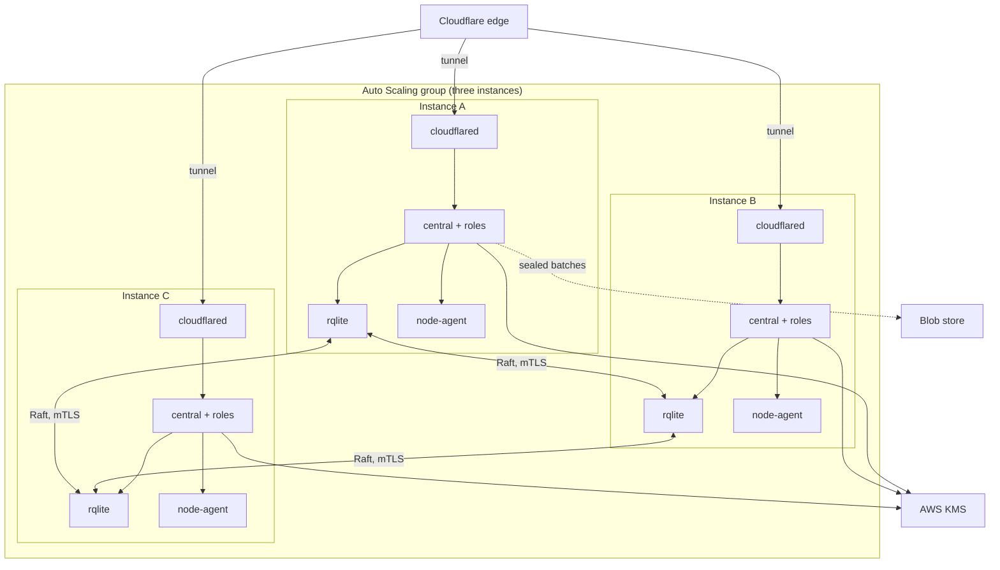

T4 is an Auto Scaling group of three `t4g.nano` instances on Amazon Linux 2023. Keys are AWS KMS keys and state is replicated by rqlite (Raft). **T4 is the first build target**: the other shapes are built after it, and its design is the reference for the units, the manifest and the tests.

## Topology

## What runs where

- Every instance runs the roles of [T3](/shapes/aws-ec2-single/): each role its own OS user and systemd unit, the drivers as platform-started services, and a `node-agent` holding the instance role.
- The state driver is rqlite, the `state-owner` mediator. It enforces one writer per record kind and audits every use.
- Instances boot from the Amazon Linux 2023 image and install the signed packages from the dnf repository. The node-agent verifies what it installs. No machine image is baked.
- The ASG replaces a lost instance, and the replacement joins the Raft cluster.

:::note[Proposed]
How a replacement instance is added to the Raft membership, and how a lost one is removed, is not yet decided.
:::

## Keys

- The key set is the same as T3: one symmetric KMS key with encryption contexts for sealing, and one `ECC_NIST_P384` key per authority purpose (token signing, CA, notary, grant). Each key policy names one role, and the instance role is denied.
- All three instances use the same KMS keys. KMS, not a local device, is the root of trust, so a replaced instance needs no key ceremony.
- Tokens are signed directly by the non-extractable KMS key, the default on KMS shapes.
- Randomness: Amazon Linux 2023 runs a kernel newer than 5.18, so the VM-clone reseeding check of `sluis doctor` passes.

## State and audit

- **State:** rqlite across three instances. Raft peer traffic uses the state driver's own TCP port over mTLS, and the security group allows it only between the peers.
- **Index:** `sqlite` on each instance.
- **Audit:** each instance's `audit-writer` drains its own local spool. The `notary` signs batch heads with its KMS key, called through the notary role's IAM role. A dedicated notary is optional.
- The reconciler compares the bucket listing with `audit_batches`, and verification does not trust the index or the state.

:::caution[Open decision OD-5: Audit outbox per shape]
Options: spool, queue, blocking. The lean is a local spool for self-hosted and EC2 shapes.
:::

:::caution[Open decision OD-4: Inter-node ports]
Options: only the Raft driver port over mTLS; or that plus a role port. The lean is the Raft driver port only.
:::

## Identity and edge

- Role identity on an instance is the uid by peer credentials. Calls to AWS use a per-role IAM role, and CloudTrail names the role, the instance and the session.
- Each instance publishes its workload-identity discovery document and JWKS under `nodes/<node>/` in the distribution bucket. An AWS role trusts only the issuers of the instances that run it, so a compromised instance can assume only its own roles.
- Every instance runs `cloudflared` with the ingress `unix:/run/sluis/central/api.sock`. The tunnel gives the edge three connectors, so it survives the loss of an instance.

## Limits and residual risk

- Raft tolerates one lost instance. Two lost instances in one window stop writes. Spread the group over availability zones so that one zone outage costs one instance.
- The instance role is the host's root of trust for AWS. If a role can reach IMDS, it can assume other roles. The node-agent closes IMDS to every uid but its own, and the per-role IAM trust policies carry labels. Both are controls against mislabelling and lateral movement, and host root defeats them.
- A `t4g.nano` has little memory. Eight roles, the drivers and rqlite have to fit in it. The memory measurement on this instance type also decides whether Rust is used for the cloud drivers (OD-14).
- Spool records not yet sealed are lost with an instance that dies before it drains.
- KMS is a regional service. A regional outage stops signing; there is no software fallback key, because the code refuses one on a production shape.
