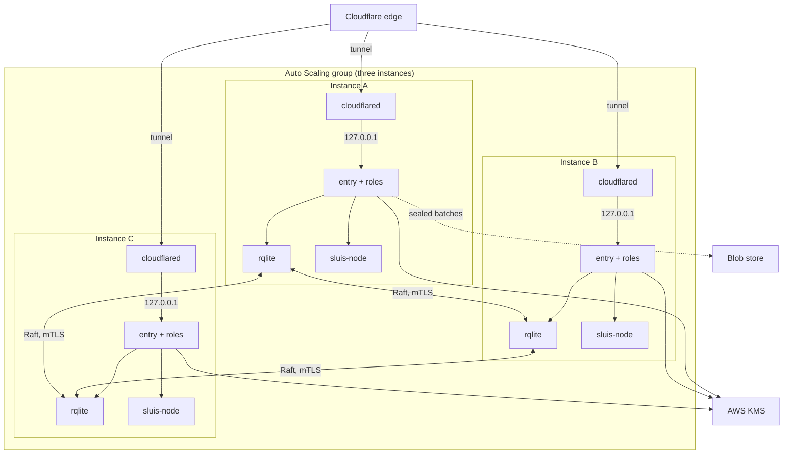

T4 is an Auto Scaling group of three `t4g.nano` instances on Amazon Linux 2023. Keys are AWS KMS keys and state is replicated by rqlite (Raft). **T4 is the first build target**: the other shapes are built after it, and its design is the reference for the units, the manifest and the tests.

## Topology

## What runs where

- Every instance runs the roles of [T3](/shapes/aws-ec2-single/): each role its own OS user and systemd unit, the drivers as platform-started services, and the node agent (`sluis-node`) holding the instance role.
- The state driver is rqlite, the `state-owner` shared driver. It enforces one writer per record kind and audits every use.
- Instances boot from the Amazon Linux 2023 image and install the signed packages from the dnf repository. The node agent verifies what it installs. No machine image is baked.
- The ASG replaces a lost instance, and the replacement joins the Raft cluster (see below).

:::note[Proposed]
The node agent (`sluis-node`) holding the instance role, brokering per-role credentials and verifying what it installs is the proposed design. It is not yet decided.
:::

### Raft membership

- **Join.** A new instance joins through rqlite discovery.
- **Reaping.** A member that stays unreachable is removed after a timeout of minutes (rqlite reaping).
- **Leave.** An ASG lifecycle hook makes an instance leave the cluster cleanly when the group scales it in.
- **Enrolment.** A replacement instance enrols its identity through the node agent (`sluis-node`).

## Keys

- The key set is the same as T3: one symmetric KMS key with encryption contexts for sealing, and one `ECC_NIST_P384` key per authority purpose (token signing, CA, grant). Each key policy names one role, and the instance role is denied. The notary is the exception: each node has its own `ECC_NIST_P384` signing key, and batch heads are co-signed 2 of 3. The node's key also signs that node's workload JWTs. A shared key cannot support co-signing, because KMS `Sign` takes no encryption context and IAM cannot restrict which message gets signed.
- All three instances use the same KMS keys for tokens, the CA and grants. KMS, not a local device, is the root of trust, so a replaced instance needs no key ceremony. A replacement gets its own notary key.
- Tokens are signed directly by the non-extractable KMS key, the default on KMS shapes.
- Randomness: Amazon Linux 2023 runs a kernel newer than 5.18, so the VM-clone reseeding check of `sluis doctor` passes.

## State and audit

- **State:** rqlite across three instances. Raft peer traffic uses the state driver's own TCP port over mTLS, and the security group allows it only between the peers. It is the only TCP port between the instances.
- **Index:** `sqlite` on each instance.
- **Audit:** the audit outbox is a local spool on each instance, and each instance's `audit-writer` drains its own spool. The `notary` co-signs batch heads across the nodes, 2 of 3, with each node using its KMS key through the notary role's IAM role. There is no separate notary key.
- The reconciler compares the bucket listing with `audit_batches`, and verification does not trust the index or the state.

## Identity and edge

- Role identity on an instance is the uid by peer credentials. Calls to AWS use a per-role IAM role, and CloudTrail names the role, the instance and the session.
- Each instance publishes its workload-identity discovery document and JWKS under `nodes/<node>/` in the distribution bucket. An AWS role trusts only the issuers of the instances that run it, so a compromised instance can assume only its own roles.
- Every instance runs `cloudflared` with the ingress service `http://127.0.0.1:8080`, `entry`'s loopback port (an example port). The tunnel gives the edge three connectors, so it survives the loss of an instance.

:::note[Proposed]
`cloudflared` as the edge connector on the EC2 shapes is a proposal, not a decision. The listener rule itself (only `entry`'s public API is reachable from outside, on `127.0.0.1`) is agreed; the choice of connector is not final.
:::

## Limits and residual risk

- Raft tolerates one lost instance. Two lost instances in one window stop writes. Spread the group over availability zones so that one zone outage costs one instance.
:::note[Proposed]
The node agent closes IMDS to every uid but its own, and the per-role IAM trust policies carry labels. Both are proposed controls against mislabelling and lateral movement, and host root defeats them.
:::

- The instance role is the host's root of trust for AWS. If a role can reach IMDS, it can assume other roles.
- A `t4g.nano` has little memory. Eight roles, the drivers and rqlite have to fit in it. The memory measurement on this instance type also bounds the Rust cloud drivers, which have to fit with the rest.
- Spool records not yet sealed are lost with an instance that dies before it drains.
- KMS is a regional service. A regional outage stops signing; there is no software fallback key, because the code refuses one on a production shape.
