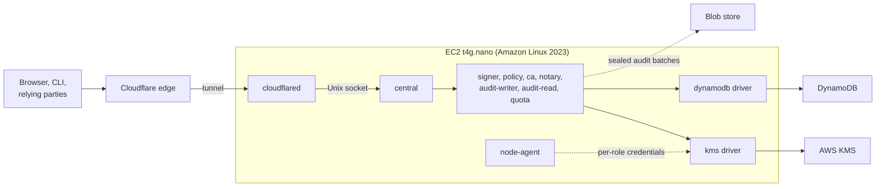

T3 is one `t4g.nano` instance on Amazon Linux 2023. Keys are AWS KMS keys, state is DynamoDB, and the instance runs every process role. It is the smallest AWS shape and has the same units as [T4](/shapes/aws-ec2-cluster/).

## Topology

## What runs where

- Each process role is its own OS user and systemd unit, with the manifest generating the units. The packages install from the dnf repository; see [Packages](/distribution/packages/).
- The `node-agent` is the only process that holds the instance role. Each role gets short-lived credentials for its own IAM role.
- The systemd floor is 252, which Amazon Linux 2023 provides, so the units use `LoadCredentialEncrypted=` where they need it.
- Egress is closed by default for roles that need no network (`policy` and `signer`).

:::note[Proposed]
The `node-agent` brokers per-role AWS credentials over a Unix socket and closes IMDS to every uid but its own, so that a compromised role cannot assume another role. The research behind it is on [Deployment](/architecture/deployment/).
:::

## Keys

- **KMS:** one symmetric key (`ENCRYPT_DECRYPT`) with encryption contexts for every sealing need, and one `ECC_NIST_P384` `SIGN_VERIFY` key per authority purpose: token signing, CA, notary, grant. Each key policy names one role.
- KMS allows one usage per key, and `Sign` takes no encryption context, so purposes are separated by key, not by context.
- Tokens are signed directly by the non-extractable KMS key. At the measured load that costs about $2.62 per month.
- The instance role is denied by every key policy. Only a role's own IAM role may use its keys.
- Cloud-federation keys use the algorithm the cloud requires: P-384 for AWS.

## State and audit

- **State:** DynamoDB behind the state port, with conditional writes and one writer per record kind.
- **Index:** `sqlite` on the instance.
- **Audit outbox:** a local spool on the instance.
- **Audit:** the `audit-writer` seals batches and writes them to the blob store; the `notary` signs the batch heads with its KMS key. A dedicated notary (EC2, a Kubernetes Job or Lambda) is optional.
- A reconciler compares the bucket listing with `audit_batches`. Verification never trusts the index or the state.

## Identity and edge

- Role identity on the instance is the uid, read by peer credentials. Calls to AWS use the role's own IAM role, so CloudTrail names the role and the instance.
- `cloudflared` runs on the instance and reaches `central` on `unix:/run/sluis/central/api.sock`. The security group needs no inbound rule for sluis.

:::note[Proposed]
`cloudflared` as the edge connector on the EC2 shapes is a proposal, not a decision. Only `central`'s public API is ever reachable from outside; how the edge reaches it is settled when the maintainer reviews this design.
:::

- The node publishes its workload-identity discovery document and JWKS, public keys only, to the distribution bucket under `nodes/<node>/`.

## Limits and residual risk

- One instance is one failure domain. Replacing it loses the local spool and the local index; the blob store and DynamoDB keep the chain and the state. Records still in the spool when the instance dies are lost, so keep the spool small and drained.
- A root-level compromise of the instance defeats host-asserted identities (uid, cgroup). KMS key policies and CloudTrail limit and record what the stolen identity can do.
- Everything that depends on the instance role is the instance's blast radius. Keep the role small.
- Egress to AWS endpoints is by IP, not FQDN, in a plain VPC. Per-role FQDN allow-lists need a proxy.
