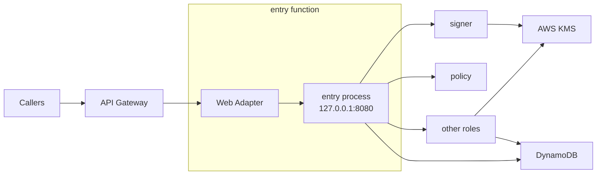
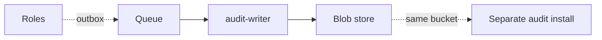

T5 runs sluis as one AWS Lambda function per process role. Keys are AWS KMS keys and state is DynamoDB. v1 already runs as many Lambda functions, and T5 keeps that lineage while moving to the v2 role split.

## Topology

The shape is drawn in two steps: the request path, then the audit path.

### Step 1: the request path

The callers are browsers, CLIs and relying parties. The web adapter is the Lambda Web Adapter; it connects to the `entry` process on `127.0.0.1:8080` inside the sandbox. Each arrow from `entry` to a role is a Lambda invoke. The other roles are `ca`, `notary`, `audit-writer` and `quota`.

### Step 2: the audit path

The other roles write their audit records to the queue. The separate audit install runs `audit-read` and its index, and reads the same bucket.

## What runs where

- Each role is its own Lambda function. Only `entry` takes requests from outside; every other function is invoke-only, and its resource policy names the caller's alias.
- **Zip only.** A function is a zip archive, so layers and extensions combine. A container image is not used on Lambda. Functions, layers and extensions are published as zips for `x86_64` and `arm64`; see [Packages](/distribution/packages/).
- **Drivers are Lambda extensions.** A driver is a platform-started service that speaks ConnectRPC over a Unix socket. On Lambda the platform that starts it is the extension mechanism, and the role calls it over the socket inside the sandbox.
- **Lambda Web Adapter.** `entry` speaks HTTP, so the Lambda Web Adapter, pinned at v1.1.0, translates Lambda events into HTTP requests. The adapter is vendored into sluis's own layer, so the function does not reference the public AWS layer.
- **Limits.** A function has at most five layers and 250 MB unzipped, counting the function code, layers and extensions together. The zips are built to fit that.

## Keys

- **KMS:** one symmetric key with encryption contexts for sealing, and one `ECC_NIST_P384` signing key per authority purpose. Each key policy names the one function role allowed to use it.
- A function's execution role is its identity to KMS. Only the `signer` function can use the token-signing key, and only `ca` the CA key.
- Tokens are signed directly with the non-extractable key. There is no software key on Lambda.

## State and audit

- **State:** DynamoDB, with conditional writes and one writer per record kind.
- **Audit outbox:** an SQS queue, because a function's local disk does not outlive its sandbox. The `audit-writer` consumes the queue, seals batches and writes them to the blob store; the `notary` signs batch heads with a single notary key, used only by the notary function's role. There is no co-signing; the function role is the isolation.
- **Index:** none. T5 ships no audit index. `audit-read` and its index run in a separate audit install on another shape that reads the same bucket: Kubernetes with Postgres (any connection string, for example CNPG), or a server with `sqlite`. A small install can run `sluis audit search` from the CLI, which builds a local `sqlite` index from the chain. The index is a rebuildable cache; the chain in the bucket is the record.

## Identity and edge

- The function's IAM role is its identity. The platform injects the credentials only into that function's execution environment. A function calls another by `lambda:Invoke`, and the callee reads the invoked alias, which tells it the caller class, and a verified token, which tells it the caller role.
- **Listener.** `entry`'s public API listens on TCP, bound to `127.0.0.1` inside the sandbox (`8080` in the example), and the Lambda Web Adapter connects to it. The sandbox holds only sluis's own processes, and the port is never reachable from outside it. The other functions have no TCP listener; their drivers use Unix sockets. See [Listeners](/architecture/listeners/).
- **Edge.** API Gateway sits in front of the `entry` function.

## Limits and residual risk

- Five layers and 250 MB unzipped bound what a function can carry. Rust or large SDKs push against it; link only the SDK packages a role uses.
- Lambda has cold starts. The adapter and extensions add start-up work, and a larger zip starts slower.
- Outside a VPC, egress is unrestricted. In a VPC, egress rules work by IP, not by name, so a per-function allow-list by hostname needs a proxy or firewall.
- Per-function role granularity needs one zip and one IAM role per role. It raises the number of artifacts and resources to keep in step; the generator derives them all from the manifest.
- The vendored adapter is part of the supply chain. It is pinned to a version, rebuilt into sluis's layer, and signed with the rest of the release.
- Search over the audit trail needs a separate audit install, or `sluis audit search` from the CLI, because T5 has no index of its own.
