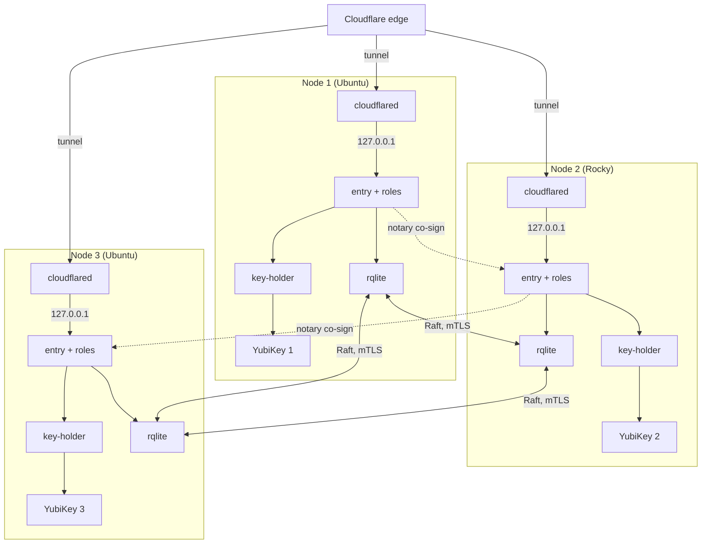

T2 is three single-board computers (arm64, 2 GB RAM, eMMC), each with its own YubiKey. State is replicated by rqlite (Raft). The nodes may mix Ubuntu and Rocky Linux, because the package set is the same on both.

## Topology

## What runs where

- Every node runs the same roles as [T1](/shapes/single-node/): each its own OS user and systemd unit, with the drivers as platform-started services.
- The state driver is rqlite on every node. It is the `state-owner` shared driver. It checks each caller by peer credentials and enforces one writer per record kind.
- The nodes need a quorum of two of three. A node that is down is replaced or repaired without losing state.
- Mixed distributions share one package set. The `.deb` and `.rpm` packages are built from the same binaries; see [Packages](/distribution/packages/).

## Keys

- One YubiKey per node, PIV, with the T1 slot plan (`9c`, `9d`, `82`, retired `83` to `95`, avoiding `9e`).
- A node's key is its own. No key is shared between nodes, so losing a board loses one key, not the install's.
- EC P-384 everywhere. Sealing uses ECDH plus HKDF with the node's `9d` key.

## State and audit

- **State:** rqlite across three nodes. Raft peer traffic uses the state driver's own TCP port over mTLS. It is the only TCP port between the nodes.
- **Index:** `sqlite` on each node. It lags the chain and is never trusted by verification.
- **Audit:** the audit outbox is a local spool on each node, and each node's `audit-writer` drains its own spool.
- **Notary:** the `notary` co-signs batch heads 2 of 3 across the nodes, with no separate notary YubiKey. A batch head carries the signatures of two nodes, so one compromised node cannot extend the chain alone.

## Identity and edge

- Role identity is the uid on the node, by peer credentials. Across nodes, the state drivers talk Raft over mTLS, with a certificate from the node identity. No role is called across nodes.
- Each node runs its own `cloudflared`. The ingress service is `http://127.0.0.1:8080`, `entry`'s loopback port (an example port), so no inbound TCP port is opened for sluis, and the only TCP port between the nodes is the Raft port.
- Each node is its own issuer for workload identity: `https://<issuer>/nodes/<node>/`. A cloud role trusts only the issuers of the nodes that run it.

## Board OS exception

The boards run the vendor's Ubuntu 22.04 for now, a declared exception. systemd 249 has `ExecPaths=` but no `LoadCredentialEncrypted=`, so units use plain `LoadCredential=`. Kernel 5.10 makes `sluis doctor` warn on the randomness checklist. Ubuntu 26.04 and Rocky Linux 10.2 board images are a backlog task, and mixing the two on boards starts once they exist. See [Platforms](/distribution/platforms/).

## Limits and residual risk

- Raft tolerates the loss of one node of three. Losing two stops writes, and sign-in stops with them, because state is needed for sessions and grants.
- The three boards usually share a site, a network and a power feed. T2 is not a multi-site design.
- A node's YubiKey and PIN guard its key. Physical access to a board with its key and PIN allows signing as that node, which the 2-of-3 notary rule limits for the audit chain but not for tokens.
- Mixed distributions widen what has to be tested, because the systemd, kernel and library versions differ between them.
