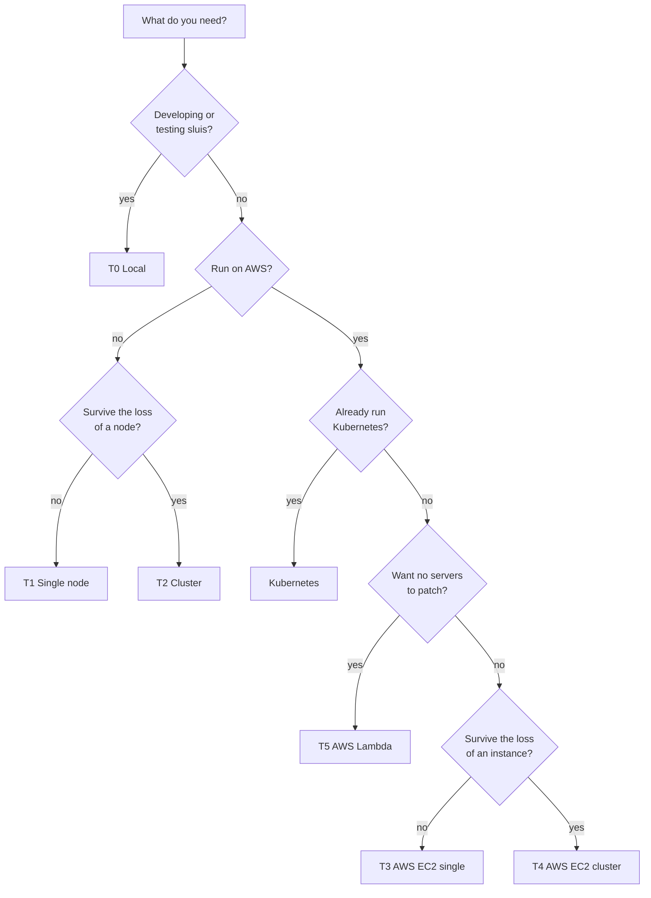

A shape is a supported way of running sluis. Each shape fixes the hardware, the key mode, the state store and the audit path, and sluis enforces its least-privilege rules in each one with the means that platform offers. The [permission manifest](/architecture/deployment/) of every process role is the same in all shapes; the shape decides how it is turned into units, policies and ACLs.

There are six shapes, T0 to T5, and Kubernetes, which is supported in the model.

## Comparison

| Shape | Hardware | Keys | State | Index | Audit outbox | Identity | Edge | Test-matrix role |
|---|---|---|---|---|---|---|---|---|
| [T0 Local](/shapes/local/) | Docker on a workstation, one node | Software, or the host's YubiKey through its `pcscd` socket | Embedded single-node store | `sqlite` | Local spool | Unix uid per role, peer credentials | None built in | Development and CI |
| [T1 Single node](/shapes/single-node/) | One arm64 single-board computer, 2 GB RAM, eMMC, a YubiKey | YubiKey PIV | Single-node store, no Raft | `sqlite` | Local spool | Unix uid per role; workload JWT from `sluis-node` | `cloudflared` to `entry`'s loopback port | Integration tests and tutorials |
| [T2 Cluster](/shapes/cluster/) | Three single-board computers, Ubuntu and Rocky may mix | A YubiKey per node | rqlite (Raft) across three nodes | `sqlite` | Local spool per node | As T1, one issuer per node | `cloudflared` on each node | Integration tests and tutorials |
| [T3 AWS EC2 single](/shapes/aws-ec2-single/) | One `t4g.nano`, Amazon Linux 2023 | AWS KMS | DynamoDB | `sqlite` | Local spool | Unix uid per role; per-role AWS credentials (proposed) | `cloudflared` to `entry`'s loopback port (proposed) | Integration tests and tutorials |
| [T4 AWS EC2 cluster](/shapes/aws-ec2-cluster/) | An ASG of three `t4g.nano`, Amazon Linux 2023 | AWS KMS | rqlite (Raft) | `sqlite` | Local spool per node | As T3, one issuer per node; per-role AWS credentials (proposed) | `cloudflared` on each node (proposed) | The first build target; integration tests and tutorials |
| [T5 AWS Lambda](/shapes/aws-lambda/) | One Lambda function per role | AWS KMS | DynamoDB | `postgres` (OD-12) | SQS queue | The function's IAM role | API Gateway, through the Lambda Web Adapter to `entry`'s loopback port | Integration tests and tutorials |
| [Kubernetes](/shapes/kubernetes/) | Pods, one per role | By platform: KMS on AWS | By platform | `postgres` | Later | A ServiceAccount per role | An in-pod edge or the pod IP (to be designed) | In the model; in the matrix later |

The edge connector, the Lambda index and the Kubernetes edge are marked on their own pages where they are proposed or open.

:::note[Proposed]
The per-role AWS credentials on T3 and T4 (the node agent, `sluis-node`, which brokers them and closes IMDS) and `cloudflared` as the edge connector on the EC2 shapes are proposals, not decisions.
:::

The audit path in all shapes is the one on [Audit](/concepts/audit/): every success is audited, records go to an outbox first and then into sealed batches, and the notary signs batch heads into a hash chain.

Integration tests and the [tutorials](/tutorials/) run on all five shapes T1 to T5. Development uses T0.

## Choosing a shape

Pick by the failure you have to survive and the key custody you accept:

- **Learning or developing:** T0. It runs in Docker with software keys. The code refuses a software key on every other shape.
- **A small, cheap, on-premises install:** T1, the "poor man's choice". One board and one YubiKey hold everything. Losing the board loses the node until it is rebuilt.
- **On-premises with a spare:** T2. Three boards run rqlite, and a signing key lives on each node's YubiKey. The audit notary co-signs batch heads 2 of 3 across nodes.
- **AWS, always on, minimal moving parts:** T3 for one instance, T4 for three. T4 is the first shape to be built, and the other shapes follow its design.
- **AWS, no hosts to operate:** T5. Each role is a function. Zip packaging and the Lambda size limits shape the build.
- **You already run a cluster:** Kubernetes. Each role is a pod under its own ServiceAccount.

A key mode follows from the shape, not from a switch: KMS on AWS shapes, a YubiKey on board shapes, a software key only in development.

:::note[Proposed]
The code carries the floor (it refuses a software key on a production shape) and configuration picks among the modes the floor allows. See [Keys](/concepts/keys/).
:::

## Board images

The two board shapes, T1 and T2, run the board vendor's Ubuntu 22.04 for now. That is a declared exception to the supported-distribution list; see [Platforms](/distribution/platforms/). Building Ubuntu 26.04 and Rocky Linux 10.2 board images is a backlog task, and the images will live in a separate public repository.

## Pages in this section

- [Local](/shapes/local/): T0, Docker, software keys or the host YubiKey.
- [Single node](/shapes/single-node/): T1, one board and a YubiKey.
- [Cluster](/shapes/cluster/): T2, three boards with rqlite.
- [AWS EC2 single](/shapes/aws-ec2-single/): T3, KMS and DynamoDB.
- [AWS EC2 cluster](/shapes/aws-ec2-cluster/): T4, KMS and Raft.
- [AWS Lambda](/shapes/aws-lambda/): T5, a function per role.
- [Kubernetes](/shapes/kubernetes/): pods per role.
