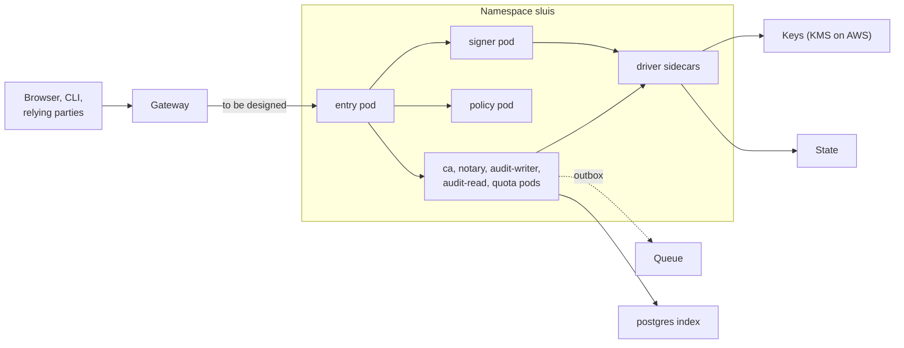

Kubernetes is a supported shape in the model: each process role is a pod, with its own ServiceAccount, and the chart renders the network policy from the permission manifest. Kubernetes joins the test matrix later. Until then the shape is specified here and validated by the generators, but integration tests do not cover it the way they cover T1 to T5.

## Topology

## What runs where

- One pod per process role, each with its own ServiceAccount. A driver runs as a sidecar of the role that uses it, or as its own pod when it is shared.
- A shared driver (`key-holder` or `state-owner`) authenticates each caller and checks an ACL generated from the manifest.
- Helm charts are OCI artifacts with images pinned by digest. They are built from the release output; see [Packages](/distribution/packages/).
- Roles run non-root with a read-only root filesystem, no capabilities and the runtime default seccomp profile.
- sluis does not write Kubernetes objects. It exports, and clusters pull. cert-manager and trust-manager stay as clients of sluis.

## Keys

- The key mode follows the platform. On AWS (EKS), the keys are AWS KMS keys, one per authority purpose, with the ServiceAccount's Pod Identity role named in each key policy.
- A software key is refused on a production shape.

:::note[Proposed]
Key custody for a Kubernetes cluster outside AWS is not yet decided. The shape documents the KMS case.
:::

## State and audit

- **Index:** `postgres`.
- **Audit outbox:** Kubernetes: later.
- Sealed batches are written to the blob store, and the `notary` signs batch heads. A dedicated notary can run as a Kubernetes Job.
- The state store is chosen by the platform; the state port, the one-writer-per-record-kind rule and the audit chain are the same as in every shape.

## Identity and edge

- A role's identity is its ServiceAccount, with a projected token bound to the callee's audience. The callee's interceptor verifies the token and maps `sub` to the role before it applies the call graph.
- On AWS, EKS Pod Identity gives each ServiceAccount its own IAM role. This is the platform-native identity, used where it exists.
- NetworkPolicy or CiliumNetworkPolicy allows only the call-graph edges. A Cilium policy can also express egress by FQDN, with default deny.
- **Listener.** `entry`'s public API is the only TCP listener, and no key-holding role and no driver has one. See [Listeners](/architecture/listeners/).

:::note[Proposed]
`entry` binds `127.0.0.1` on every shape, and a gateway cannot route to a loopback address in another pod. Two ways to reach it are being considered: an in-pod edge, such as a `cloudflared` sidecar that connects to the loopback port, or binding the pod IP behind a default-deny NetworkPolicy. This is still to be designed.
:::

## Limits and residual risk

- The shape is not in the test matrix yet, so a regression here can go unnoticed longer than on T1 to T5.
- Identity is as strong as the cluster. A cluster admin, a compromised node or a permissive admission policy can impersonate a ServiceAccount.
- A `postgres` index adds a stateful dependency.
