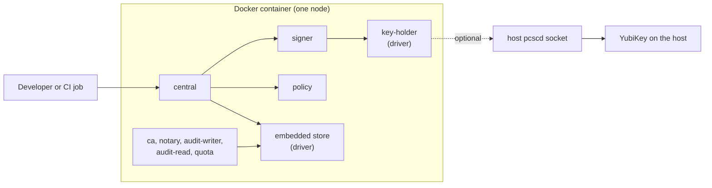

T0 is the development shape: sluis in Docker on one workstation, with one node and no cluster. It is the shape that CI uses, together with sluis v1 for GitHub OIDC to cloud permissions. It is not for production, and the code refuses a software key on every production shape.

## Topology

## What runs where

- All process roles run in one container on one node. Each role is still its own OS user and its own process, started by a supervisor inside the image, so the call graph and the socket ACLs are the ones the other shapes enforce.
- Drivers are services that speak ConnectRPC over Unix sockets under `/run/sluis/`. Nothing execs a driver.
- The `key-holder` and the state driver are shared drivers. They check each caller by peer credentials against the ACL generated from the permission manifest.
- Integration roles run only when a test needs them.

## Keys

- **Default:** software keys, EC P-384. No production secret is involved.
- **Optional:** the host's YubiKey, reached through the host's `pcscd` socket mounted into the container. The `key-holder` is the only role that talks to the socket.

:::caution[Open decision OD-8: YubiKey in Docker]
Options: (a) mount the host's `pcscd` socket into the container; (b) software keys only in the local shape. The current lean is (a).
:::

## State and audit

- **State:** an embedded single-node store behind the state port.
- **Index:** `sqlite`.
- **Audit outbox:** a local spool. Records go to the spool first, the `audit-writer` seals them into batches, and the `notary` signs the batch heads into a hash chain, as in every shape. The batches go to a local files blob driver.
- Verification never trusts the index or the state, so a test can rebuild the index and still verify the chain.

## Identity and edge

- Each role's process identity is its uid, read through peer credentials on the Unix socket.
- Roles listen only on Unix sockets under `/run/sluis/<role>/`. Only `central`'s public API ever gets a TCP listener.

:::note[Proposed]
How a browser on the workstation reaches `central` is not yet decided. Two candidates are an edge-connector container (`cloudflared` with a `unix:` ingress service, as on the board shapes) and a local reverse proxy that forwards to `/run/sluis/central/api.sock`.
:::

See [Listeners](/architecture/listeners/) for the rule and its exceptions.

## Limits and residual risk

- Software keys are extractable by anyone who can read the container's filesystem. T0 is for development data only.
- With the host `pcscd` socket mounted, any process in the container that can open the socket can ask the YubiKey to sign, subject to the PIN. The `key-holder` ACL is the control inside the container, and the socket is shared with the host.
- One node has one failure domain. T0 proves behaviour, not availability.
- T0 does not exercise the platform controls of the other shapes (IAM and KMS key policies, systemd sandboxing, Cilium policy). Those are tested on T1 to T5.
