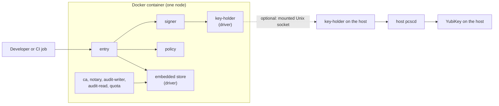

T0 is the development shape: sluis in Docker on one workstation, with one node and no cluster. It is the shape that CI uses, together with sluis v1 for GitHub OIDC to cloud permissions. It is not for production, and the code refuses a software key on every production shape.

## Topology

## What runs where

- All process roles run in one container on one node. Each role is still its own OS user and its own process, started by a supervisor inside the image, so the call graph and the socket ACLs are the ones the other shapes enforce.
- Drivers are services that speak ConnectRPC over Unix sockets under `/run/sluis/`. Nothing execs a driver.
- The `key-holder` and the state driver are shared drivers. They check each caller by peer credentials against the ACL generated from the permission manifest.
- Integration roles run only when a test needs them.

## Keys

- **Default:** software keys, EC P-384. No production secret is involved.
- **Optional:** the host's YubiKey. The `key-holder` runs natively on the host, talks to the host's `pcscd`, and the container mounts only the `key-holder`'s Unix socket. Other roles reach the YubiKey only through it.

In the local shape the `key-holder` runs natively on the host and talks to the host's `pcscd`. The container mounts only the `key-holder`'s Unix socket, and the host keeps using the YubiKey. The fallback is to mount the host's `pcscd` socket into the container; the risk is that the pcsc-lite protocol versions of the image and the host must match.

## State and audit

- **State:** an embedded single-node store behind the state port.
- **Index:** `sqlite`.
- **Audit outbox:** a local spool. Records go to the spool first, the `audit-writer` seals them into batches, and the `notary` signs the batch heads into a hash chain, as in every shape. The batches go to a local files blob driver.
- Verification never trusts the index or the state, so a test can rebuild the index and still verify the chain.

## Identity and edge

- Each role's process identity is its uid, read through peer credentials on the Unix socket.
- `entry`'s public API listens on TCP, bound to `127.0.0.1` inside the container. Every other role and every driver listens only on Unix sockets under `/run/sluis/<role>/`.
- A browser or a test harness on the workstation reaches `entry` through a port the container publishes. That published port is a development convenience; no production shape publishes it.

:::note[Proposed]
How a developer reaches `entry` with the real edge in the loop is not yet decided. One candidate is an edge-connector container (`cloudflared` with an `http://127.0.0.1:<port>` service, as on the board shapes) next to the sluis container.
:::

See [Listeners](/architecture/listeners/) for the rule.

## Limits and residual risk

- Software keys are extractable by anyone who can read the container's filesystem. T0 is for development data only.
- With the host's YubiKey, any process in the container that can open the mounted `key-holder` socket can ask for a signature, subject to the `key-holder` ACL. The host keeps using the YubiKey too, because `pcscd` lets several programs share the card. In the fallback where the host `pcscd` socket itself is mounted, the ACL does not apply and the pcsc-lite protocol versions of the image and the host must match.
- One node has one failure domain. T0 proves behaviour, not availability.
- T0 does not exercise the platform controls of the other shapes (IAM and KMS key policies, systemd sandboxing, Cilium policy). Those are tested on T1 to T5.
