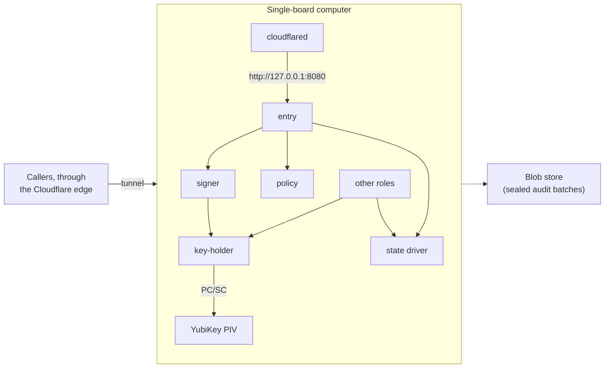

T1 is the "poor man's choice": every role runs on one arm64 single-board computer (2 GB RAM, eMMC) with a YubiKey in its USB port. It needs no cloud account for keys or state. The [single-node install tutorial](/tutorials/single-node-install/) walks through it.

## Topology

The callers are browsers, CLIs and relying parties. The tunnel ends at `cloudflared`, which connects to `entry` on `127.0.0.1:8080`. The `key-holder` reaches the YubiKey in the board's USB port over PC/SC. The other roles are `ca`, `notary`, `audit-writer`, `audit-read` and `quota`; they use `key-holder` and the state driver, which is the single-node store. The `audit-writer` seals audit batches to the blob store.

## What runs where

- Each process role is its own OS user and its own systemd unit. Drivers are systemd units too, started by the platform.
- The packages install under `/usr/libexec/sluis/{roles,drivers,integrations,node,vendor}/<short-name>`.
- The node agent (`sluis-node`) runs on the node and issues each role a short-lived workload JWT.
- `cloudflared` is the edge connector. It connects to `entry`'s loopback port (`127.0.0.1:8080` in the example below); it holds no key and has no access to any other role's socket.
- The permission manifest generates the units: `User=`, a private state directory, `LoadCredential=` for the secrets a role may read, and socket modes and groups for the callers the manifest allows.

## Keys

- The key mode is a YubiKey in PIV mode. It has no symmetric keys, so sealing uses ECDH plus HKDF (HPKE-style) with a P-384 key in a slot.
- Slot plan: `9c` node intermediate and signing, `9d` ECDH sealing and ring wrap, `82` SSH CA, `83` to `95` retired sealing keys. Slot `9e` is avoided.
- Only the `key-holder` talks to the YubiKey. It audits every use.
- Algorithm: EC P-384, no RSA. A cloud-federation key may use the algorithm its cloud requires, and an audience that cannot take EC may get RS256 from a separate RSA key; each is in its own slot.
- A YubiKey signs P-384 at about 120 ms, about 8 per second. A production install measured about 25,000 tokens in seven days and a peak of 0.8 per second, so direct signing fits.
- EUCLEAK is fixed from YubiKey firmware 5.7. Use 5.7 or newer.

Tokens are signed directly with the YubiKey; there are no derived signing keys. TPM 2.0 support is a backlog feature; when it ships it is an addition to the YubiKey, not a replacement.

## State and audit

- **State:** a single-node store behind the state port, no Raft.
- **Index:** `sqlite`. It lags the chain, and verification never trusts it.
- **Audit:** every success is audited. Records go to a local spool, the `audit-writer` seals batches and the `notary` signs the batch heads.
- **Blob store:** sealed batches go to the configured blob driver, a local files driver or an object store. Keep the blob store off the board if you need the audit trail to outlive it.
- Recovery needs no Kubernetes and no cloud: a hardware-token challenge or SRP. A recovery spools its audit record locally and delivers it later.

## Identity and edge

- A role's identity is its uid, read through SO_PEERCRED on the Unix socket. A shared driver checks an ACL generated from the manifest.
- `entry`'s public API listens on TCP, bound to `127.0.0.1` (the port is configuration; `8080` is an example). Every other role and every driver listens on a Unix socket under `/run/sluis/<role>/`.
- The `cloudflared` ingress service is `http://127.0.0.1:8080`, so the board opens no inbound TCP port for sluis. `cloudflared` makes outbound connections only.

The rule is described on [Listeners](/architecture/listeners/).

## Board OS exception

The board runs the vendor's Ubuntu 22.04 for now. This is a declared exception to the supported-distribution list.

- systemd 249 has `ExecPaths=` but no `LoadCredentialEncrypted=`. The generated units use plain `LoadCredential=`, and the credential files are protected by file mode and by the dedicated state directory.
- The kernel is 5.10. `sluis doctor` warns on the randomness checklist, because VM-clone reseeding needs a kernel from 5.18.
- Ubuntu 26.04 and Rocky Linux 10.2 board images are a backlog task. The systemd floor of 252 applies to them; see [Platforms](/distribution/platforms/).

## Limits and residual risk

- One board is one failure domain. Losing it stops sign-in until the board is rebuilt and its state restored.
- The YubiKey is physical. Whoever holds the board and the key, and knows the PIN, can sign. Set a PIN, a touch policy where the workflow allows it, and keep the board in a controlled place.
- On Ubuntu 22.04 the credential files are not encrypted at rest on the board. The key material never is, because it stays in the YubiKey.
- eMMC wears under heavy writes. The spool and the state are small, and a blob store off the board keeps the audit chain.
- Signing speed is limited to about 8 tokens per second. That is far above the measured load, but a burst beyond it queues.
